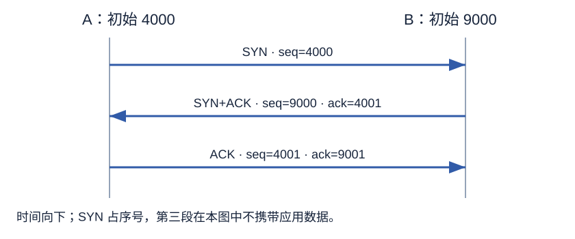

# 第 3 章 网络协议和体系结构

> 大纲定位：张海霞主编《计算机网络技术》（机械工业出版社，2016 年版），课程代码 02141 配套自学考试大纲。按该版知识范围复习，不代表现行考试公告或当前产品指南；讲解、算例与练习由项目独立编写。

## 复习导航

| 大纲条目索引 | 层次 | 讲解 | 自编练习 |
| --- | --- | --- | --- |
| 1 网络协议和体系结构 | 领会 | [第 1 节](#s1) | 1 |
| 2 OSI参考模型 | 领会 | [第 2 节](#s2) | 1、2 |
| 3 TCP/IP参考模型 | 领会 | [第 3 节](#s3) | 1 |
| 4 UDP和TCP | 简单应用 | [第 4 节](#s4)、[第 5 节](#s5)、[第 6 节](#s6)、[第 7 节](#s7) | 3、4、5、6、7 |

## 1 协议、服务与分层 {#s1}

网络协议约束通信参与者。语法规定格式与编码，语义说明字段、控制信息和动作的含义，时序规定动作发生的先后关系。格式正确但顺序不对，仍可能违背协议。

分层把任务拆给不同层：本层利用下层服务，并为上层提供服务；接口规定相邻层怎样调用，协议规定不同节点的对等实体怎样协作。上层不必了解下层所有实现细节，但必须遵守接口约定。层次和协议的集合构成体系结构，它描述逻辑职责与关系，不等同于某一份程序代码或设备清单。

## 2 OSI 七层与层间数据 {#s2}

OSI 从下到上分为七层。按数据经过的位置记职责，比只背层名更容易判断问题。

| 层 | 本版教材中的主要职责 |
| --- | --- |
| 物理层 | 比特流传输，约定机械、电气、功能和规程特性 |
| 数据链路层 | 成帧、链路寻址、差错控制及相应链路管理 |
| 网络层 | 分组寻址、路由与转发 |
| 传输层 | 进程间端到端通信、复用/解复用及相应控制 |
| 会话层 | 建立、组织和管理会话 |
| 表示层 | 处理数据表示差异，如编码转换、压缩和加密 |
| 应用层 | 为网络应用提供通信服务 |

PDU 是按本层协议组织的协议数据单元，SDU 是本层从上层接受的服务数据，PCI 是本层加入的协议控制信息。在简化封装模型中，本层给 SDU 加 PCI 形成 PDU；接收侧去掉相应控制信息再交给上层。应用数据经过链路层后称帧，并不是上层对象“改了名字”就不再包含原数据。

服务访问点 SAP 是相邻层访问服务的位置。请求、指示、响应、确认四类服务原语分别描述发起请求、告知对方用户、对方响应、把结果告知请求者，不能把四种原语简单数成线路上必有四个数据报。面向连接服务先建立再传输和释放，无连接服务则逐个提交数据，不先建立该逻辑连接。

## 3 TCP/IP 与 OSI 的对应 {#s3}

TCP/IP 围绕互联与实际协议逐步形成，本书按四层讨论：网络接口层、网络互联层、传输层、应用层。网络接口层承接具体链路技术；网络互联层以 IP 完成跨网络分组传送；传输层提供进程间通信；应用层组织 DNS、FTP、邮件和 WWW 等服务。

与 OSI 比较，TCP/IP 的网络接口层涵盖其物理层和数据链路层相关功能；TCP/IP 应用层还承担 OSI 会话层、表示层中的一些工作。两种模型有共同的分层思路，但不能只把七个名字压缩成四个名字便认为职责一一相等。讨论本课程模型时采用四层口径，不混入其他教材的五层口径。

## 4 UDP 首部、报文边界与能力 {#s4}

传输层通过端口帮助把数据交给相应应用进程。UDP 首部固定为 8 B，源端口、目的端口、长度和检验和各占 2 B。长度包含首部与数据，不能直接当成应用载荷长度。检验和用于差错检测，不是鉴别发送人身份的密码机制。

UDP 无连接，保留应用报文边界，不自行提供 TCP 式的重传、顺序交付、流量控制与拥塞控制。低首部开销不等于数据必达，也不等于任何业务使用 UDP 都更合适。自编读取：UDP 长度为 108 B 时，应用数据为 100 B；应用是否需要处理丢失或重复，要结合其自身协议。

## 5 TCP 字节序号与连接管理 {#s5}

TCP 提供面向连接的可靠传输，通过检验、序号、确认、重传与去重等机制组织数据。首部至少 20 B；源/目的端口标识进程，序号和确认号各 32 位，首部长度按 4 B 计。窗口字段通告接收能力，选项用于协商选项；URG、ACK、PSH、RST、SYN、FIN 等控制位各有职责，不能把控制位和确认号混为一个字段。

TCP 按数据字节编号，某段序号是其首字节序号；累积确认给出接下来期望的字节。自编数据：从 4001 开始收到连续 300 B，则期望 4301。若后面某段未到而更晚的段先到，不能仅按已见的最大序号把缺口也确认过去。

建立连接的基本三次握手：A 发 SYN、seq=x；B 回 SYN+ACK、seq=y、ack=x+1；A 回 ACK、seq=x+1、ack=y+1。SYN 占一个序号，建立后第一字节从初始序号加 1 开始。

连接的两个发送方向分别结束。本书基本拆除过程为 FIN、对 FIN 的 ACK、另一方向 FIN、最终 ACK；FIN 也占一个序号。收到对方 FIN 表示对方结束那个发送方向，不说明本方向立刻没有待发数据。本节按教材给出的基本过程推演，不以消息次数概括所有实际时序变化。

## 6 接收窗口与流量控制 {#s6}

流量控制防止发送端超过接收端的承受能力。接收端在确认等报文中通告可用窗口，发送端控制尚未确认的数据量，不能在每发一个新段时把窗口当成全新额度。窗口以字节计，和段数不是同一个量。

自编模型：对方通告窗口 2400 B，当前已有 900 B 数据发出但未确认，暂不考虑其他限制，则还可发 1500 B。若接收方应用处理变慢、窗口收缩，这反映接收能力，不能直接推出整个网络拥塞。实际能发多少还可能同时受拥塞窗口等限制。

## 7 拥塞控制的教材模型 {#s7}

拥塞控制关注网络承载能力，发送端通过丢失、超时和确认等反馈调节拥塞窗口。它与接收窗口约束不同，两者都可能限制发送量。以下按本书的简化窗口模型，单位为 MSS；假定持续有数据、没有接收窗口限制，并按每个 RTT 观察。

慢启动阶段窗口大体成倍增长，到阈值后进入拥塞避免，按 RTT 线性增长。超时与收到三个重复确认是不同的反馈：本书超时模型把阈值设为原窗口一半、窗口置 1，再慢启动；三个重复确认触发快速重传，配合本书简化快速恢复把窗口减半，再拥塞避免。不要把此规则当成所有 TCP 实现的完整状态机。

自编轨迹：初始窗口 1、阈值 8，理想 RTT 边界上为 1、2、4、8，随后为 9、10。若在窗口 10 时超时，阈值改为 5，窗口回 1；若题设改为三个重复确认，本节模型为窗口降到 5 后线性增长。答题时先写触发事件，再写采用的变体和观察时刻。

## 本章小结

- 协议约束对等实体，接口连接本机相邻层；PDU、SDU 和 PCI 必须带上所处层次理解。本课程 TCP/IP 采用四层口径。
- UDP 长度包含 8 B 首部；TCP 按字节编号，累积确认指向下一期望字节，SYN/FIN 的占号须按过程单独计算。
- 接收窗口保护接收能力，拥塞窗口约束网络负担。计算可再发送量要扣除在途数据；超时与重复确认后的窗口轨迹按本章简化变体解释。

## 自编练习

**1. 某层规定“第一个字节是消息类型”“该类型要求返回确认”“先建连再发送”。分别对应协议哪个要素？这些规则与本机向下层调用的接口有什么区别？**

考点：第 1、2、3 节；层次：领会。

**答案：** 三项依次对应语法、语义和时序。协议约束不同节点的对等实体，接口描述本机相邻层如何使用服务。OSI 与 TCP/IP 都使用分层，但层次划分不同；不能用某一个接口函数等同整个网络体系结构。

**2. 在简化封装中，第 N 层收到上层 PDU，再加入本层控制信息。指出本层 SDU、PCI 与 PDU，并解释 SAP 的位置。**

考点：第 2 节；层次：领会。

**答案：** 上层交下来的数据成为本层 SDU，本层加入的协议控制信息为 PCI，组合后得到本层 PDU。SAP 位于相邻层服务接口处，是上层访问本层服务的位置，不是对等实体间的一条直接物理线路。

**3. UDP 长度字段为 108 B，应用把它当作 108 B 载荷，并认为检验和能证明消息来自可信用户。分别改正。**

考点：第 4 节；层次：简单应用。

**答案：** 载荷为 108−8=100 B，长度包含 UDP 首部。检验和用于检测传输差错，不是身份认证；UDP 本身也不因有检验和而获得可靠重传和按序交付能力。

**4. A、B 的初始序号分别为 4000、9000。写出基本三次握手的 seq/ack，随后 A 从首字节开始连续发 300 B，B 应确认到哪里？**

考点：第 5 节；层次：简单应用。

**答案：** 第一段 SYN 的 seq=4000；第二段 SYN+ACK 的 seq=9000、ack=4001；第三段 ACK 的 seq=4001、ack=9001。连续数据为字节 4001～4300，下一期望字节为 4301。不要把 SYN 的序号当成第一个应用字节。

**5. 一端已发 FIN，另一端只回 ACK 而尚未发 FIN，能否断言连接两方向都已经停止发送？**

考点：第 5 节；层次：简单应用。

**答案：** 不能。FIN 结束其发送方的数据方向，ACK 确认这一结束。另一方向仍可能有数据要传，待其发送完再用自身 FIN 结束；分析拆除时必须把两个方向分开。

**6. 接收窗口 2400 B，已有 900 B 未确认。只考虑流量控制时还能发多少？若答案因拥塞窗口更小而下降，这两个窗口各在保护什么？**

考点：第 6、7 节；层次：简单应用。

**答案：** 流量控制允许额外 2400−900=1500 B，不是重新获得 2400 B 额度。接收窗口围绕接收缓存，拥塞窗口围绕网络承载能力；最终发送还受这些约束共同限制。不能因接收端还有缓存便忽略拥塞控制。

**7. 按本节理想 RTT 模型，初始窗口 1、阈值 8。列到首次达到 10 的窗口序列，再分别给出此时超时或三个重复确认后的处理。**

考点：第 7 节；层次：简单应用。

**答案：** 序列为 1、2、4、8、9、10。超时后阈值 5、窗口 1，再慢启动；三个重复确认则按本节简化快速恢复模型降到 5，再拥塞避免。题设限定教材模型，这个轨迹不是对任意 TCP 变体的预测。
