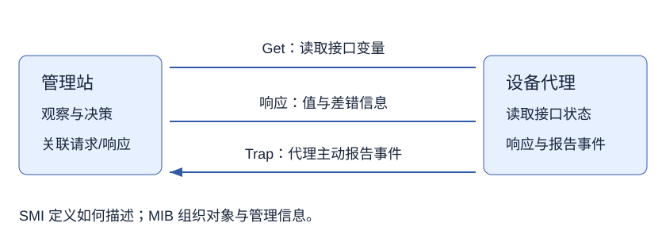

# 第 7 章 网络管理技术

> 大纲定位：张海霞主编《计算机网络技术》（机械工业出版社，2016 年版），课程代码 02141 配套自学考试大纲。按该版知识范围复习，不代表现行考试公告或当前产品指南；讲解、算例与练习由项目独立编写。

## 复习导航

| 大纲条目索引 | 层次 | 讲解 | 自编练习 |
| --- | --- | --- | --- |
| 1 网络管理的基本概念 | 识记 | [第 1 节](#s1) | 1、7 |
| 2 网络管理的体系结构与模式 | 领会 | [第 2 节](#s2)、[第 3 节](#s3) | 2、3 |
| 3 网络管理的功能 | 领会 | [第 4 节](#s4) | 1、4 |
| 4 简单网络管理协议（SNMP） | 领会 | [第 5 节](#s5) | 2、5、6 |
| 5 网络管理系统 | 识记 | [第 6 节](#s6) | 6、7 |

## 1 管理任务、对象与标准 {#s1}

网络管理不仅在故障发生后“修网络”，还包括配置优化、监测状态、预防风险和规划扩展。有效性、可靠性、安全性、开放兼容与经济性可能同时成为目标，管理动作需要围绕这些目标评估效果。

被管对象是对资源某方面的抽象，可涵盖链路、接口、主机、路由器等硬件，也涵盖操作系统、应用和通信软件。一个物理设备可对应多个被管对象，管理软件本身也可能是对象。教材比较 OSI、TCP/IP、TMN 和基于 Web 等管理标准或模型；共同规范使不同厂商的管理站与代理可以理解彼此，不能把一个厂商控制台等同全部管理标准。

## 2 管理站、代理、协议与信息 {#s2}

管理站组织采集与控制，管理代理接近被管资源，读取状态并处理允许的设置操作。管理协议规定双方交换信息的方法，MIB 表示对象与有关值的集合，SMI 规定这些对象的命名、类型和表示规则。区分这五项时，可以分别问“谁决策、谁执行、怎样通信、管理什么、怎样描述”。

MIB 是逻辑上的管理信息集合，不应一律想成管理站硬盘上的一个集中数据库文件。界面读出一项变量也不说明可以写它，代理能力和权限约束仍需核对；监测与控制是不同的操作目的。

## 3 集中、分布与混合管理 {#s3}

集中式由中心管理站组织全网管理，便于统一观察和决策，但中心负担、通信集中和故障影响需要考虑。分布式把部分管理职责靠近资源或问题来源，减少事事依赖中心，却需要协调信息与动作。混合方式把两者结合，不是简单把两套软件同时启动。

自编场景：三个园区各自采集接口状态，本地处理简单故障，总部汇总趋势并统一调整策略。分析时分别画采集、局部处理与统一决策的位置，可以辨认为分布与集中结合。只看管理窗口有几个，无法判断整个体系结构。

## 4 五类管理功能与排障证据 {#s4}

故障管理发现、告警、定位和处理异常；配置管理维护设备参数与资源关系；安全管理控制非法使用和保护信息；性能管理持续测量并分析瓶颈；计费管理记录资源使用并按策略核算。相同事件可以触发多类工作，不必强行只归一类。

自编记录：某接口差错计数上升，是监测证据；确认链路故障并定位属于故障管理；调整参数属于配置管理；比较吞吐量变化属于性能管理；检查未授权修改属于安全管理；根据使用量核算费用属于计费管理。先保留时间、对象、观测值和动作，再作判断，不能把一个计数上涨直接写成唯一故障原因。

## 5 SNMP、对象标识与报文 {#s5}

SNMP 体系结合协议、SMI 和 MIB。Get 由管理站发起读取，Set 由管理站发起设置，Trap 由代理报告事件。轮询是管理站周期读取；事件通报是代理发起。两种方式可以配合，不能把 Trap 本身解释成管理站发起的一次轮询。

SMI 按对象树命名，以 OID 标识对象，并规定数据类型与编码。MIB 把这些可管理对象组织起来；例如书中 mib-2 的 OID 为 `1.3.6.1.2.1`，其下继续按功能分支。背出一串数字不等于已知道某对象的类型、含义或读写权限。

读报文重点看 PDU 类型、请求标识、差错状态/索引和变量绑定。请求标识帮助把响应对应到请求，变量绑定携带对象名及有关值；SetRequest 请求修改，GetRequest 请求读取，GetBulkRequest 用于批量读取，Trap 类报文报告事件。教材并列介绍了不同版本的机制，不能把版本字段、安全参数和所有 PDU 都拼成一个通用于各版的固定格式。

本书 SNMP 使用 UDP 承载；没有收到响应要区分网络、代理、权限和请求本身的问题，不能以“UDP 高效”推导管理命令必达。共同体名属于教材中的一种简易认证安排，不把它当成任何网络中的充分安全方案。

## 6 网络管理系统与工具选择 {#s6}

NMS 把发现、采集、显示、告警和管理应用组织成可操作系统，作用不止画设备图。MIB 浏览器便于查看对象树及变量，命令行便于明确执行读取或设置，Sniff 类工具观察管理报文；三个角度相互补充，不是互相替代。

本版教材列举 OpenView、Tivoli NetView、CiscoWorks 和 Cacti，并讨论开放、综合、智能、安全以及 B/S 管理的发展方向。这里用于识别产品定位与系统能力，不把书中介绍当成当前购买建议。自编选择条件应先明确对象范围、所需协议、采集和告警、图表或配置能力，再判断工具是否适合，而不是只看产品名称是否熟悉。

## 自编练习

**1. 管理员每天只看设备是否在线，自称已完成全部网络管理。列出至少三项还需要围绕目标检查的工作，以及它们可能涉及的软件对象。**

考点：第 1、4 节；层次：识记、领会。

**答案：** 还需性能测量与瓶颈分析、配置维护、权限和安全检查、故障定位或使用量核算等。对象不仅有硬件，也可有操作系统、应用与通信软件；“在线”只是某一观察，不能替代各类管理目标。

**2. 一次接口读取中，谁发请求、谁返回变量值？MIB 与 SMI 是否分别等同“数据库软件”和“采集软件”？**

考点：第 2、5 节；层次：领会。

**答案：** 管理站发起读取，代理返回相应对象值。MIB 是管理对象信息的逻辑集合，SMI 规定命名、类型与表示；二者不能直接等同具体数据库和采集程序。协议负责把操作在双方间表达和传输。

**3. 三个园区本地处置简单故障，总部汇总趋势并制定统一策略。解释这种管理模式的分工及需要协调的事情。**

考点：第 3 节；层次：领会。

**答案：** 该场景将局部处理分布到园区，把全局分析与策略集中在总部，可按混合模式理解。需要协调对象标识、观测时间、告警汇总与配置动作，否则局部独立决策可能与统一策略冲突。

**4. 一组记录依次为“发现丢包”“定位接口故障”“修改配置”“比较吞吐变化”“核算用量费用”。分别映射功能，并补一个安全管理动作。**

考点：第 4 节；层次：领会。

**答案：** 前两步主要属于故障发现与定位，修改属于配置管理，比较吞吐属于性能管理，核算属于计费管理；检查该修改是否获授权可属于安全管理。同一事件可跨功能处理，不需要强制唯一分类。

**5. 管理站周期 Get，与代理主动 Trap，方向有何不同？请求标识与变量绑定各帮助解释报文的哪一部分？**

考点：第 5 节；层次：领会。

**答案：** 周期 Get 由管理站发起读取，Trap 由代理发起事件通报。请求标识关联响应和相应请求，变量绑定说明被操作的对象名及相关值；不能把返回了某个请求标识理解成被管对象名称。

**6. 发现两个回复乱序到达，为什么不能按到达先后当成同一请求的结果？若还要观察异常 PDU，可选哪类工具？**

考点：第 5、6 节；层次：领会、识记。

**答案：** 应核对请求标识、对象和差错信息，不能把网络到达顺序当成请求配对依据。MIB 浏览器适合查看对象，Sniff 类工具适合观察报文，命令行可明确重现某个读取；选择随所需证据而变。

**7. 拟选 NMS 时只因教材出现某产品名就直接采用，缺少了哪些判断？**

考点：第 1、6 节；层次：识记。

**答案：** 需要先列被管对象、协议及权限、采集频率、告警、配置与展示需求，并比较适用范围和管理成本。教材产品举例属于所列版本的学习材料，不能自动成为当前产品能力和采购结论。
