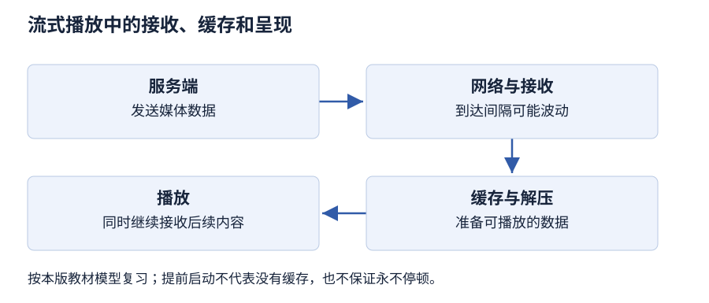

# 第 1 章 多媒体技术基础知识

> 大纲定位：刘成明、石磊主编《多媒体技术及应用》（第三版，清华大学出版社，2021 年），对应江苏省课程代码 13511《多媒体技术与应用》江南大学编 2024 年大纲。以下讲解与练习独立编写，按该版范围学习。

!!! warning "学习草稿 · OCR 尚未终校"

    教材整理稿尚未逐字终校。流媒体分类和历史产品仅按教材语境说明，不代表当前服务的全部实现；旧版软件与设备未实测。原稿的个别编码名称、超媒体表述和统计数据存在待核处，不作为本页练习的判定依据。

## 复习导航

| 大纲短考点 | 层次 | 讲解 | 自编练习 |
| --- | --- | --- | --- |
| 媒体、多媒体与媒体分类 | 识记 | [第 1 节](#s1) | 1 |
| 常见表示媒体 | 识记 | [第 2 节](#s2) | 1 |
| 多媒体技术特征 | 识记 | [第 3 节](#s3) | 2 |
| 系统组成与分类 | 识记 | [第 4 节](#s4) | 2 |
| 流媒体优点与传输方法 | 领会 | [第 5 节](#s5) | 3 |
| 发展阶段、关键事件与判断 | 识记、领会、简单应用 | [第 6 节](#s6) | 4 |
| 发展趋势 | 识记 | [第 7 节](#s7) | 5 |
| 应用领域与虚拟现实 | 识记、简单应用 | [第 8 节](#s8) | 6 |

## 1 从信息内容到承载实体 {#s1}

“媒体”既可以指信息的表现载体，也可以指存放信息的物理实体。说明一个多媒体方案时，应先说正在讨论哪种角色。例如，讲解录音是声音信息，存放录音的硬盘则是实体，两者不能因保存关系而合并为同一概念。多媒体把文本、图像、声音等不同形式组织起来，借助计算机进行信息交流；其技术范围还包括采集、编码、加工、存储和传输。

教材把媒体分为感觉媒体、表示媒体、显示媒体、存储媒体、传输媒体。感觉媒体面向人的直接感受，如听到声音；表示媒体面向信息的表达形式和编码；显示媒体在此分类中涵盖输入与输出设备，不能只按“显示”二字理解为显示器；存储媒体负责保存；传输媒体负责在地点之间承载信息。

自编情境：口述介绍被话筒采集后保存为数字录音，再经电缆传给另一台机器播放。听觉对应感觉，数字表达对应表示，话筒和扬声器对应显示，保存录音的介质对应存储，电缆对应传输。分类依据是作用，同一流程中可以同时出现多类媒体。

## 2 静态内容与随时间展开的内容 {#s2}

常见表示媒体有文字符号、图形、图像、音频、视频和动画。文字符号适合描述名称、条件和说明；图形以几何元素及其属性表达形状；图像通过像素的颜色与亮度表现画面。地图中的可编辑路线可以按图形来理解，拍摄到的地图照片则按图像来理解，判断依据是表达方式。

音频包括语音、音乐和音效。视频呈现连续变化的影像；动画通过连续画面表现设计出来的运动或变化。制作方式与用途可能交叉，不能仅凭“画面会动”就排除其中一种。图形图像的处理见[第 4 章](chapter-04.md)，声音与视频分别见[第 5 章](chapter-05.md)和[第 6 章](chapter-06.md)。

文字、图形、图像属于静态媒体，其信息理解不依赖固定播放速度；声音、视频、动画属于时变媒体，播放顺序和速度会影响信息再现。将一段解说任意减速，会改变声音的时间组织；读一张静态路线图时，读者则可停留在某处反复观察。

## 3 用系统行为辨认技术特征 {#s3}

多样性说明系统能够使用不同媒体形式；集成性说明这些信息及相关软硬件被组织成整体。一个文件夹里碰巧放有录音和照片，只能证明素材存在；若它们按同一主题、界面和播放关系工作，才体现信息的有机集成。设备的连接和软件平台配合也属于集成问题。

交互性使用户的操作影响系统提供的内容或运行方式。教材从查询已有信息、修改数据影响展示、虚拟环境中的操作等角度描述交互程度。复习时可检查用户能做什么、系统如何响应，而不只检查界面上有没有按钮。

协同性关心各种媒体及其时间、空间关系能否配合，例如解说是否与画面同步。实时性关心交互、播放能否在感官允许的时间内连续完成；一段内容最终能播完，不等于满足实时要求。非线性使读者借助链接按关联选择阅读路线，而不必始终依照固定的页序。六项特征观察的对象不同，回答时要把名称与具体行为对应。

## 4 系统组成与分类依据 {#s4}

多媒体系统需要硬件、操作系统、媒体处理工具和面向用户的应用软件协同工作。硬件承担计算、输入输出和信号转换；操作系统负责调度、驱动与同步等支持；处理工具制作和编辑素材；应用软件将结果提供给具体使用者。某一部件功能齐全，也不能替代整个系统的配合。硬件与软件的分类见[第 2 章](chapter-02.md)。

按功能可分开发系统与演示播放系统。开发系统侧重采集、编辑、创作和研究，需要相应的处理工具与设备；演示播放系统侧重把已完成的作品展示、播放和传递给用户。两者可能使用相似主机，但任务、配置侧重点和所需工具不同。

按应用范围又可分信息管理咨询、教育培训、家庭和通信等系统。这个维度回答“为谁完成什么服务”，功能维度回答“主要用来开发还是播放”。一套面向访客的信息查询系统，既可按用途归为咨询系统，也可按实际职责分析其演示播放功能，两个标签并不冲突。

## 5 边接收边播放的条件 {#s5}

流媒体允许接收一部分数据后开始解压和播放，其余部分继续传来。与等待整个文件下载完成相比，启动等待可缩短，客户端也不必先缓存全部内容。但网络数据并非始终均匀到达，仍需缓存缓冲延迟与抖动；“边下边播”不等于无需等待或永不停顿。教材还从专门服务器和协议的支持解释实时传输能力。

在教材的两种方法中，实时流式传输强调适时传送，适合现场广播，需要相应服务器、协议以及与媒体需求相适应的网络条件。支持随机访问是所述系统的能力，不能理解为尚未发生的现场画面也可提前观看。网络不匹配时，实时送达和画面完整性之间会产生约束。

顺序流式传输按顺序下载，并播放已经接收的部分，教材将其联系到普通 HTTP 服务器。未下载区域不能直接观看，因此启动会等待，也不适合依赖任意跳转或现场广播的任务。两种方法的选择应看现场性、访问方式和质量要求，而不只看文件长度。这里保留教材模型，不用协议名称概括所有现行网络播放器。

### 接收、缓冲与播放的关系

用一次观看任务检查三个条件：内容是否必须紧跟现场、是否需要跳转、服务与网络能提供什么支持。先回答这些问题，再使用本版的实时或顺序流式传输分类。例如尚未下载到的资料片片段不能仅凭拖动进度条就保证立即播放，现场直播也不能跳到尚未发生的内容。

复述优点时，应把“相对完整下载后再播放”这一比较条件带上。启动较早、无需先存下全部内容，并不意味着取消缓存；持续播放仍需数据及时到达。本段据成书 1.1.4 组织，不作为现行播放器协议的分类清单。

## 6 按技术任务理解发展阶段 {#s6}

教材以启蒙发展、标准化、蓬勃发展三个阶段组织历史。启蒙阶段的线索是概念提出和早期实现：超文本把相关文本按联系组织，图形界面改变交互方式，多媒体主机和光盘系统使多种信息的处理与读取有了实现条件。按教材的历史叙述，1965 年的超文本概念、1984 年的 Macintosh 图形交互与 1985 年的 Amiga 系统可作为记忆节点。教材还以 1986 年的 CD-I 联系多种信息的光盘存储与交互读取，以 1987 年的 DVI 联系数字视频信息的检索和重放。不同事件分别补充了组织、交互、处理和保存能力。

标准化阶段关注跨行业产品如何具有可共同遵循的规格。教材以 1990 年成立 MPC 联盟及最低硬件要求为例，还列举图像、音频、光盘数据格式等标准。JPEG、MPEG、H.26X 和 AVS 等名称可联系媒体压缩与编码的规范，光盘格式则联系存储交换。最低要求是参照门槛，并不代表所有机器的实际配置，也不能拿来当作当前采购指标。

蓬勃发展阶段强调标准与实现进入产品、处理能力提高、网络与终端扩展。教材把 1997 年带 MMX 技术的奔腾处理器作为标志之一。判断一个材料属于哪个阶段，应说明它在概念探索、规范形成还是产业应用中的作用；阶段的年代会有衔接，不能只看年份就机械划界。这些年份仅用于该版历史复习。

## 7 四种趋势各在改变什么 {#s7}

集成化着重多种媒体、设备与时空关系的结合，使信息通过多种感知与动作通道表达。智能化着重识别与理解，例如识别文字、语音或图像内容，使处理不止于展示文件。集成化强调组织配合，智能化强调处理能力，两者可以同时体现在一个系统中。

嵌入化把多媒体与通信处理能力放入专用设备或日常用品，使其围绕特定用途工作；网络化通过通信连接使媒体资源在不同终端之间传递和使用。一个终端可同时具有专用处理、语音识别与联网通信功能，因此趋势名称不是互斥的产品类别。复习时可分别问：哪些能力合在一起，系统识别什么，功能嵌入哪里，信息如何跨设备流动。

## 8 按主要服务目标判断应用领域 {#s8}

教材归纳商业、学校、家庭、公共场所、虚拟现实五大应用领域。商业应用可以围绕商品说明、营销、培训与协作展开；学校应用以课程学习、体验和学生创作为目标；家庭应用面向生活、学习、娱乐与内容共享；公共场所应用向现场访客提供查询、导览和服务信息。相同的视频素材进入不同任务，应用分类可能不同。

虚拟现实利用图像、声音、动画及专门的人机接口，形成可交互的模拟环境。用户的观察位置或操作发生变化时，系统需要重新组织相应场景反馈。仅把一段普通视频放到较大的屏幕上，不能据此说明已经具有这种环境交互。

领域之间允许交叉。例如学校采用可交互模拟环境训练学生，既有教育目标，又使用虚拟现实。作答应先交代主要服务对象，再说明使用机制，避免只因系统出现在学校建筑中，就忽略它实际承担的商业或公共服务任务。

### 同一作品的不同判断维度

以自编社区服务终端为例，可先分别判断媒体角色、系统行为、使用目的，再组合答案。

| 看到的对象或行为 | 判断维度 | 判断依据 |
| --- | --- | --- |
| 介绍文字与照片 | 表示内容 | 表达的信息形式 |
| 存放资源的存储卡 | 承载角色 | 保存信息的实体 |
| 触屏选择主题 | 交互行为 | 用户操作改变响应 |
| 解说配合画面 | 时间组织 | 多种媒体同步配合 |
| 面向办事群众查询 | 应用目的 | 主要使用者与任务 |

这里同一项作品可以同时满足不同维度的描述。答题时先圈定对象，再给类别和理由，比把所有名词排成一张互斥名单更准确。分类与特征据本章 1.1，应用任务据 1.3 设计。

## 本章小结

- 媒体分类先确定对象和角色：信息表达与保存实体不同，静态媒体与时变媒体也不是按扩展名简单划分。
- 多样性、集成性、交互性、协同性、实时性和非线性要各对应实际行为；素材共存不等于已组成可交互系统。
- 流式播放可提前启动，仍依赖接收、缓冲和网络条件；发展阶段、最低配置和趋势名称按第三版历史语境复习。

## 自编练习

**1. 为地方口述史做一份电子展册：文字记录地名，可编辑线条标注路线，照片记录旧屋，录音保存讲述。材料存入硬盘并通过光缆传送。分别指出媒体元素、静态与时变类别，以及硬盘、光缆在媒体分类中的角色。**

考点：第 1、2 节；层次：识记。

**答案：** 地名文字、路线图形、旧屋图像属于静态媒体，讲述录音属于时变音频。硬盘承担存储媒体的角色，光缆承担传输媒体的角色；录音的数字表达和保存录音的实体不是同一个分类对象。

**2. 展览终端让访客选择主题，播放配有解说的画面；后台编辑端负责重新剪辑。说明交互性、协同性分别体现在哪里，并按功能区分两个端。**

考点：第 3、4 节；层次：识记。

**答案：** 主题选择改变系统展示内容，体现交互性；画面与解说在时间上配合，体现协同性。后台承担素材编辑与作品创作，属于开发系统的职责；访客端以查询和演示播放为主，不因拥有选择按钮就等同开发系统。

**3. 研讨会要求观众听到正在发生的发言，资料库预告片则只需依次观看已接收部分。按教材模型分别选择传输方式，并解释为何两者仍可能等待。**

考点：第 5 节；层次：领会。

**答案：** 现场发言适合实时流式传输，预告片可用顺序流式传输。前者需要相应服务与网络支持，后者不能跳到尚未下载处；两者都可能为接收数据和缓冲到达波动而等待，流式播放并未消除网络条件的约束。

**4. 一份历史展板有三张卡片：探索关联文本的阅读方式、提出多媒体计算机最低配置规范、把成熟的媒体处理技术做进商品。请按教材发展阶段归类，并各给出归类理由。**

考点：第 6 节；层次：识记、领会、简单应用。

**答案：** 关联文本探索属于启蒙发展线索，重点是概念与方法；最低配置规范属于标准化，重点是共同要求；成熟技术进入商品属于蓬勃发展，重点是实现与普及。理由应依据卡片的技术任务，不必凭缺失的年份猜测。

**5. 一台家庭设备把图文和声音同步呈现，能够识别口述查询，专用于客厅并能与其他终端分享内容。将四项描述分别联系教材中的发展趋势。**

考点：第 7 节；层次：识记。

**答案：** 图文声音配合联系集成化，识别口述查询联系智能化，专用设备中的媒体功能联系嵌入化，跨终端分享联系网络化。这些描述可同时成立，不能因设备专用就排除它具有智能与联网能力。

**6. 社区中心设置办事查询屏，职业学校设置可随学员转头改变视野的模拟操作环境。分别判断主要应用领域，并说明第二个案例为什么还涉及虚拟现实。**

考点：第 8 节；层次：识记、简单应用。

**答案：** 办事屏主要面向公共场所的信息服务；学校环境以教育培训为目标。后者根据学员动作改变模拟场景反馈，具有虚拟现实的环境交互特征，可同时具有学校应用和虚拟现实两个标签。
