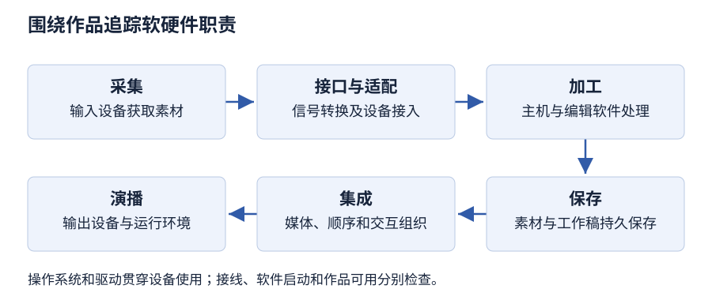

# 第 2 章 多媒体计算机系统

> 大纲定位：刘成明、石磊主编《多媒体技术及应用》（第三版，清华大学出版社，2021 年），对应江苏省课程代码 13511《多媒体技术与应用》江南大学编 2024 年大纲。学习重点是系统架构、硬件职责及软件分类，讲解和练习独立编写。

!!! warning "学习草稿 · OCR 尚未终校"

    教材整理稿尚未逐字终校，旧版软件及设备未实测。架构按可核实正文说明，不复刻原图；光盘容量、显卡性能比较、显示器健康性与市场预测等原稿表述留待核对，不作为练习的定量依据，也不构成当前采购建议。

## 复习导航

| 大纲短考点 | 层次 | 讲解 | 自编练习 |
| --- | --- | --- | --- |
| 系统含义与基本架构 | 识记、领会 | [第 1 节](#s1) | 1 |
| 多媒体主机 | 识记、领会、简单应用 | [第 2 节](#s2) | 1、7 |
| 多媒体接口设备 | 识记、领会、简单应用 | [第 3 节](#s3) | 2、7 |
| 多媒体存储设备 | 识记、领会、简单应用 | [第 4 节](#s4) | 3 |
| 多媒体输入设备 | 识记、领会、简单应用 | [第 5 节](#s5) | 2、4 |
| 多媒体输出设备 | 识记、领会、简单应用 | [第 6 节](#s6) | 4 |
| 操作系统与驱动程序 | 识记、领会 | [第 7 节](#s7) | 5 |
| 素材软件、集成工具与应用软件 | 识记、领会 | [第 8 节](#s8) | 6 |

## 1 沿信息处理过程理解系统架构 {#s1}

多媒体计算机系统在普通计算机的基础上，配合多媒体硬件、软件和接口，使各部分能够共同处理多种媒体信息。其任务贯穿采集、加工、存储、集成和演播。判断系统时，不能只数机箱内有多少块卡，还要检查这些部件是否能够围绕任务协同工作。

可以按一次自编录制任务理解架构：话筒和摄像机提供素材，接口与适配部件使信息进入主机，主机在软件控制下编辑，存储设备保存素材和结果，输出设备呈现作品。操作系统、驱动、编辑工具和应用程序分别提供不同支持。这个处理链用于说明正文中的职责关系，不是对教材架构图的重画。

采集端可正常工作，而演播端仍可能缺少适当设备；硬件已连通，而软件也可能尚未形成可用环境。因此“能录入”“能处理”“能保存”“能播放”应分别检查，最后再检查声音、画面与操作能否共同完成任务。系统集成的基本特征见[第 1 章](chapter-01.md)。

检查一条采集链时，从外部对象追到计算机中的素材；检查一条演播链时，从已保存作品追到观众接收的声音和画面。中间还应记录存储位置、编辑工具及设备的软件支持。该图是按成书 2.1～2.3 的职责重新组织的任务图，不是硬件连接规格图。

## 2 主机类别与任务侧重点 {#s2}

教材将多媒体主机分为多媒体个人计算机、专用多媒体计算机系统和多媒体工作站。多媒体个人计算机可在通用个人计算机上增加相应接口设备和软件，也可直接提供媒体处理能力。它保留通用计算的用途，并通过多媒体环境完成声音、图像、视频等工作。

专用系统围绕特定领域设计，多媒体处理能力可以集成到专用芯片、主板或处理器中；工作站强调较强的计算、存储和图形图像处理能力，以满足较高层次的任务。分类应结合设计用途与处理要求，不能仅凭外壳大小或产品名称下结论。

自编对照：用于日常编辑的通用主机、只围绕固定展示业务设计的专用系统、承担复杂图形处理的工作站，可以分别联系上述类别。分类说明的是配置与任务关系，并未保证某个类别的任意产品都快于另一类别。教材举出的历史品牌仅是理解线索。

## 3 接口与适配卡承担什么转换 {#s3}

显卡是主机与显示设备之间的显示适配部件，参与图形数据处理和显示输出。GPU 负责相应的图形计算，显存暂存相关数据；这些职责不同于显示器把结果呈现给人看。教材还涉及独立与集成方式，复习时应理解部件功能，不把某种安装形式直接等同于所有情境中的性能结论。

声卡处理声音信号与数字信息之间的转换，并支持录音、编码、回放等工作。话筒采集声音，音箱把输出信号变成人可听到的声音，声卡处于其间承担适配与处理。拥有音箱不能替代录音所需的输入链，拥有话筒也不能替代播放链。声音数字化知识见[第 5 章](chapter-05.md)。

视频采集卡使外部视频进入计算机；视频压缩卡处理压缩与解压；视频输出卡处理面向相应播放设备的输出信号。压缩卡还可按算法和实现承担数据压缩。多种功能可能合在同一设备中，分类仍要回答“该部件现在完成哪项任务”，不能见到“视频”二字就把采集、压缩和输出视为同一动作。

## 4 存储介质、用途与性能指标 {#s4}

多媒体素材需要保存，也需要在处理过程中暂存。教材的半导体存储器包括 RAM、ROM，并介绍主存与高速缓存的不同用途。所述 RAM 的信息会随断电丢失，不能把工作时暂存的数据自动当作已经归档的文件；存储卡、闪存和 U 盘也是教材列举的半导体存储产品。

移动硬盘强调大容量数据的便携交换，通过接口与计算机传递信息。光盘利用激光存储与读取，读取和写入要有相应的驱动或刻录能力。固态硬盘使用半导体存储，没有传统机械硬盘读写时旋转、移动的机械部件。判断适用性要同时看介质、接口、能否写入和实际任务。

容量说明可以存多少；存取时间说明一次读写要多久；存取周期描述独立操作之间的时间要求；可靠性与功耗也是指标。把容量加大，不能直接推出读取一定变快。自编整理任务若要求携带素材去另一台机器继续编辑，除容量外，还要检查便携交换与接口条件；若只是运行时临时保存处理中数据，应先分析主存职责。

## 5 输入设备与素材获取的差别 {#s5}

输入设备把人的操作或外部内容交给系统。键盘、鼠标提供操作与字符输入；触摸屏检测触点位置，让用户直接选中屏幕上的对象。按本章分类，触摸感应部分承担输入职责，即使它与显示画面组合成一体，也应分别说明感应输入和画面输出的作用。

平面扫描仪把纸面等对象转成数字图像，关注分辨率、色彩深度、速度和幅面。三维扫描仪获取物体形状及外观数据，用于建立数字模型；不同对象表面与采集方式会限制效果，不能把平面图像扫描与三维重建混为一谈。教材还按接触测量、激光往返时差、几何三角关系、投射图样变形及被动接收环境辐射等方式介绍三维获取方法，选择时要联系物体特性与测量条件。扫描得到文字图片后，还需识别处理才成为文本素材，见[第 3 章](chapter-03.md)。

语音识别系统把声音中的语言内容用于听写或控制。数码相机主要用于获取静止画面，数码摄像机侧重连续活动影像及同步声音，除了画面分辨率还涉及帧频和传输要求。有些设备具备交叉功能，回答分类时应以题设正在执行的任务为依据，而不是把设备的其他能力一并否定。

## 6 输出面向听觉、视觉与实体结果 {#s6}

音箱、耳机等呈现声音；功放增强信号以驱动扬声器；调音台对多路信号进行混合、分配和处理。教材在音频设备总述中还列出话筒等部件，但判断具体输入输出方向时，仍应追踪信息流：话筒是获取声音，扬声器是呈现声音，不能只因同属音频设备便互换职责。

显示器向用户呈现画面，教材介绍 CRT、LCD、LED、立体显示与等离子等技术名称；投影仪用于将内容展示给较多观众，并按成像原理介绍 CRT、LCD、DLP。CRT 联系阴极射线管，LCD 联系液晶，LED 联系发光二极管；立体显示涉及两眼接收不同画面。DLP 投影则用数字微镜反射光线成像。复习重在识别输出用途及教材中的技术类别，不沿用旧稿的市场占比、健康性判断或优劣绝对比较。

打印机将结果输出到介质上。针式、喷墨、激光等设备的技术方式不同，选择时可比较分辨率、速度、噪声及输出用途。三维打印通过分层堆积形成实体，与纸面图文输出不同。要把实物表面转为模型，应分析三维扫描；要将已有模型形成实物，应分析三维打印，处理方向相反。

## 7 操作系统与驱动程序的支持关系 {#s7}

多媒体软件系统以操作系统为核心，还包括驱动程序、素材采集处理软件、创作集成工具和应用软件。操作系统提供运行与资源管理环境，多媒体相关支持还涉及任务调度、数据转换、设备控制和同步。它不只是文件列表，也不能用某一个媒体播放器概括。

驱动程序使软件环境能够按相应方式使用具体硬件，教材介绍由厂商提供、随设备安装以及即插即用等情形。把设备连上主机，只说明建立了物理联系；还要有合适的软件支持。反过来，安装编辑软件也不等于系统已具备一切采集设备及其驱动。

复习分类时可问：负责整体运行环境的是什么，负责某个设备接口支持的是什么，负责完成编辑任务的又是什么。一本教材列举的操作系统版本说明其写作时点，不能称为今天的最新版本。实际安装与兼容检查没有在本页进行，不能把课堂分类直接当作当前故障排除结论。

## 8 从单项素材到完整作品 {#s8}

素材制作软件围绕文本、图形、图像、音频、视频和动画等对象进行采集或加工。教材以 Word 联系文字编辑排版，以 AutoCAD、CorelDRAW 联系图形制作，以 Photoshop 联系图像处理。音频工具可联系 Audition，以 Premiere 联系视频，以 Animate 和三维动画工具联系动画。软件可能跨类工作，类别说明的是当前主要任务。

创作集成工具把不同素材组织、编辑、管理并组合成有交互功能的作品。教材列举 PowerPoint、Animate、Dreamweaver 及程序设计方法。用图像工具修整照片属于素材准备；把照片、解说和导航组织成演示作品属于集成，即使二者可能由同一个软件完成，也应分别解释任务。

多媒体应用软件是交付使用者的作品，例如教学课件、咨询系统或演示系统。开发工具是制作手段，应用软件是用户使用的结果。一次交付能否脱离原制作环境运行，要看作品的实际封装与运行条件，不能仅凭已导出一个文件就断言。教材中的功能举例保留为分类线索，旧版软件操作不作实测承诺。

### 自编任务：为同一作品配置制作端与使用端

工作室要制作访谈导览，交给固定地点的观众使用。先填职责表，再判断是否缺少某个环节，不按历史产品名直接开采购单。

| 环节 | 制作端要确认 | 使用端要确认 |
| --- | --- | --- |
| 输入 | 摄像、录音及相应接口 | 用户选择或控制方式 |
| 处理 | 编辑工具、主机和驱动 | 运行作品的软件条件 |
| 保存 | 素材、工程与备份 | 可用作品及访问位置 |
| 输出 | 预览画面、声音 | 显示、播放与音量控制 |

在制作端能预览，不足以说明使用端可用；应把交付副本放入目标环境再检查。本任务检验本章设备与软件职责，不提供当前配置或性能推荐。

## 本章小结

- 沿采集、处理、保存和演播追踪软硬件职责；声卡、视频采集、压缩和输出分别解决不同任务，接口相连不等于驱动可用。
- 容量、存取时间和介质保持性分别判断；RAM 中的暂存数据不能直接当作已完成持久保存的成果。
- 扫描把实体内容变成数字资料，打印把数字结果输出；素材工具、创作集成平台和最终应用按工作阶段区分，同一工具可能承担多种职责。

## 自编练习

**1. 一处展馆的固定导览系统负责展示内容，编辑人员另用通用计算机整理素材。请解释两者为何都要软硬件协同，并说明判断主机类别还缺哪些信息。**

考点：第 1、2 节；层次：识记、领会。

**答案：** 展示和编辑都要依赖主机、输入输出、存储与软件支持，不能只有素材或机箱。编辑端可联系多媒体个人计算机；固定导览只是用途描述，要确认它是否围绕专门任务设计，才能判作专用系统，不能仅凭摆放地点判定。

**2. 资料员要把旧录像设备的影像转入计算机，另录一段说明音。现有音箱、话筒、显示器和主机。分别指出影像采集与声音采集链中应检查的适配职责。**

考点：第 3、5 节；层次：识记、领会、简单应用。

**答案：** 影像链应检查能接收相应外部视频并完成采集的部件，而显示器只能呈现结果。说明音由话筒获取，还要有声卡等声音适配与数字化支持；音箱用于播放，不能代替话筒，也不能独自完成声音输入。

**3. 学员说：“素材还在运行中的内存里，所以已经可以关机；另外，只要购买容量更大的介质，读取一定更快。”请分别分析两个判断。**

考点：第 4 节；层次：识记、领会、简单应用。

**答案：** 教材所述 RAM 暂存的信息随断电丢失，应先保存到适合长期保存的介质。容量与存取时间是不同指标，大容量只说明可存数据更多；读写快慢还需相应性能条件，不能由容量单独推出。

**4. 工作室要给一件自制模型建立数字外形，再把修改后的模型制成实体，并向一群观众展示介绍。为这三项任务分别选设备类别，说明输入输出方向。**

考点：第 5、6 节；层次：识记、领会、简单应用。

**答案：** 三维扫描获取原物体的形状数据，属于输入；三维打印根据模型形成实体，属于输出；投影设备把介绍画面呈现给观众，也属于输出。平面扫描得到的是图像，不能仅因同叫扫描就当作三维几何采集。

**5. 新采集设备已经接线，编辑软件也能启动，但这是否足以说明采集环境完整？分别说出操作系统、驱动与编辑软件在判断中的位置。**

考点：第 7 节；层次：识记、领会。

**答案：** 这些现象不足以确认环境完整。操作系统支撑整体运行，驱动提供具体设备的软件支持，编辑软件完成任务操作；应核对三者与硬件的配合。不能因软件能启动，就认定设备接口已经可用或采集必然成功。

**6. 团队先修整照片、录制解说，再把素材与导航合成为可供访客使用的导览作品。请分出素材制作、创作集成和应用软件，并解释工具能跨类为何不影响这种分析。**

考点：第 8 节；层次：识记、领会。

**答案：** 修图与录音属于素材制作，组织素材及导航属于创作集成，交给访客操作的导览作品属于应用软件。分类依据是正在完成的职责；同一工具可承担多个阶段，仍需分别说明它在该阶段加工素材还是组织完整应用。

**7. 两个方案都能播放导览：甲在通用个人计算机上增加采集设备和编辑软件；乙从硬件到界面均围绕单一导览任务设计。判断主机类别，并说明“二者都有屏幕”为什么不能替代接口和运行条件检查。**

考点：第 2、3 节；层次：识记、领会、简单应用。

**答案：** 甲属于在通用计算机上形成多媒体能力的个人计算机方案；乙按题设围绕专门用途设计，可联系专用多媒体系统。屏幕主要承担输出，不能证明录音、视频输入或设备驱动已具备。应分别追踪输入、适配、处理及演播的职责，不能只根据可见外观判断系统完整性。
