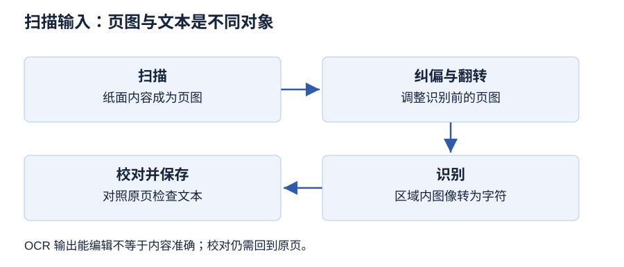

# 第 3 章 文本处理技术

> 大纲定位：刘成明、石磊主编《多媒体技术及应用》（第三版，清华大学出版社，2021 年），对应江苏省课程代码 13511《多媒体技术与应用》江南大学编 2024 年大纲。本章按识记、领会要求组织，讲解和练习独立编写。

!!! warning "学习草稿 · OCR 尚未终校"

    教材整理稿尚未逐字终校。Unicode 的历史位宽、字符范围及扩展 ASCII 表述留待核对，本页不据此推算所有文本的字节数。Word 及输入软件属于旧版功能语境，未实测其界面、识别率或当前版本行为。

## 复习导航

| 大纲短考点 | 层次 | 讲解 | 自编练习 |
| --- | --- | --- | --- |
| 文本与西文编码 | 识记 | [第 1 节](#s1) | 1 |
| 汉字编码 | 识记 | [第 2 节](#s2) | 1 |
| Unicode 编码 | 识记 | [第 3 节](#s3) | 2 |
| 文本类型与存储类型 | 识记 | [第 4 节](#s4) | 3 |
| 文本输入方法 | 识记 | [第 5 节](#s5) | 4 |
| OCR 与扫描输入步骤 | 识记、领会 | [第 6 节](#s6) | 4 |
| 文本处理与格式文本技术 | 识记、领会 | [第 7 节](#s7) | 5 |
| Word 主要功能 | 识记 | [第 8 节](#s8) | 6 |

## 1 字符内容与编码表示 {#s1}

文本用文字和专用符号描述、保存与传递信息。计算机需要按约定的二进制编码表示字符，而不是把屏幕上的字形直接当成字符内容。一次文本处理可能同时涉及“是什么字符”“用什么编码表示”“如何显示”几个问题，讨论编码时应先明确正在处理哪一层。

教材以 ASCII 介绍西文编码。基本 ASCII 使用 7 位，可以区分 128 个编码位置，其中包括英文字母、数字符号、标点等。这里的位数决定能够区分多少种取值；数字字符也是一个字符，不能因它看起来像数值，就把其字符编码与它所表示的数值直接等同。

自编辨析：一份通知中的字母与数字都需要编码后保存；把同一行文字改成另一种字体，是改变显示属性，并没有因此改变文字内容。相反，换成另一个字母，即使字体未变，内容也发生了变化。文字属性与内容的这种差别也会影响文件类型和排版的判断。

## 2 汉字输入、交换与内部表示 {#s2}

汉字数量多，需要为字符建立相应的编码。教材围绕国标码、机内码和输入码说明处理过程。GB 2312—1980 字符集使用区和位定位字符，区位码描述字符在表中的位置；国标码则是教材所述的信息交换编码。区号与位号要分别处理，不能把一串十进制数字直接看作一个整体十六进制数。

教材所述转换先把区、位分别转换为相应数值，再分别加上偏移得到国标码；其机内码模型又把两个字节的最高位置为一，用来与所述 ASCII 表示区分。这个模型服务于教材中的编码体系，不能据此断言各种系统的汉字内部表示始终相同。大纲在此要求识记编码方案，不要求扩展为所有编码标准的比较。

输入码解决“怎样通过键盘选择汉字”。拼音按读音，五笔等方法按字形组织输入；教材还概括顺序码、音码、形码、音形码。输入动作不同，不表示在同一编码环境下选中同一汉字后，存储结果也一定不同。输入方法负责选择，内部编码负责表示，应按两种职责理解。

## 3 统一编码所解决的交流需求 {#s3}

Unicode 在教材中被称为统一字符编码标准，其目的在于为不同语言中的字符提供统一的标识，支持跨语言、跨平台的文本处理与转换。复习重点是它针对多文字交流的需求，而不是把它等同于某种输入法、某个字体或某个编辑软件。

输入法帮助用户选中字符，字体提供显示的字形，统一编码则关心字符如何获得共同的身份。多语言通知中出现不同文字，不能仅靠给文档安装一种艺术字体来说明字符编码问题已经解决。字体能否显示与字符标识的讨论有关联，但二者所负责的问题不同。

教材的 Unicode 历史版本介绍属于当时的知识背景；其中位宽和范围表述不作为本页的容量计算条件。若一个任务要求精确计算文件大小，必须另有明确、可核实的编码条件，不能从“采用 Unicode”就自行假定每个字符都占相同字节数。本章练习只考其统一编码的目的和概念角色。

## 4 三种文本组织与常见文件用途 {#s4}

无格式文本以文字内容为主，通常保存为 .txt。编辑器可以用某种字体显示它，但这种显示选择不等于文件保存了完整的文字排版属性。格式文本除内容外，还保存字体、字号、颜色、段落及版面等信息，适合需要控制输出外观的文档。

超文本按内容联系组织文本块，通过超链接形成非线性阅读路线；包含图片、声音、视频、动画等媒体时，可联系超媒体。格式文本与超文本观察的重点不同：一个重在保留外观信息，一个重在关联与导航，不能只看文字有没有颜色来判断。

按教材所列文件用途，.rtf 用于带格式文字交换，.doc/.docx、.wps 联系相应文字处理文档，.ppt 联系演示文档，.pdf 联系便携式文档；.htm/.html 联系静态网页，.asp 与 .aspx 联系动态网页，.js 联系脚本，.css 联系网页样式。它们不都属于同一种内容结构。表中还列有图像格式 .tiff，它可存扫描页图，却不能仅凭包含文字图案就当作已经识别好的可编辑文本。

## 5 让不同来源成为文本 {#s5}

键盘输入通过按键及中文输入法获得文字，适合直接录入与修改。手写输入需要获取书写动作并经过识别，可以借助手写板、手写笔或相应输入界面。会手写而不熟悉键盘的人，仍可借助这种途径输入，但应检查识别结果。

语音输入先采集声音，再由识别软件转换为文字。声音被录下来不等于文字已经产生。教材中的使用流程还包括麦克风调试、语音适应训练和错误修改，这些是所举软件语境下的流程说明，不能由此保证任意说话内容都能正确识别。

扫描输入先获取印刷页面的图像，再通过 OCR 提取文字。选择途径要看原资料是什么：待撰写的短通知可直接键入，纸质印刷档案可考虑扫描识别，口述内容可考虑语音识别。输入方法解决素材进入系统的路径，结果仍需检查；不能把省去手工敲字理解为省去校对。硬件职责可联系[第 2 章](chapter-02.md)。

## 6 OCR 扫描输入的三个环节 {#s6}

OCR 是光学字符识别。它识别扫描图像中的文字，并把结果转成文本文件。纸面信息、扫描页图和识别文字是处理链中的不同对象：页图可供人查看，文本则能继续按字符编辑。只完成扫描，尚未完成教材所说的 OCR 文本输入。

第一个环节是扫描，把印刷页面转换成图像。教材给出偏向识别任务的扫描设置与 TIFF 保存流程，其作用是获得适合后续识别的图像；本页不把旧版设置当作所有设备的唯一参数。第二个环节是纠偏和翻转，对倾斜或倒置的页面作相应处理，让待识别内容方向合适。

第三个环节是选取文字区域并识别，再保存文本。软件可能标记可疑文字并供人工修改，但没有标记不等于结果已经正确。自编档案任务若在识别后发现姓名或段落顺序错误，应回看对应页图，检查区域、方向和字符结果，而不是只把文本排得整齐。纠偏针对图像方向，文字校对针对识别内容，二者不能互相替代。

### 自编校对任务：从一页活动说明取得文本

材料选自行撰写并打印的一页活动说明，其中安排段落、日期和表格标签。保存扫描页图，再按教材三个环节整理：检查方向与倾斜、选择识别区域、生成文本。随后逐项对照原页，记录错字、数字、标点、段落顺序和表格对应关系。原页清楚而识别错误的，记录识别问题；原页本身不清楚的，保留疑点并回查原件。

交付原页图、校对后的可编辑文本及修改记录。文本能搜索、能复制，只能证明输出已成为字符对象，不能单独证明识别准确。任务据成书 3.3.4 设计，不预设识别率或把一次软件输出称为终校。

## 7 格式文本处理的三个层次 {#s7}

文本信息处理根据使用目的，对内容、形式和风格进行编辑设计。格式文本中的文字内容是主体，属性与版面信息负责呈现方式。先明确文档是供阅读、打印还是电子发行，再安排格式；内容有误时，增加效果不能代替内容修改。

版面格式设置包括页边距、页眉页脚、排列方向和纸张等条件，它们影响整页如何容纳内容。文字属性包括字体、字号、风格、颜色和对齐方式。加粗、斜体、下画线等在字体和字号基础上改变表现；磅值增大表示字变大。左对齐、右对齐、居中、两端对齐与分散对齐则是不同的排列选择，应结合使用要求判断。

非文本内容排版处理图片、表格、公式、文本框等对象与文字的位置关系。页边距过小、标题难以辨认、表格位置不当，分别需要版面、文字属性和对象排版层面的调整。一个合适的字号不能自动解决所有问题。正式文档还要符合对应的格式要求，不能把教材中的字体搭配举例当作一切场景的固定规则。

## 8 按编辑任务识别 Word 功能 {#s8}

教材以 Word 介绍文字处理软件。内容编辑包括插入、修改、删除、复制等操作，用于改变文字内容；图文混排把图片、艺术字等对象与文本组合；表格功能用于建立、调整表格，并支持所述数据处理。分类时先说操作对象和结果，比只列软件名称更能说明功能。

排版功能设置字符、段落和页面外观，包括字体、字号、颜色、纸张大小、页边距、页眉页脚等。公式编辑、格式转换和打印预览等被教材归入其他功能。打印预览用于观察预期输出，不能代替核对文档中的姓名、符号或识别错误。

自编通知制作流程可以先改正文字，再整理表格、放置示意图片，随后设置页面和标题外观，最后预览输出。这个任务顺序用于理解功能之间的配合，不是对旧版菜单操作的复现。教材展示 Word 2019 界面，本页未实测该版本，也不把某个界面位置写成跨版本都成立的操作指令。

### 自编编辑任务：保持内容与版面分别可查

用校对后的活动说明完成一次图文编辑，按本章列出的 Word 功能组织，具体界面仍待对应教材环境验证。

1. 先核对文字、日期和段落顺序，再设置标题、正文及段落格式。
2. 插入自制说明图与一张信息表，检查图文对应及表格标签，避免只追求版面位置而漏掉内容。
3. 保留可继续编辑的文档，再做打印预览，检查分页、对象裁切与表格是否完整。

内容修订、文字属性和页面编排应分别登记。字体换了不等于文字内容已纠正，打印预览正常也不能证明编码或识别结果全部正确。本任务的功能范围据成书 3.4，不补写未核实的快捷键。

## 本章小结

- 输入码选择字符，内部编码表示字符，字体呈现字形；更换输入法或字体不直接证明字符身份改变，也不能由 Unicode 名称推出固定字节数。
- 无格式文本、格式文本和超文本分别关注内容、外观与关联；扫描页图经过识别后才成为可按字符编辑的文本。
- OCR 的方向与区域处理帮助识别，最终仍需对照原稿核字词、顺序和结构；版面、文字属性和对象位置也要分别检查。

## 自编练习

**1. 编辑员分别用拼音与字形输入法录入同一个地名，接着把标题改为黑体。他声称“输入方式和字体各改变了一次字符内部编码”。请从输入码、内部表示和文字属性三个角度解释。**

考点：第 1、2 节；层次：识记。

**答案：** 输入码决定怎样选中字符；在同一编码环境下，选中同一地名不能仅因输入法不同就推定内部表示不同。改黑体属于改变显示属性，地名的文字内容没有随之改变，也不能据字体变化判断字符编码已被更换。

**2. 一个团队要处理含多种语言的通知，成员提出“改用一种输入法就等于使用 Unicode，安装字体就能代替统一编码”。请指出三种工具或机制分别解决的问题。**

考点：第 3 节；层次：识记。

**答案：** 输入法帮助选取与输入字符，字体提供显示字形，Unicode 面向不同语言字符的统一标识。三者职责有别，改用输入法或安装字库不能作为已经采用统一编码的证明，更不能据此确定每个字符占用的字节数。

**3. 项目要保留未排版的采访文字、带字体与表格的报告，以及能按主题跳转的介绍页。分别联系三种文本类型；另有一张扫描页保存为 TIFF，它为何不能直接算作采访文字文件？**

考点：第 4 节；层次：识记。

**答案：** 未排版文字联系无格式文本，保留外观的报告联系格式文本，主题链接联系超文本。TIFF 保存的是页面图像，虽然人能看见其中的文字，但若未完成识别，就还不是能直接按字符编辑的采访文本。

**4. 社团收到一份倒置且略倾斜的印刷名单，还要补入负责人的口述说明。按材料来源选择输入途径，并说明名单经扫描后还需哪些环节。**

考点：第 5、6 节；层次：识记、领会。

**答案：** 名单可用扫描加 OCR，口述说明可用语音识别后校对。名单扫描成图像后，应纠偏和翻转，再选文字区域识别、保存并检查结果。图像方向修正有助于识别，却不能保证姓名完全正确，仍须对照原资料校验。

**5. 一份活动报告存在三个问题：正文紧贴纸边、标题不显眼、图片遮住表格。请分别定位到格式处理层次，说明为什么只调整标题字号不能解决全部问题。**

考点：第 7 节；层次：识记、领会。

**答案：** 贴边应检查页边距等版面设置，标题应检查字体字号等文字属性，图片与表格的关系应检查非文本内容排版。三者处理对象不同，标题字号只改变相应文字的表现，不能自动恢复整页边界或安排对象位置。

**6. 制作实验通知时，成员要改错字、插图、建立分工表、设置页脚并检查打印外观。请分别说出 Word 对应的功能；哪些步骤不能代替文字校对？**

考点：第 8 节；层次：识记。

**答案：** 改字属于内容编辑，插图属于图文混排，分工表联系表格功能，页脚联系排版，观察打印外观联系打印预览。插图、表格和预览都不自动证明文字正确，错字仍需要在内容编辑与校对环节发现并修改。
