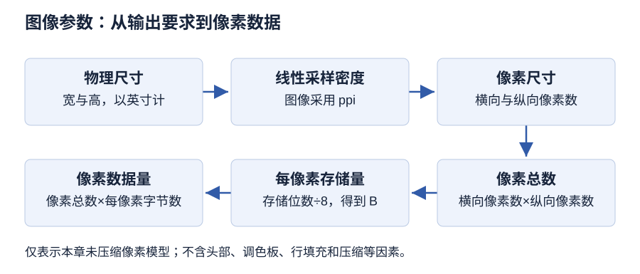

# 第 4 章 图形图像处理技术

> 大纲定位：刘成明、石磊主编《多媒体技术及应用（第三版）》（清华大学出版社，2021 年）。复习范围结合江苏省高等教育自学考试 13511《多媒体技术与应用》大纲（江南大学编，2024 年）第 5至6 页所列本章范围。以下是独立组织的学习讲解与自编任务，不代表现行考试公告或当前软件操作指南。

!!! warning "学习草稿 · OCR 尚未终校"

    来源成书稿尚未逐字终校。软件操作需在对应版本中实测；来源疑点不作为唯一标准答案。自编练习用于本章复习。

## 复习导航

| 复习条目 | 层次 | 讲解 | 自编练习 |
| --- | --- | --- | --- |
| 图形与图像 | 识记、领会 | [第 1 节](#s1) | 1 |
| 分辨率、尺寸和数据量 | 识记 | [第 2 节](#s2) | 2 |
| 颜色的表达 | 识记、领会、简单应用 | [第 3 节](#s3) | 1、5 |
| 文件格式的选择 | 识记 | [第 4 节](#s4) | 3 |
| 公式、条件与步骤 | 识记、领会、简单应用、综合应用 | [第 5 节](#s5) | 2、3、4、5、6 |

## 1 图形与图像 {#s1}

图形侧重以点、线、面等数学模型和几何参数描述对象，结构为参数图或矢量图；图像处理侧重对位图进行数字化处理、压缩、存储和传输。教材以设计、仿真、模拟对应图形，以模式识别、景物分析、计算机视觉对应图像应用，同时说明二者在实际应用中可以结合。

**自编归纳。** 辨析题按“表示结构 → 处理目标 → 应用场景”作答。不要仅用扩展名猜测题目所问的表示方式。

## 2 分辨率、尺寸和数据量 {#s2}

| 概念 | 教材定义要点 | 单位或表示方式 |
| --- | --- | --- |
| 图像分辨率 | 单位图像线性尺寸包含的像素数 | 像素/英寸，ppi |
| 显示分辨率 | 显示器单位长度显示的像素或点数 | 教材用 dpi；也讨论屏幕横纵像素设置 |
| 打印分辨率 | 打印机每英寸产生的油墨点数 | dpi |
| 扫描分辨率 | 每英寸扫描得到的点数 | dpi |
| 像素尺寸 | 图像横向、纵向的像素数量 | 宽 × 高，像素 |
| 输出尺寸 | 给定输出分辨率下的物理尺寸 | 英寸等长度单位 |

教材 PDF 第 65 页“打印分辨率”段同时出现“每英寸”和“每平方英寸”的表述，该疑点尚待来源层修订。本笔记的计算明确按线性单位处理，不将两种表述混用。

### 从用途反查参数

屏幕上的图像先检查横纵像素是否满足画面需要；纸面输出还要检查物理尺寸和每英寸像素数。ppi 描述图像采样密度，打印机的 dpi 描述设备形成的点，二者不能直接替换。颜色模式回答怎样描述颜色，位深回答每个像素使用多少位，文件格式回答怎样组织和保存数据。

同一批像素按更低 ppi 输出时，可以占据更大的纸面范围；这没有增加原图细节。实际重新采样又是另一项处理，计算题须说明像素数量是否保持不变。上述关系据本章 4.1.2、4.2.3、4.2.5 的定义组织。

## 3 颜色的表达 {#s3}

色彩三要素为亮度、色相、饱和度；色相与饱和度统称色度。颜色深度是描述像素颜色所用的二进制位数。

| 模式 | 组成或特点 | 教材用途线索 |
| --- | --- | --- |
| RGB | 红、绿、蓝；加色法 | 显示输出 |
| HSB | 色相、饱和度、亮度 | 按视觉特征描述颜色 |
| CMY / CMYK | 青、品红、黄；印刷另加黑色 K | 彩色打印与印刷 |
| Lab | 亮度 L、色度分量 a 和 b | 颜色描述与转换 |
| 索引颜色 | 调色板和颜色索引；教材上限为 256 色 | 限制颜色数量以控制文件大小 |
| 位图模式 | 黑白像素，1 位/像素 | 黑白图像表示 |
| 灰度模式 | 灰度亮度，教材最多 256 级 | 不含原来的彩色信息 |

**自编辨析。** “位图图像”是点阵表示结构，“位图模式”是教材所述黑白颜色模式；二者不能互换。灰度图重新转为彩色模式，不能因此恢复此前丢失的原始颜色。教材对 32 位像素的例子采用 RGB 三字节加一字节其他属性，因此不能直接把 32 位全算成 RGB 色彩位数。（依据 PDF 第 68 页。）

## 4 文件格式的选择 {#s4}

图像文件包含图像说明与图像数据；说明中包括宽、高、格式、颜色深度、调色板、压缩方式等。

| 格式 | 本章复习要点 | 选择线索 |
| --- | --- | --- |
| BMP | 位映射形式、文件头与位图信息 | 识别结构和数据量条件 |
| GIF | LZW、256 色、动画与透明 | 教材中的网络图像场景 |
| JPEG | 有损压缩、可设置品质和压缩级别 | 制作完成后的输出 |
| TIFF | 支持多种颜色模式，可压缩或不压缩 | 扫描与页面排版 |
| PSD | 保存图层、通道、蒙版等编辑信息 | 保留可继续编辑的备份 |
| PNG | 无损压缩、透明图像 | 网络图像与透明背景 |

**自编方法。** 选择格式前先写明“后续是否继续编辑、是否需透明或动画、是否允许有损、目标软件是否接受”。像素数据量公式不能直接给出 JPEG 等压缩文件的实际字节数。教材对 BMP、PSD 压缩的绝对表述以及 SWF 的使用现状保留为版本边界，不扩写成当前所有文件实现的规则。

## 5 公式、条件与步骤 {#s5}

### 未压缩像素数据量

教材 PDF 第 70 页，4.2.5 给出：

\[
B_{\text{pixels}}=H\times W\times C/8
\]

其中 H、W 为高和宽的像素数量，C 为每像素存储位数，结果为字节 B。自编计算约定：只算均匀位深的未压缩像素数据，不含文件头、调色板、行填充、元数据等开销；题目若给出额外存储分量，须先计入 C。本章自编练习明确使用 KiB 表示 1024 B，不让 KB 的不同换算习惯混入答案。

**自编算例：从每像素到整幅图。** 设缓存保存 800 × 600 像素，每像素 24 位；忽略上述开销。

1. 每像素占用：24 bit ÷ 8 = 3 B。
2. 像素总数：800 × 600 = 480000。
3. 采样数据：480000 × 3 = 1440000 B。
4. 按本题约定换算：1440000 ÷ 1024 = 1406.25 KiB。

这里每一步都是对给定数据的独立推算。若宽、高都变成原来的两倍而位深不变，像素数和数据量均变成四倍；若只把位深由 24 位改为 32 位，则数据量按 32/24 倍变化。两种变化不能混算成“分辨率越高，文件一定按同一倍数增长”。压缩文件还需另看实际编码与结构。

### 输出尺寸与采样密度

由 PDF 第 64、70 页的线性分辨率定义作自编推导：横向像素数 = 输出宽度（英寸）× 分辨率（ppi），纵向同理。例：2 × 3 英寸、300 ppi 对应 600 × 900 像素；若按 24 位未压缩像素数据计算，则为 1620000 B。这里只计算给定输出条件所需像素，不声称提高已有低清图的 ppi 能恢复缺失细节。

### 获取与扫描

图像获取包括使用设备转换自然影像，以及从数字图像库或网络获取、通过计算机截图。网络素材需检查授权、费用和使用条件。

图像扫描是借助扫描仪和相应软件，将平面印刷品进行数字化转换的过程。

教材以清华紫光扫描仪为例，列出模式、分辨率、扫描参数、预览、扫描范围、正式扫描和保存。设备厂家和软件不同，扩充功能会有差异。自编步骤卡：调用驱动 → 选模式和分辨率 → 按预览结果调整参数 → 选范围 → 正式扫描并保存。数值和模式应按任务要求设定，不将教材界面当作当前产品说明。

教材将数码拍摄描述为用数码相机或数码摄像机直接获取自然影像；相机中的 CCD 或 CMOS 感光元件把自然影像转换为电信号，再转成数字信号。教材列举像素数量、分辨率、存储容量等指标。

| 环节 | 要点 | 来源 |
| --- | --- | --- |
| 拍摄前 | 压缩、闪光、白平衡、对焦、像素、曝光 | PDF 第 74 页 |
| 拍摄 | 取景、构图、对焦、快门 | PDF 第 74至75 页 |
| 传输 | 接口、信号电缆、相机驱动 | PDF 第 75 页 |
| 处理 | 尺寸、色彩、修复、合成、效果 | PDF 第 89至99 页 |
| 输出 | 选择与用途相符的成品格式 | PDF 第 89至91 页 |

以上顺序是按教材内容形成的自编流程；设备、接口和软件描述限于第三版语境。

教材该段没有清楚列出数码相机机身类型的分类表，而提到 CCD/CMOS 感光元件及四种取景器：光学平视、单反式光学、液晶屏电子式、辅助式液晶屏取景（PDF 第 73至74 页）。这些是感光元件或取景方式的区别，不能直接改写成相机机身分类。

教材介绍搜索图像、保存网页图片，以及全屏、活动窗口、矩形或自定义区域、滚动窗体等截图方式。以上是教材工具说明；当前软件名称、网站界面和版权状态需另查来源。

### Photoshop 2020 处理步骤卡

依据教材 PDF 第 87至102 页整理，以下为流程摘要，尚未完成软件实操验收。

| 任务 | 教材步骤摘要 | 页序 |
| --- | --- | --- |
| 改尺寸与格式 | 等比调整像素尺寸；另存 JPEG | 89至91 |
| 制作特效文字 | 输入文字，设置图层样式 | 92至93 |
| 修正曝光 | 色阶调整并比较 | 93至94 |
| 拼接图像 | 选区、蒙版、调色融合 | 94至99 |
| 添加滤镜效果 | 选图层或区域，设置滤镜 | 100至102 |

可编辑文件另存 PSD，以保留图层、通道和蒙版（PDF 第 69至70 页）。教材“图层”面板用于分层管理图像；“路径”面板配合钢笔工具管理路径；“通道”面板保存颜色信息、选区和蒙版。（PDF 第 87至88 页。）操作题应记录当前选中的是图像还是蒙版，并交付原素材、可编辑文件及输出副本，不能只用口述步骤作为已完成实操的证据。

### 自编操作任务：修订社区活动说明图

**环境与状态：** 按 Photoshop 2020 的教材功能组织，尚待该版本实测。准备自摄照片和自行撰写的活动名称，保留原件。目录自定为 `originals/`、`work/`、`output/`，分别保存原件、可编辑稿和交付副本；这些目录是本任务的组织约定。

**任务一：裁切与尺寸。** 先写出要保留的主体及输出横纵比例，打开副本，检查像素尺寸和颜色模式。用裁剪工具确定保留范围，再按用途调整像素尺寸；每次改动后检查主体是否被切断、比例是否拉伸。保存分层工作稿，另存输出副本，重新打开检查尺寸。裁切控制保留范围，缩放控制像素尺寸，不能只改 ppi 数字便认定两项均已完成。

**任务二：可修改的标题。** 在独立文字图层输入自编标题，调整字体、大小及位置，使用教材介绍的图层样式观察效果。保存后重新打开，修改一个字并再次保存；若只能修改整幅平面像素而不能编辑文字，就回查保存格式与图层状态。检查标题在实际输出大小下是否清晰，是否遮挡照片主体。

**任务三：曝光与合成。** 在工作副本中比较调整前后的色阶；另将一份自制图形或自摄局部放入独立图层，以选区、蒙版和颜色调整处理衔接。每次操作前确认选中的是图像还是蒙版，检查边缘、主体细节及文字可读性。保留可返工版本，再生成交付副本。任务来自本章工具与处理能力的组合，不复刻教材实例。

| 交付物 | 核对内容 |
| --- | --- |
| 原素材 | 来源、原始尺寸、未覆盖的原件 |
| 可编辑稿 | 图层、文字、蒙版、重新打开结果 |
| 输出副本 | 尺寸、格式、显示与目标用途 |
| 操作记录 | 版本、初始状态、步骤、预期与实际 |

工具学习对应 PDF 第 87至102 页。操作记录还应写明日期与未解决问题；没有工程文件和检查记录时，只登记任务设计完成。

## 本章小结

- 几何对象表示便于修改轮廓，像素表示记录图像采样；表示结构、颜色模式、像素尺寸与输出分辨率是不同维度。
- 未压缩像素数据按宽×高×每像素位数÷8 求字节数，必须声明不含头部、调色板、行填充等；它不直接给出压缩文件大小。
- 处理流程应保留原素材与可编辑工作稿，再另存交付副本；第三版软件步骤和原书分辨率表述疑点继续保留验证边界。

## 自编练习

**1. 展馆要同时制作可反复放大的标志和包含纹理的实景照片。为两类素材分别选择表示方式，并说明显示用颜色模式与印刷用模式为何不能混成同一项要求。**

考点：第 1、3 节；层次：识记、领会。

**答案：** 标志适合以几何对象及其属性组织，便于改变尺寸；照片适合按像素保存连续色调与纹理。RGB围绕显示光的组合，CMY/CMYK围绕印刷着色。表示方式回答如何描述图像，颜色模式回答如何组织颜色，这两个维度应分别记录。

**2. 展馆屏幕使用1920×1080像素的24位图像。仅计算一帧不压缩像素缓冲区，不计文件头、调色板和行填充；求字节数及KiB，并说明为什么不能据此断定下载文件大小。**

考点：第 2、5 节；层次：识记。

**答案：** 每像素24÷8=3字节，缓冲区为1920×1080×3=6220800字节，即6075 KiB。这里的KiB以1024字节计。图像文件还受到压缩、文件结构和附加信息影响；像素缓冲区的大小不是所有格式的磁盘文件大小。

**3. 同事把带透明背景的按钮导出成只保留平面像素的交付文件，同时删去了分层工作稿。说明此交付在后续改字、调整图层和恢复透明效果时留下什么问题。**

考点：第 4、5 节；层次：识记、领会。

**答案：** 交付格式与可编辑工作稿承担不同用途。平面像素文件不能替代原有图层、选区及对象关系；应分别保留可继续修改的源文件和面向使用环境的输出文件，并核对透明信息是否被目标格式和保存设置保留。

**4. 为一张偏暗、背景杂乱的活动照片拟定处理检查单，要求保留主体、统一展板尺寸，并能在修改错误时回到原素材。无需写菜单名称。**

考点：第 5 节；层次：综合应用。

**答案：** 先备份原素材并检查尺寸与用途，再用选区或裁切确定主体，调整亮度和色彩，按需要清理背景并组织图层，最后核对像素尺寸和输出格式。保留工作稿后另存交付文件，复查是否误切主体以及显示效果；这是一项流程设计任务，不代表已完成软件实操。

**5. 同一活动需要屏幕说明图、黑白印刷校样和可继续改字的工作稿。比较 RGB、灰度与保存图层的工作稿分别解决什么问题。先做灰度校样再转回 RGB，能否取得原来的彩色照片？**

考点：第 3、5 节；层次：领会、简单应用。

**答案：** RGB 用于描述显示所需的颜色，灰度用于只保留亮度层次的校样；工作稿保存图层和文字关系，便于继续编辑。颜色模式与保存编辑结构是不同要求，可以同时记录。灰度转换后丢失的原始颜色不能因再次选 RGB 而自动恢复，应回到保留的彩色原件或可返工版本。

**6. 学习拓展：一幅 2400×1600 像素、24 位的图像，不重新采样，按 200 ppi 输出。求物理尺寸与未压缩像素数据量，忽略文件结构开销。改成 100 ppi 后，这两个结果各如何变化？**

考点：第 2、5 节；层次：简单应用。

**答案：** 宽为 2400÷200=12 英寸，高为 1600÷200=8 英寸。每像素 24÷8=3 B，数据量为 2400×1600×3=11520000 B，即 11250 KiB。改为 100 ppi 后输出为 24×16 英寸；题设像素数和位深未变，像素数据量不变。本题是从定义形成的自编推算，不将设备 dpi 代入 ppi。
