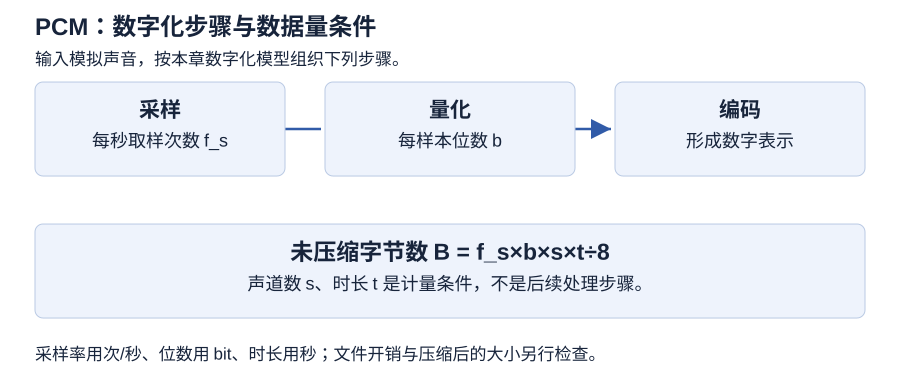

# 第 5 章 音频处理技术

> 大纲定位：刘成明、石磊主编《多媒体技术及应用（第三版）》（清华大学出版社，2021 年）。复习范围结合江苏省高等教育自学考试 13511《多媒体技术与应用》大纲（江南大学编，2024 年）第 6至7 页所列本章范围。以下是独立组织的学习讲解与自编任务，不代表现行考试公告或当前软件操作指南。

!!! warning "学习草稿 · OCR 尚未终校"

    来源成书稿尚未逐字终校。软件操作需在对应版本中实测；来源疑点不作为唯一标准答案。自编练习用于本章复习。

## 复习导航

| 复习条目 | 层次 | 讲解 | 自编练习 |
| --- | --- | --- | --- |
| 声音和音频 | 识记 | [第 1 节](#s1) | 1 |
| 数字化过程 | 识记、领会 | [第 2 节](#s2) | 1、2、6 |
| 未压缩 PCM 数据量 | 领会 | [第 3 节](#s3) | 2、6 |
| 编码与文件格式 | 识记、领会 | [第 4 节](#s4) | 3 |
| 音频工具的用途 | 识记 | [第 5 节](#s5) | 3 |
| 采集与软件操作 | 识记、领会、综合应用 | [第 6 节](#s6) | 4、5 |

## 1 声音和音频 {#s1}

教材用振幅 A、周期 T 和频率 f 描述声波，频率与周期互为倒数：$f=1/T$。教材将振幅与响度感受联系，将频率与音调联系；复音中的基频和谐音组合后，可形成不同音质和音色。教材按频率将低于 20 Hz、20 Hz 至 20 kHz、高于 20 kHz 的声音分别称为次声、音频、超音频（或超声）（PDF 第 107 页）。

教材举例说明分贝与输出功率呈对数关系：输出功率提高到 4 倍，dB 值增加约 6；提高到 100 倍，dB 值增加 20（PDF 第 105 页）。这说明 dB 不能按功率倍数线性换算，但教材没有据此给出高保真音响的信噪比最低门槛。

教材区分波形音频、CD 音频和 MIDI 音乐（PDF 第 107至108 页）。波形音频记录数字化后的声波样本；CD 音频存储在音乐 CD；MIDI 记录演奏消息，播放端按消息合成声音，不是声波采样的副本。

## 2 数字化过程 {#s2}

| 环节 | 处理对象 | 关键点 |
| --- | --- | --- |
| 采样 | 时间连续的波形 | 每秒取样次数为采样频率 $f_s$ |
| 量化 | 采样点幅值 | 位数影响离散量化级数 |
| 编码 | 量化后数据 | 形成可存储或传输的数字音频表示 |

教材给出的奈奎斯特关系为 $f_s\geq 2f_{max}$，其中 $f_{max}$ 是信号最高频率。以教材所列 20 kHz 音频上限计算，采样率需至少约 40 kHz（PDF 第 108 页）。教材未在此处展开实际滤波器的过渡带，因此练习按书中条件计算。

教材列出 8 位量化有 256 级、16 位有 65,536 级（PDF 第 108 页）。按 $b$ 位二进制编码组合数 $2^b$ 可作学习层推导；具体可用幅值还受编码方式约束。

判断参数先问它控制哪个维度：采样率控制单位时间的取样次数，量化位数控制幅值表示的级数，声道数控制并行保存的声音通道。不能用增加声道数来代替提高采样频率，也不能从采样数据量更大直接断言录音更清楚；音源、输入电平和处理同样需要检查。

## 3 未压缩 PCM 数据量 {#s3}

自编计算式：

$$R_{bit}=f_s\times b\times s\quad(\text{bit/s})$$

$$R_{byte}=\frac{f_s\times b\times s}{8}\quad(\text{B/s}),\qquad B=\frac{f_s\times b\times s\times t}{8}\quad(\text{B})$$

$f_s$ 用 samples/s，$b$ 为 bit/sample，$s$ 为声道数，$t$ 用秒；采样率以 kHz 给出时先乘 1000。此式只计未压缩采样数据，不计文件头、元数据、块对齐、压缩或封装开销。题目若使用 KB，应说明采用 $1\text{ KB}=1000\text{ B}$；若采用 KiB，则 $1\text{ KiB}=1024\text{ B}$。

- 自编变式：10 秒、48 kHz、24 bit、双声道，结果为 2,880,000 B，即 2.88 MB 或 2,812.5 KiB。

教材将采样率（kHz）、位数和声道数相乘后除以 8，称结果为 KB/s；紧随其后的 10 秒例算得到 220,500，却仍标为 KB/s。该数值对应 10 秒内的字节数，不是每秒 KB。表 5-2 前两行扫描件确印“5.5Hz”，同表“单声道生源”也与扫描字面一致。以上原书疑点不静默改写。PDF 第 112 页给出的 CD 音质约 172 KB/s，与 44.1 kHz、16 bit、双声道的 176,400 B/s 折合约 172.27 KiB/s 数值接近；原书未说明 KB 换算定义。

### 自编推算：预算能保存多久

设每秒 24000 次采样、16 位、单声道，仅有 1536000 B 可保存未压缩采样数据；不计其他开销。这是为检验公式方向自行设定的任务。

1. 位率为 24000×16×1=384000 bit/s。
2. 字节率为 384000÷8=48000 B/s。
3. 可用时长为 1536000÷48000=32 s。
4. 若保持采样率和位数，改为双声道，字节率为 96000 B/s，可用时长为 16 s。

反查时将时长乘回字节率，两种方案均得到题设预算。容量、时间和数据率的单位必须相配，不能把 bit/s 直接当 B/s，也不能对 MP3 等已编码文件只凭扩展名套用采样公式。

## 4 编码与文件格式 {#s4}

教材将音频压缩分为无损和有损；有损编码介绍波形编码、参数编码、混合编码。书中说明波形编码适应性强、压缩比不大；参数编码压缩率较大、计算量较大且保真度较低；混合编码结合两类方法的特点。

| 格式 | 教材所述特点 | 复习关注 |
| --- | --- | --- |
| WAV | 波形音频文件；本章按未压缩采样例讨论 | 记录波形样本 |
| MP3 | MPEG-1 Audio Layer III，有损压缩 | 体积与质量折中 |
| WMA | 教材介绍的微软音频压缩格式 | 依教材版本识记 |
| MIDI | 音符、力度、时长等演奏消息 | 播放依赖合成器 |
| CD-DA | 音乐 CD 上的数字音频 | 抓轨后再保存 |
| AU、RealAudio、AIFF | 教材列举的其他格式 | 按书中名称识记 |

厂商和格式用途依 2021 年版教材语境整理，不表示当前设备或软件的完整兼容性。

## 5 音频工具的用途 {#s5}

第 5.5 节以软件实例说明常用音频工具。复习时把软件与处理任务对应，不把这些例子扩展为当前软件目录。

| 教材软件 | 本节介绍的用途 |
| --- | --- |
| Adobe Audition | 录制、混合、编辑、修复数字音频 |
| GoldWave | 编辑、播放、录制、转换与提取声音 |
| All Editor | 录音、剪贴混合和音频效果处理 |
| Total Recorder | 截取硬件、软件等音源并录音 |

软件能力和音源支持均按教材版本记录。Total Recorder 段落的“理论上不会失真”是原书论述，本笔记不将其作为任意录音链路的质量保证。

## 6 采集与软件操作 {#s6}

教材建议按用途选择采样参数，并在录音前检查输入强度。输入过低时，噪声相对突出；输入过高会造成失真。教材还列出抓取 CD、VCD、DVD 音轨和 MIDI 合成等获取途径（PDF 第 112至115 页）。

示例包括录音、多轨伴奏、采样率不匹配提示，以及用噪声样本降噪。可将任务归纳为导入或录制、试听并检查电平、剪辑、多轨安排、效果处理和导出；这是学习层流程归纳，尚未进行软件实测，不替代书中的具体操作步骤。

### 自编操作任务：分段旁白与背景声

**环境与状态：** 以 Audition 2020 及本章录音、多轨和降噪功能组织，尚待该版本实测。素材为自行录制的分段介绍和自行制作的背景声，不使用教材伴奏。先建原件、工作稿和输出目录，写明采样率、位数、声道与保存位置。

1. **试录与留原件。** 确认输入设备和通道，先试录正常发声及停顿，试听是否过轻、过强或出现失真；调整输入后再正式录制，原录音单独保存。后期降噪不代替录音前的电平检查。
2. **组织与衔接。** 保留工作副本，去掉误录和无关片段；逐一试听段首、段尾和连接处，检查是否切掉字音。记录每段的用途与位置，再检查全段顺序。
3. **多轨安排。** 新建多轨会话，导入旁白及背景声，分别安排轨道，检查起止和重叠。若素材采样率与会话不一致，记录提示、处理选择和结果；不把软件出现提示本身记作匹配完成。
4. **噪声处理。** 在工作副本中选取不含所需语音的噪声片段作为样本，再对目标段尝试降噪，比较处理前后的背景和人声。若人声受损，返回处理前状态调整；没有合适样本时记录条件不足，不把语音当噪声样本。
5. **保存与复听。** 保存可返工的会话、关联素材和处理记录，另存播放交付物。关闭编辑视图后独立打开输出文件，试听整段、衔接和音量，核对时长与声音是否完整。

采集与电平检查据 PDF 第 111至113 页，多轨与降噪据第 118至122 页。剪辑及输出按本章通用处理流程组织，不补写来源未给出的菜单、快捷键或固定效果参数。

验收记录包含环境、输入参数、素材位置、操作、预期、实际、工程与输出位置、日期和未决问题。只保存一份播放文件，无法证明会话及关联素材能继续编辑；只保存会话，也没有证明交付音频可独立播放。

## 本章小结

- 声音的响度、音高和音色与采样率、量化位数、声道数分别描述听觉和数字表示，不能相互代替。
- 未压缩 PCM 字节数=采样率×位数×声道×秒数÷8，先换算 kHz，再区分 B、MB 与 KiB；MIDI 消息不等同波形采样。
- 采集前试录并检查输入电平，编辑后核对衔接与导出结果；原书单位疑点及指定软件未实测状态仍显式保留。

## 自编练习

**1. 讲解员说话更响，是否意味着声音频率一定更高？为录音单列响度、音高、音色和数字化参数，解释为什么这些栏目不能互相代替。**

考点：第 1、2 节；层次：识记、领会。

**答案：** 响度、音高和音色描述不同听觉特征；提高响度不能据此推出频率升高。采样频率描述时间上的取样密度，量化位数描述幅度表示的级数，声道描述通道数。应把声音特征与数字表示参数分别列出。

**2. 导览系统保存45秒、32000次/秒、16位、单声道的未压缩PCM。仅计采样数据，求所需字节数；若只知道同长度MP3文件的扩展名，是否能照此求其大小？**

考点：第 2、3 节；层次：领会。

**答案：** PCM采样数据为32000×16×1×45÷8=2880000字节，即2812.5 KiB。压缩音频不能只凭扩展名套用这个结果；还需知道编码后的码率、时长及相应开销。公式中的采样频率、位数与声道条件缺一不可。

**3. 项目收到一份WAV、一份MIDI和一段待录制的访谈。如何分别安排检查和处理工具，避免把音符指令文件当成已经录好的声音波形？**

考点：第 4、5 节；层次：识记、领会。

**答案：** 先确认文件内容和编码，不能只按名称推断。WAV属于声音文件格式的讨论范围；MIDI用于描述演奏相关信息，其内容不能直接等同于录音波形。访谈要先采集，再做剪辑和效果处理；工具应按录音、编辑、合成或格式转换的任务选用。

**4. 为导览旁白设计录音至交付的工作流程，要求去除无关片段、保留可返工版本，并检查多段旁白衔接。请给出检查点，不宣称已在指定软件中执行。**

考点：第 6 节；层次：综合应用。

**答案：** 先明确设备、输入通道和录音参数，试录确认后采集素材；保留原录音，再剪除无关片段并处理衔接，按需要做效果和音量调整。保存编辑项目或工作稿，另行导出交付音频，试听头尾、连接点和整段结果。Audition操作仍需在教材对应版本中验证。

**5. 试录时声音失真，操作员仍直接录完，再把整段人声选作噪声样本，准备以最大处理强度补救。指出录音检查和降噪处理各应先确认什么。**

考点：第 6 节；层次：识记、领会。

**答案：** 先核对输入设备、通道和电平，调整后重新试录，不能把有问题的采集链留给降噪补救。噪声样本应对应要处理的背景噪声，不能将所需人声整体当作噪声。效果设置还要通过前后试听判断，处理强度更大并不保证人声更完整；保存原件才能比较或返工。

**6. 固定保存 1536000 B 的未压缩 PCM，参数为 24000 次/秒、16 位、单声道。有人用“容量÷384000”得到秒数，错在哪里？正确计算后，解释改双声道为何会改变可存时长。**

考点：第 2、3 节；层次：领会。

**答案：** 384000 是 bit/s，预算是 B，不能直接相除求秒。先除以 8 得到 48000 B/s，再计算 1536000÷48000=32 s。双声道的每秒数据量变为两倍，同预算只能保存 16 s；这是保持其他条件不变的采样数据推算，未计文件结构开销。
