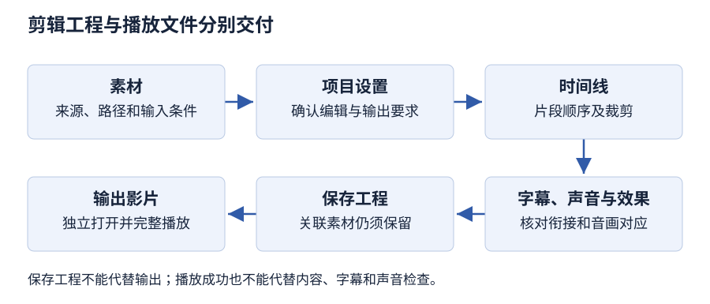

# 第 6 章 视频处理技术

> 大纲定位：刘成明、石磊主编《多媒体技术及应用（第三版）》（清华大学出版社，2021 年）。复习范围结合江苏省高等教育自学考试 13511《多媒体技术与应用》大纲（江南大学编，2024 年）第 7至8 页所列本章范围。以下是独立组织的学习讲解与自编任务，不代表现行考试公告或当前软件操作指南。

!!! note "笔记校对与版本说明"

    2026-11-06 已复核本章讲解与自编练习，范围及勘误见[课程校对记录](index.md#proofreading)。帧场精度与原书算术勘误见正文；Premiere 2020 等软件操作尚未实测。

## 复习导航

| 复习条目 | 层次 | 讲解 | 自编练习 |
| --- | --- | --- | --- |
| 视频与信号类型 | 识记 | [第 1 节](#s1) | 1 |
| 数字视频的特点与编辑对象 | 识记、领会 | [第 2 节](#s2) | 1、2 |
| 编辑、压缩与格式 | 识记、领会 | [第 3 节](#s3) | 2、3、5 |
| 采集、转换与 Premiere 流程 | 识记、领会、简单应用、综合应用 | [第 4 节](#s4) | 3、4、5 |

## 1 视频与信号类型 {#s1}

教材将视频描述为多幅静止图像（图像帧）与连续音频信息在时间轴上同步运动的混合媒体，并用 $v(x,y,t)$ 表示画面随空间坐标与时间变化。名词解释可从图像帧、连续音频、时间同步组织。

教材列出复合、分量、分离视频（Y/C）和射频信号。复合视频不含伴音；射频传输把全电视信号及伴音调制后传输。教材所列模拟电视制式为 NTSC、PAL、SECAM。帧频按每秒完整画面计，场频按每秒扫描场计，二者不能互换。原书表格中的 NTSC 帧频与场频精度不一致，本笔记不以该组数值作计算题依据（PDF 第 127 页）。

数字视频以离散数字信号表示、存储、处理和传输。教材列 PDTV、SDTV、HDTV 三个清晰度等级，表 6-2 同时列隔行与逐行扫描示例。扫描方式不等同于模拟/数字分类。原稿关于数字视频扫描方式的概括与同页数字电视表项并存，不能据概括断言所有数字视频都逐行。

## 2 数字视频的特点与编辑对象 {#s2}

教材从计算机编辑处理、再现性和数字网络传输三个方面说明数字视频的优点，也指出原始数据量大，需要压缩及解压处理。答题可按“便于计算机处理 → 数字数据便于复制再现 → 便于网络共享与访问”组织；这是对原段落的学习归纳。

原书关于无限复制、传输不退化的表述应放在数字数据再现的讨论中理解。它不能证明任意压缩、转码或故障链路均不损失质量；本笔记没有独立验证这一扩大命题。

数字视频编辑包括**内容编辑**和**效果处理**：前者如拼接、裁剪，后者如画面变换、字幕、合成和淡入淡出。伴音也要与画面对应处理，不能把视频编辑只理解为调整图像。

## 3 编辑、压缩与格式 {#s3}

教材中的线性编辑基于传统声像媒介，素材按时间顺序存储，选取片段需顺序查找；非线性编辑在计算机中以数字方式组织素材，可按需要调用和编辑。

教材介绍 MPEG-1、MPEG-2、MPEG-4，以及 MPEG-7 内容描述接口和 MPEG-21 多媒体框架；另介绍用于视频通信的 H.261、H.263、H.264。H.262 与 MPEG-2 视频编码对应；H.264 在书中称 MPEG-4 第 10 部分 AVC。MPEG-7 和 MPEG-21 不能当作视频文件扩展名或单一编码器。

**原书算术勘误（PDF 第 133 页）。** H.261 码率按同页给出的 $p\times64$ kb/s、$p=1$—30 计算，应为 64至1920 kb/s，上限为 $30\times64=1920$ kb/s。扫描件将上限印作 192 kb/s，与该页公式不一致；计算时采用复算值，原书印刷值在此注明。

教材概括视频处理为捕获、编辑、修饰、压缩。编辑软件可剪辑、拼接、混合音视频素材，添加字幕和效果。

PDF 第 135至136 页并列 QuickTime、Windows Media、RealMedia、MPEG 体系及 AVI、MOV、RM/RMVB、MPEG/MPG/DAT 等名称。书中的“体系、格式、编码”类别有交叠；扩展名不等同于编码标准。书中关于市场使用情况的描述也只保留为教材版本语境。PDF 第 135 页小节标题扫描字样为“MEPG 文件”，正文写 MPEG，记作原书疑点。

### 把名称放回所描述的对象

| 所描述的对象 | 本章例子 | 回答的问题 |
| --- | --- | --- |
| 模拟视频信号 | 复合、分量、Y/C、射频 | 怎样连接和传送信号 |
| 模拟电视制式 | NTSC、PAL、SECAM | 按什么制式组织信号 |
| 压缩编码 | MPEG-2 视频、H.264 | 怎样编码视频信息 |
| 文件与媒体体系 | AVI、MOV、QuickTime | 怎样组织文件或媒体服务 |
| 编辑工程 | Premiere 项目 | 怎样继续修改制作过程 |
| 输出影片 | 最终播放文件 | 怎样交给使用端播放 |

这张表用于拆分作答对象。原书有些名称跨越多个层次，仍须看题目具体问的是输入、编辑、编码还是交付，不能仅按扩展名反推全部参数。

## 4 采集、转换与 Premiere 流程 {#s4}

| 路径 | 教材处理要点 |
| --- | --- |
| 模拟视频 | 信号源与采集卡接口匹配；考虑伴音连接和同步采集 |
| DV 数字视频 | 教材以 IEEE 1394 接口为例 |
| 屏幕录像 | 录屏软件记录计算机屏幕变化，作为补充采集方式 |

教材示例涉及视频/音频格式转换和从视频提取音频。格式转换不等于完成剪辑、字幕、转场等影片创作。

教材的一般流程是创建和设置项目 → 采集素材 → 添加并整理素材 → 编辑素材 → 特效处理 → 添加字幕 → 保存项目 → 输出影片。保存项目用于继续编辑；输出影片用于生成播放文件。时间轴用于按时间进度合成视频、音频和图像。PDF 第 153 页说明“音频音量栏”只用于监视，不能编辑音量。

速度设置、时间轴片段和输出时长应分开核对。改变速度后还需检查片段边界、声音和导出结果，不能只凭项目文件已保存就认定最终影片符合要求。本章不以来源不完整的题面推定统一变速答案。

### Camtasia Studio 9 录屏检查卡

| 环节 | 学习时说明什么 | 检查什么 |
| --- | --- | --- |
| 准备 | 录制对象、区域及是否采集声音 | 避免录入无关窗口和素材 |
| 录制 | 选定录屏范围，开始、暂停或停止 | 所需操作是否完整出现 |
| 编辑 | 将录制结果放入编辑流程 | 起止、冗余片段及画面与声音 |
| 保存与输出 | 区分继续编辑的项目和播放结果 | 输出能否播放、内容是否完整 |

### 格式转换检查卡

先确认是视频转换、音频转换还是提取音频，再选输入文件、目标格式和输出位置。转换后核对时长、声音、画面和目标文件；不能仅以扩展名变化认定剪辑与效果制作也已完成。

### Premiere 综合处理检查卡

先建立项目与整理素材，再在时间轴上处理片段顺序、裁剪、效果和字幕；保存项目后输出影片。检查分为素材引用、片段衔接、字幕内容、音画对应以及输出播放。教材第 153 页的音量监视栏不能替代音量编辑；此处不补写未经验证的菜单与快捷键。

### 自编操作任务：制作一段器材使用说明

**版本与状态：** 按教材 Camtasia Studio 9、格式工厂及 Premiere 2020 的工作流组织，待实测。素材为自行录制的器材照片、屏幕操作和旁白；先列出必须出现的操作，不使用教材影片。

1. **试录。** 在 Camtasia 中选定录制区域和声音来源，录制一个完整操作后停止。检查指针、窗口变化与旁白是否在记录范围内，再录制正式素材。
2. **必要时转换。** 记录输入文件、目标格式与输出目录，保留采集原件。转换后独立播放，检查声音、画面和时长；不把转换当作剪辑完成。
3. **建立项目。** 在 Premiere 中设置项目，导入照片、录屏与旁白，记录项目条件和素材位置。先预览每份输入，排除导入后缺画面或缺声音的情况。
4. **组织时间轴。** 按使用顺序拼接并裁掉冗余片段，补充说明字幕，检查音轨对应，再按内容需要加入效果。逐段播放，确认最后一个操作仍完整保留。
5. **保存与输出。** 保留项目及关联素材，另行输出影片。关闭制作预览后打开输出文件，从头检查操作顺序、字幕、音画对应和结尾。

交付记录分为项目位置、关联素材位置、播放文件位置，以及操作系统、软件版本、预期结果、实际结果和验证日期。步骤依据成书第 6.3.3、6.4.2、6.5.2～6.5.4 节；这里没有预设成书未给出的统一编码参数。

## 本章小结

- 模拟输入须匹配采集接口，数字文件须核对编码和导入条件；帧与场、编码标准与文件格式不能混成同一分类。
- 时间线剪辑、效果处理、压缩和输出是不同动作。保存项目用于返工，输出影片才产生相应播放交付物。
- 交付前独立检查素材引用、完整时长、字幕和音画同步；本章原书算术/格式疑点不直接用作唯一计算答案。

## 自编练习

**1. 素材室交来一段模拟摄像机输出和一份已保存的数字视频文件。为什么二者不能直接安排成同一种输入操作？同时说明模拟信号标准与文件扩展名分别描述什么。**

考点：第 1、2 节；层次：识记、领会。

**答案：** 模拟输出要经相应采集设备完成信号输入和数字化；数字文件则需要导入、检查编码与编辑兼容性。模拟视频标准关系到信号的组织方式，文件扩展名关系到文件格式标识。名称相似不代表采集接口、制式和文件结构是同一层次。

**2. 剪辑员在时间线上改变片段顺序、增加字幕并调整声音后，认为已经完成视频压缩。判断这个说法，并把编辑、编码标准和文件格式分别放入正确的栏目。**

考点：第 2、3 节；层次：领会。

**答案：** 片段顺序、字幕和音轨属于编辑内容；压缩编码涉及把视频信息按编码方法表示，文件格式则组织保存的数据。非线性编辑允许按内容安排片段，但一次编辑动作不等于已经执行某种标准的压缩输出，应分别记录编辑工程与输出参数。

**3. 展馆拷走了Premiere项目文件，却没有拷走关联素材，也没有导出影片。对方能否仅凭“已保存项目”认定取得了可播放交付物？列出应补查的内容。**

考点：第 3、4 节；层次：领会、综合应用。

**答案：** 项目文件保存编辑组织关系，不能据此认定关联素材已包含其中，也不能当作已输出的播放文件。应核查素材路径、时间线和音轨、字幕和效果，完成面向目标环境的影片输出，再独立打开交付文件检查画面、声音和完整时长。

**4. 设计一次含窗口操作与旁白的录屏演示：从录屏范围、采集、格式转换到最终剪辑，分别安排什么验证，才能区分“文件生成”与“内容合格”？**

考点：第 4 节；层次：简单应用、综合应用。

**答案：** 先核对录屏范围及声音来源并试录，再检查采集画面是否包含所需操作、旁白是否同步；若转换格式，要确认目标参数和转换后能否播放。导入剪辑软件组织片段、字幕和声音，输出后复查完整流程。仅看到文件名或转换成功提示不足以判定内容合格。

**5. 制作记录把 PAL、H.264、裁剪片段、转换格式和保存项目都填入“输出文件格式”一栏。应怎样拆分？若导出的说明片遗漏最后一个操作，转换成功能否证明交付合格？**

考点：第 3、4 节；层次：识记、领会。

**答案：** PAL 属于模拟电视制式，H.264 属于视频编码，裁剪属于内容编辑，转换格式属于文件转换，保存项目用于保留编辑工程。应分别记录输入与制式、编辑动作、编码或格式及交付物。最后一个操作缺失是内容不完整，转换成功不能消除该缺陷，还须修订时间轴并重新输出、完整播放检查。
