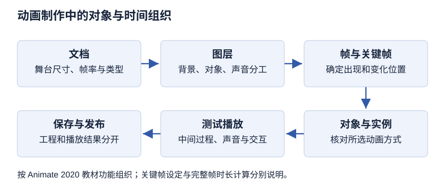

# 第 7 章 计算机动画制作技术

> 大纲定位：刘成明、石磊主编《多媒体技术及应用（第三版）》（清华大学出版社，2021 年）。复习范围结合江苏省高等教育自学考试 13511《多媒体技术与应用》大纲（江南大学编，2024 年）第 8至9 页所列本章范围。以下是独立组织的学习讲解与自编任务，不代表现行考试公告或当前软件操作指南。

!!! warning "学习草稿 · OCR 尚未终校"

    来源成书稿尚未逐字终校。软件操作需在对应版本中实测；来源疑点不作为唯一标准答案。自编练习用于本章复习。

## 复习导航

| 复习条目 | 层次 | 讲解 | 自编练习 |
| --- | --- | --- | --- |
| 动画原理、分类与文件格式 | 识记 | [第 1 节](#s1) | 1 |
| 动画原理的教材边界 | 领会 | [第 2 节](#s2) | 1 |
| Animate 工作界面与文档 | 领会、简单应用 | [第 3 节](#s3) | 2、7 |
| 绘图与文本操作 | 简单应用 | [第 4 节](#s4) | 2 |
| 时间轴、帧与帧率 | 识记、领会、简单应用 | [第 5 节](#s5) | 3、8 |
| 动作补间与形状补间 | 简单应用 | [第 6 节](#s6) | 4 |
| 遮罩、引导和骨骼动画 | 领会、简单应用 | [第 7 节](#s7) | 4 |
| Animate 声音、视频与交互 | 领会、简单应用 | [第 8 节](#s8) | 5 |
| Maya 三维动画流程 | 领会、综合应用 | [第 9 节](#s9) | 6 |
| 公式、条件与步骤 | 简单应用 | [第 10 节](#s10) | 3 |

## 1 动画原理、分类与文件格式 {#s1}

教材把计算机动画概括为连续播放静止图像以产生景物运动效果。教材按不同维度分类：表现形式分“完善动画”和“局限动画”；空间视觉效果分二维、三维；播放效果分顺序动画、交互式动画；每秒播放幅数分全动画（教材写每秒 24 帧）和半动画（少于 24 帧）；控制方式分实时/算法动画与逐帧/关键帧动画。分类维度不能混为同一组互斥类型。

教材列举 GIF（点阵、支持动画但无声音）、FLI/FLC（FLIC）、SWF（矢量动画）和 AVI（音视频交错）等格式。此表反映教材内容，不是当前平台兼容性指南。

教材列举的制作软件包括 Animate、Maya、3ds Max 等。复习时把软件、制作方法与输出格式分别登记：软件名不能直接说明作品是逐帧还是补间，也不能保证指定终端能够播放输出文件。软件名称与功能介绍均限于教材版本。

## 2 动画原理的教材边界 {#s2}

教材以人眼看到画面后短时保留视觉印象来解释连续画面的运动观感，并给出 1/24 秒这一数值。这里记录的是教材说法；不把该简化表述当成经过本笔记独立验证的视觉科学定律，也不据此推导所有显示设备或动画的必要帧率。相关选择题只可回答“按教材术语”，并注明教材归属。

## 3 Animate 工作界面与文档 {#s3}

Animate 2020 的舞台承载当前画面，时间轴组织图层与帧，库用于管理元件和导入资源，属性面板用于查看与设置当前文档或所选对象。应先辨认正在编辑的是文档、图层、帧还是对象，再解释操作结果。

文档基本操作按教材组织为：新建文档并设置属性 → 制作内容 → 保存工程 → 再次打开继续编辑。书中区分 FLA 工程与 SWF 播放文件；保存可编辑工程不等于完成发布。这里保留教材格式关系，不据此推断当前浏览器支持 SWF。

**自编检查。** 打开工程后确认舞台、帧率、图层和资源是否符合原设置；另行测试播放结果。指定版本的软件尚未实测，不能把操作整理当成成果验收。

**自编文档任务。** 用 Animate 2020 制作“场馆开放提示”画面：新建文档并登记舞台尺寸、帧率，将背景、指示标记与标题分层，给图层命名。选中文档和选中标题各查看一次属性面板，说明设置对象的区别；保存 FLA，关闭后重开，检查图层、文字与资源。此任务待实测。

## 4 绘图与文本操作 {#s4}

教材以直线、椭圆、矩形、多角星等工具绘制简单图形，以钢笔、铅笔等完成较复杂路径，并介绍图形变换。文字部分介绍文本创建、属性和变换。

| 任务 | 处理顺序（学习归纳） | 操作后检查 |
| --- | --- | --- |
| 基本图形 | 选工具，设描边或填充，绘制 | 形状、大小、颜色及所在图层 |
| 路径与变换 | 选择对象，编辑路径或做变换 | 选区是否正确，形状是否符合目标 |
| 文字 | 选择文本类型，输入，设置属性 | 字体、字号、颜色、排列与文本框 |
| 文本变换 | 按示例分离或变换所选文字 | 是否仍需保留可编辑文字副本 |

静态文本与动态文本按教材用途区分，不能仅凭画面是否移动判断。绘图和文本是后续动画的素材制作；要让内容随时间变化，还需安排图层、关键帧与动画机制。

## 5 时间轴、帧与帧率 {#s5}

时间轴组织图层、帧和播放头；动画的播放长度以帧组织，时间轴显示帧编号与当前帧率。普通帧延续同一内容；关键帧定义内容或变化；空白关键帧不继承左侧帧内容。Animate 2020 中教材给出的快捷键为 F5 插入帧、F6 插入关键帧、F7 插入空白关键帧（PDF 第 186 页）。

逐帧动画为连续关键帧逐一建立内容，适合每帧内容变化较大的细致动作，但制作工作和输出文件量也会增加（PDF 第 188至189 页）。教材例子在倒计时工程中把帧速率设为 10.00 fps（PDF 第 190 页）。

### 帧类型与逐帧任务

| 帧类型 | 内容作用 | 自编观察点 |
| --- | --- | --- |
| 普通帧 | 延续已有内容 | 画面持续但时间轴仍占帧 |
| 关键帧 | 定义内容或变化 | 修改此处所控制的内容 |
| 空白关键帧 | 不继承左侧内容 | 需要另行建立画面 |

**自编操作。** 为“闭馆提示”绘制三个依次出现的标记，在连续关键帧分别建立内容，再用普通帧延长最后一个标记的停留。插入空白关键帧前保存一个版本，对比插入前后的画面；同时记录帧数与帧率。逐帧动画的变化来自各关键帧内容，普通帧承担延续，二者不能只凭画面看起来静止而混淆。操作待 Animate 2020 实测。

## 6 动作补间与形状补间 {#s6}

教材用动作补间表现实例/组/文字的位置、大小、旋转、倾斜，以及颜色或淡入淡出变化；通常设置关键帧对象，软件生成中间变化。教材示例“弹簧振子”将底座、弹簧、滑块分层并转成元件，再在不同帧设置位置/尺寸、创建传统补间。原书称动作补间也叫动画补间；题目中应保留这一教材用语。

教材以“几何切面”演示在关键帧中绘制不同形状并创建补间形状。复杂变化可加形状提示，起始与结束关键帧的提示点须按一致逻辑对应；复杂补间宜设置中间形状。教材提到“角形/分布式”混合方式及缓动参数。

**学习辨析。** 需要移动、缩放、旋转或改变元件实例属性时优先归入动作补间；需要形状本身逐渐变形时归入形状补间。此为按教材示例整理的辨析方法，实际软件约束以 Animate 2020 教材流程为限。

**自编对照任务。** 在独立图层上分别制作“指示标记横向移动”和“色块轮廓渐变”。前者先确认元件实例或其他符合教材动作补间条件的对象，再设首末状态；后者检查形状补间的对象条件并建立不同轮廓。预览时同时看端点和中间帧，记录出现跳变时的对象、关键帧及补间类型。任务待 Animate 2020 实测，不沿用教材实例的构图。

## 7 遮罩、引导和骨骼动画 {#s7}

教材把遮罩层描述为通过遮罩对象显示关联被遮罩图层内容的特殊图层效果。所举“地球自转”示例由圆形遮罩呈现横向移动、首尾相接的地图。原书还指出遮罩实心对象类型与线条的限制。p.200关于未关联图层不可见的句子已回扫描确认，属于原书语义疑点；未实测前不将改写当作一般软件规律。

普通引导层辅助静态定位；传统运动引导层用于绘制运动路径，被引导层对象沿路径运动，引导层本身发布时不显示。教材“地球公转”实例包含轨道路径、影片剪辑实例、引导层、帧位置对齐和测试播放等步骤。

Animate 高级动画部分将骨骼反向动画列为动画种类之一；Maya 流程部分将骨骼用于角色模型装配，并提到 IK、FK、控制器及驱动关键帧。教材未在本章提供完整的 Animate 骨骼动画实操教程，因此笔记只整理概念范围；不补写未见的 Animate 骨骼工具步骤。

**自编高级动画任务。** 用矩形窗口显示横向移动的彩条，分别保存遮罩形状、被遮罩图层和关联关系；再为另一标记建立弯曲引导路径，检查路径与动画所在帧区间及对象位置。预览和发布结果分别记录。原书关于未关联图层的疑点单独观察，不能用预期代替软件结果；本任务不包含骨骼教程，待实测。

## 8 Animate 声音、视频与交互 {#s8}

教材把声音同步分为事件声音和音频流：事件声音常用于按钮音效，音频流与时间轴同步，常用于背景音乐。声音可导入库，再放到单独图层；属性面板可设置效果和同步方式。原书列出的同步属性选项还包括“开始”“停止”“重复”“循环”。菜单路径依教材版本记录。

教材介绍在 Animate 2020 中导入视频、选择外观并完成导入，再在属性/组件参数中设置实例位置、大小和播放器参数。书中关于视频转换、发布格式的描述属于该版本工作流，不能泛化为今日格式支持结论。

ActionScript 可赋予帧、影片剪辑实例和按钮动作。按钮元件包括弹起、指针、按下、点击四个状态；“点击”用于设置响应热区。实例演示了同场景帧间和不同场景间的跳转。代码、场景命名和发布行为均须按 Animate 2020 / ActionScript 3.0 语境理解，不在本笔记中承诺现代运行环境兼容。

**自编交互任务。** 为“开始说明”按钮制作可辨认的状态，登记可见图形与点击热区；导入自行录制的短旁白和视频，逐项测试单击、重复单击、播放结束及停止或跳转。记录声音的同步方式、视频实例及动作所在对象。保留工程、测试记录和发布结果；具体动作须在教材文档类型与 ActionScript 3.0 环境中实测，不能从按钮外观推定事件已执行。

## 9 Maya 三维动画流程 {#s9}

教材列两层流程：动画前期含剧本、文字/画面分镜、角色/场景/道具设计；三维生产流程概括为建模、材质、骨骼、动画、灯光、渲染、后期。细分说明模型绑定骨骼后制作角色动作；渲染输出序列图，再在后期环节合成、剪辑并输出。实例为 Maya 2020 中制作跳动小球。

**自编归纳。** 复述题按“前期策划 → 三维资产和绑定 → 动画与灯光/材质 → 渲染 → 后期合成输出”分阶段组织，避免把 Maya 建模步骤和影片后期混为一项。

**自编三维任务。** 在 Maya 2020 中制作一块移动的方向指示牌：建立简单模型，设置材质和灯光，在不同时间点设置位移关键帧，预览运动，再渲染并整理后期输出。分别提交模型状态、关键帧位置、预览观察与输出检查记录。该场景只使用成书所述流程及关键帧操作，不复用教材跳动小球的场景或步骤数据；任务待实测，不据此宣称已完成角色绑定训练。

## 10 公式、条件与步骤 {#s10}

**自编计算关系。** 在帧率恒定且每帧按完整帧时长计的简单场景，可用“播放时长（秒）=帧数÷帧率（帧/秒）”估算。例如 120 帧、24 fps 对应 5 秒。该算式是基于帧率定义的学习推算，不是教材明列公式；实际工程可能还涉及首末帧计数、时间线区间和导出设置，需按题目约定说明。

## 本章小结

- 动画分类按制作方式、空间、播放与控制等维度分别说明；教材视觉暂留的简化叙述不扩展成所有显示系统的必要帧率规律。
- 文档、图层、帧和对象分层管理；位置运动、轮廓变形、路径与遮罩各有控制条件，改变帧率不代替这些设计。
- 恒定帧率且每帧完整计时才用帧数÷帧率求时长；工程保存、发布和完整播放验证分开记录，历史格式支持不作当前承诺。

## 自编练习

**1. 展览同时使用实景录像和逐帧制作的示意动画。请分别记录制作方式、空间表现与输出格式，并解释为何不能只看播放文件扩展名就判断制作过程。**

考点：第 1、2 节；层次：识记、领会。

**答案：** 制作方式、二维或三维的空间表现以及输出格式属于不同观察维度。动画可以由连续画面表现变化，但播放文件不保存全部制作历史。应查项目、素材和制作流程；教材关于视觉暂留的表述按其教学语境理解，不把一个术语当作全部视觉机制的定论。

**2. 同一段动画中的标题需要反复修改，而背景与角色应分别调整。为文档、图层、图形和文本安排组织方式；保存工作文档与发布动画各保留什么？**

考点：第 3、4 节；层次：简单应用。

**答案：** 先定义文档尺寸和制作要求，按内容职责分开组织背景、角色与标题；标题保留为便于编辑的文本对象，调整位置与格式时避免误改其他内容。保留可继续编辑的文档，同时另存面向播放的发布结果；二者不能互相替代。

**3. 一段时间轴从第1帧到第36帧，共36帧，按12帧/秒完整播放一次。求时长。若若干帧沿用同一画面，是否会因此减少时间轴长度？**

考点：第 5、10 节；层次：识记、简单应用。

**答案：** 在本题“共36帧”的计数约定下，时长为36÷12=3秒。相同画面可以在多个帧位置持续显示，它不自动删除时间轴上的帧；要缩短时长，需改变实际帧数或播放帧率，而不是仅观察画面是否变化。

**4. 一个对象沿曲线路径移动，另一个图形逐渐改变轮廓，还要让移动对象只在指定区域显露。分别确定需要解决的运动、形状和可见范围问题。**

考点：第 6、7 节；层次：领会、简单应用。

**答案：** 路径运动关注位置沿指定路线变化，可结合引导路径与适当补间；轮廓改变要按形状补间的对象条件设计；指定区域显露则涉及遮罩层与被遮罩内容。三个要求分属不同控制任务，不应以一个补间名称代替全部设计。

**5. 交互动画含开始按钮、旁白和视频片段。设计预览检查记录，说明哪些事件和时间关系必须验证，避免只检查画面第一帧。**

考点：第 8 节；层次：领会、简单应用。

**答案：** 应检查按钮触发后播放是否开始、重复触发的行为、旁白与画面的对应、视频片段的进入与结束，以及需要的停止或跳转。记录触发条件、预期动作与实际结果。声音、视频导入成功不表示交互逻辑与时间关系都正确，仍须实际预览。

**6. 三维动画已经建好模型，但最终画面仍缺少表面效果和可用镜头。将建模、材质、灯光、动画和渲染放入制作检查单，并说明一次渲染输出为何不等于整个三维项目都已验证。**

考点：第 9 节；层次：领会、综合应用。

**答案：** 建模解决形体，材质描述表面，灯光影响场景照明，动画组织随时间变化的动作，镜头决定观察方式，渲染形成输出画面。应分别检查静态外观和完整时间段，输出结果只是某些设置与时间点的结果；还需检查运动、镜头和连续播放，软件操作需实测。

**7. 制作者想改文档帧率，却一直选中舞台上的标题并修改文本属性。为什么属性面板中看到的设置没有达到目标？应先判断什么？**

考点：第 3 节；层次：领会。

**答案：** 属性面板随当前文档或所选对象显示相应设置。标题的字号、颜色等属于文本对象，文档帧率属于文档条件。应先辨明当前选择对象与要修改的层次，再进入相应文档设置；不能把面板名称相同理解为其中每项设置都作用于整个文档。

**8. 为提示灯逐次改变外观时，为什么要建立相应关键帧？如果只在末端增加普通帧，通常完成了什么任务？给出需要检查的时间轴内容。**

考点：第 5 节；层次：识记、领会、简单应用。

**答案：** 逐帧变化需要在相应关键帧中建立不同内容。普通帧用于延续已有内容，仅增加普通帧通常延长当前画面的持续时间，并未逐一建立新外观。应核查关键帧位置及内容、普通帧延续区间、空白关键帧是否造成空画面，并结合帧率预览整个时间段。
