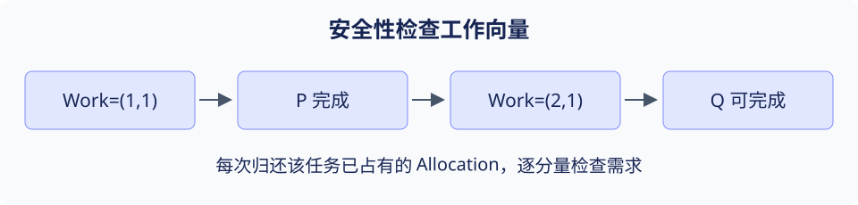

# 第 3 章 进程调度与死锁

> 大纲定位：《操作系统概论》（2017 年版）配套自学考试大纲。

## 复习导航

| 大纲条目索引 | 层次 | 讲解 | 自编练习 |
| --- | --- | --- | --- |
| 1.1 进程调度功能、1.2 调度时机 | 识记 | [第 1 节](#s1) | 1 |
| 2.1 选择准则 | 识记 | [第 2 节](#s2) | 1 |
| 2.2 周转、平均周转、平均带权周转 | 简单应用 | [第 3 节](#s3) | 2 |
| 2.3 六种算法及抢占时机 | 领会 | [第 4 节](#s4) | 1、2 |
| 2.4 实时条件、EDF、LLF | 领会 | [第 5 节](#s5) | 3 |
| 2.5 多处理机类型、分配与调度 | 识记 | [第 6 节](#s6) | 4 |
| 3.1–3.3 死锁定义、原因、必要条件 | 领会 | [第 7 节](#s7) | 5 |
| 4.1 死锁预防 | 识记 | [第 8 节](#s8) | 5 |
| 4.2 安全／不安全状态 | 识记 | [第 9 节](#s9) | 6 |
| 4.2 银行家算法 | 简单应用 | [第 10 节](#s10) | 6 |
| 4.3 检测、解除，死锁定理 | 识记 | [第 11 节](#s11) | 5 |

## 1 调度入口与任务选择 {#s1}

调度器从可运行任务中选择下一位执行者，分派机制完成必要的现场切换。任务退出、因 I/O 阻塞，或可抢占系统中的时间片到期、高优先级任务变为就绪，都可能成为调度入口。不可抢占方案要等当前任务主动交出 CPU 或结束当前运行阶段。

比较算法时先固定单核还是多核、是否抢占、是否考虑切换成本、同一时刻事件的处理顺序，再画时间线。

## 2 评价目标 {#s2}

吞吐率计算单位时间完成的任务数，响应时间关注首次获得服务的等待，周转时间关注从提交到完成的全过程。CPU 利用率、截止期限、公平性和开销也影响选择，不能只优化一个均值便声称所有任务获益。

交互任务可能优先响应，批处理可能关注吞吐，实时控制则要求满足期限。即使平均值相同，个别任务的长时间等待仍值得检查。

## 3 周转与带权周转 {#s3}

对任务 $i$，周转时间 $T_i=C_i-A_i$，带权周转时间 $W_i=T_i/S_i$；$C_i$ 是完成时刻，$A_i$ 是到达时刻，$S_i$ 是服务需求。平均值分别对 $T_i$、$W_i$ 求算术平均。等待时间在无 I/O 的题设下可用 $T_i-S_i$ 得到，不能把响应时间与周转时间互换。

自编算例：A、B、C 分别在时刻 0、1、2 到达，服务时间为 4、2、1。FCFS 的执行顺序是 A[0,4)、B[4,6)、C[6,7)，完成时刻为 4、6、7，周转时间为 4、5、5，平均为 $14/3$；带权值为 1、2.5、5，平均为 $17/6$。

[进程调度实验](../../labs/scheduling.md)提供另一组输入的完整周转时间表，可再切换 SPF 与 RR 比较。

## 4 六种调度思路 {#s4}

FCFS 按到达顺序服务；短作业优先在就绪集合中选择预计服务最短者，较长作业可能饥饿；最短剩余时间是可抢占的相近思路，但不应与不可抢占 SPF 混为一谈。高响应比优先在调度时比较 $R=(等待时间+服务时间)/服务时间$，等待会提升比值。

时间片轮转把就绪队列按时间配额循环服务；优先级调度按规定优先级选取，可配合老化；多级反馈队列利用不同队列与配额调整任务位置。

## 5 实时调度 {#s5}

EDF 选择绝对截止时间最近的就绪任务。LLF 比较松弛度 $L=截止时刻-当前时刻-剩余执行时间$，选择余量最小者。某任务的松弛度为负，说明在当前模型下已不能按时完成；为零表示不能再无故推迟。

在独立周期任务、单核、可抢占、忽略开销且相对截止期等于周期等特定条件下，EDF 的利用率分析可简化；题设未给这些条件时，不能只凭利用率小于 1 就断言任何任务集都可调度。

## 6 多处理机调度 {#s6}

可按处理器是否同构、任务分配是否固定以及是否允许迁移分类。全局队列便于调配负载，处理器私有队列有利于亲和性；迁移可能破坏缓存局部性。主从式组织集中分派职责，对称式组织允许处理器参与调度，具体方案还需协调共享状态。

自调度由空闲处理器领取任务；成组调度使相关线程同步推进；专用处理器分配为任务保留处理器资源。

## 7 死锁与必要条件 {#s7}

死锁中的任务相互等待，而所需事件只能由等待集合中的其他任务产生。常见必要条件是互斥、占有并等待、不可剥夺和循环等待。只发现任务正在等待不能证明死锁；还要检查是否存在集合之外能打破等待的完成事件。

资源分配图用任务到资源的边表示请求，用资源到任务的边表示已分配。每类资源只有一个实例时，环有更强的判定作用；有多个实例时，存在环本身不足以认定死锁。

## 8 预防 {#s8}

预防在设计时破坏必要条件，例如一次申请全部资源破坏占有并等待，统一资源申请顺序破坏循环等待，允许安全回收某类资源破坏不可剥夺。不是所有资源都可随意剥夺，打印到一半的输出也不能当成普通内存值恢复。

预防减少某些等待结构，也可能降低利用率或限制并发。

## 9 安全性 {#s9}

安全状态意味着存在一个完成顺序，使每个任务都能在其他任务按该顺序完成并释放资源后获得其剩余最大需求。不安全表示无法作出这种保证，并不意味着当前已经死锁。这里依赖最大需求声明及完成后释放资源的模型。

判断安全序列必须同时比较所有资源分量，不能只比较需求总和；不同类别的资源通常不能互相替代。

## 10 银行家算法 {#s10}

先计算 $Need=Max-Allocation$。处理一个请求时按固定顺序检查：若 `Request > Need`，说明进程超过了自己的最大声明；若 `Request > Available`，只能等待，不能试分配。两个条件都满足时，暂时执行 `Available -= Request`、`Allocation += Request`、`Need -= Request`，再用新的 `Work=Available` 运行安全性检查。只有所有进程都能找到完成顺序才正式批准；检验失败时恢复这三个向量，不能仅因为资源当前足够便批准。

自编安全性检查过程表：设 Available=(1,1)，P 的 Allocation=(1,0)、Need=(0,1)，Q 的 Allocation=(0,1)、Need=(2,0)。初始 Work=(1,1)，P 可完成，Work+Allocation=(2,1)；随后 Q 可完成，Work=(2,2)。序列 P、Q 说明状态安全。更新 Work 时加回 Allocation，不是 Max 或 Need。

在[银行家算法练习](../../labs/banker.md)中修改请求，比较原状态的安全序列与试分配后的 Work。

## 11 检测与解除 {#s11}

检测检查当前实际请求与已分配资源，避免算法则用最大需求判断试分配后的风险。可反复选择请求能被当前工作向量满足的任务，假定它完成并归还资源；无法继续化简时，再分析剩余集合。检测用的请求不应直接替换成最大剩余需求。

解除可终止部分任务或回收适合剥夺的资源；选择对象要考虑损失、恢复点与饥饿。

## 自编练习

**1. 构建批处理与互动终端共用的调度方案时，为什么不能只比较吞吐率？何时允许从运行任务手中抢占 CPU？**

考点：第 1、2、4 节；层次：识记、领会。

**答案：** 吞吐率未体现首次响应、公平和极端等待；需要同时观察用户交互延迟。抢占必须是系统与算法允许的行为，例如时间片到期或更紧迫任务到达，不能把不可抢占算法在任意到达时重排。

**2. 任务 A、B、C 的到达时刻是 0、1、2，服务时间是 4、2、1。求 FCFS 与不可抢占 SPF 的平均周转时间。**

考点：第 3、4 节；层次：简单应用。

**答案：** FCFS 完成时刻 4、6、7，平均周转时间 $14/3$。SPF 在 0 时刻只有 A 就绪，先执行 A，再执行 C[4,5)、B[5,7)，A、B、C 的周转时间为 4、6、3，平均 $13/3$。不能把 C 放到尚未到达的时刻运行。

**3. 时刻 5，任务 X 截止于 13、还需 4 单位，任务 Y 截止于 11、还需 1 单位。EDF 与 LLF 各选择谁？**

考点：第 5 节；层次：领会。

**答案：** EDF 选 Y，因为其截止更近。X 的松弛度为 4，Y 为 5，LLF 选 X。两个规则比较的不是同一指标。

**4. 相互频繁通信的线程散落在多核私有队列中，为什么可能需要成组调度？**

考点：第 6 节；层次：识记、领会。

**答案：** 一个线程等待伙伴时，伙伴若迟迟未被调度，可能浪费运行机会；成组调度使相关线程有机会同步推进，但会带来处理器协调和资源保留代价。

**5. 两任务分别持有一种资源并申请对方持有的资源。怎样用全局编号规则防止这一结构？该措施属于哪一类？**

考点：第 7、8、11 节；层次：识记、领会。

**答案：** 要求所有任务按资源编号递增申请，使循环等待无法形成，属于预防。检测是在分配后查等待关系，解除则在发现问题后回收或终止，不能混称。

**6. 按本章自编表的数据写出安全序列，并判断能否用资源需求总和替代逐分量比较。**

考点：第 9、10 节；层次：简单应用。

**答案：** 初始 Work=(1,1)，P 完成归还 (1,0)，得到 (2,1)，再让 Q 完成，得到 (2,2)。不能只比总和；例如 (2,0) 无法用 (1,1) 直接满足。
