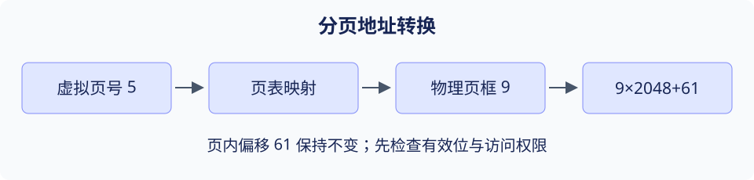

# 第 4 章 内存管理

> 大纲定位：《操作系统概论》（2017 年版）配套自学考试大纲。条目编号用于复习定位，不代表当前考试政策。本文讲解、算例与练习由项目独立编写；练习不标作教材原题或历年真题。

## 复习导航

| 大纲条目索引 | 层次 | 讲解 | 自编练习 |
| --- | --- | --- | --- |
| 1.1–1.2 层次、局部性 | 识记 | [第 1 节](#s1) | 1 |
| 2.1–2.3 链接与装入 | 领会 | [第 2 节](#s2) | 1 |
| 3.1–3.3 连续分配与动态分区 | 识记、简单应用 | [第 3 节](#s3) | 2 |
| 4.1–4.2 页、页框、页表与地址映射 | 识记、综合应用 | [第 4 节](#s4) | 3 |
| 4.3 快表（TLB） | 领会 | [第 5 节](#s5) | 3 |
| 4.4 二级分页 | 综合应用 | [第 6 节](#s6) | 4 |
| 4.5–4.6 分段、段页式 | 领会 | [第 7 节](#s7) | 4 |
| 5.1–5.2 虚拟存储与请求分页硬件 | 识记、领会 | [第 8 节](#s8) | 3 |
| 5.3–5.4 页框分配 | 识记 | [第 9 节](#s9) | 5 |
| 5.5 页面置换 | 领会 | [第 10 节](#s10) | 5 |
| 5.6–5.7 缺页性能、工作集与抖动 | 领会、识记 | [第 11 节](#s11) | 5 |
| 6.1–6.3 伙伴系统 | 领会 | [第 12 节](#s12) | 6 |

## 1 层次与局部性 {#s1}

寄存器、Cache、主存和外存分担速度、容量与成本的约束。时间局部性表示近期访问过的对象可能再被访问；空间局部性表示相邻位置可能随后被访问。局部性是工作负载的性质，存储层次利用它，但不能保证所有程序都命中高速层。

顺序扫描数组通常具有空间局部性，循环复用少量变量通常具有时间局部性。分析性能时还要考虑工作集大小、访问步长和数据布局。

## 2 链接、装入与重定位 {#s2}

编译产生目标模块，链接解决模块间符号引用并组织地址，装入使程序获得运行所需的内存映射。静态链接在运行前组合依赖；动态链接允许在装入或运行过程中解析部分依赖，但仍须匹配接口与符号规则。

绝对装入依赖指定位置；可重定位装入调整地址相关内容；运行时地址转换把逻辑地址映射到物理位置。区分符号解析和执行时地址映射，不要把链接器当成页表硬件。

## 3 连续分配 {#s3}

固定分区预先划定大小，分区内部可能留有不能给其他任务使用的空间；动态分区按请求切分空闲区，释放后要尝试合并相邻空闲区，仍可能出现外部碎片。紧凑能移动已分配区域，但需要支持重定位且有搬移成本。

自编算例：按低地址到高地址排列的空闲区大小是 14、27、19 KiB，请求 18 KiB。首次适应选择 27，最佳适应选择 19，最坏适应选择 27；剩余空间分别为 9、1、9 KiB。首次适应的首次依赖扫描起点与链表顺序。

## 4 页与地址变换 {#s4}

分页把虚拟地址空间分为等大的页，把物理内存分为同样大小的页框。页表记录映射及保护状态。地址拆成页号与页内偏移，页号用于查表，偏移在映射前后保持不变。若每页 $2^k$ B，按字节编址地址 A 的页号为 $\lfloor A/2^k\rfloor$，偏移为 $A\bmod 2^k$。

自编算例：页大小 2048 B，虚拟地址 10301 属于页 5，偏移 61。若页 5 映射到页框 9，则物理地址是 $9×2048+61=18493$。页表项无效时必须按其含义处理，不能把无效项的数值当成页框直接使用。

[分页地址转换练习](../../labs/address.md)可分别核对驻留、缺页与越界时的处理。

## 5 TLB 与访存代价 {#s5}

TLB 缓存近期地址转换。命中时可减少页表访问，未命中时查页表并按规则填入。TLB 未命中不等于缺页：页仍可能在主存，只是映射不在 TLB。权限检查也不能因缓存命中而省略。

用题设的串行模型计算：TLB 查询 2 ns，主存访问 60 ns，单级页表，命中率 95%，忽略缺页。命中用时 62 ns，未命中用时 122 ns，平均 $0.95×62+0.05×122=65$ ns。若题设允许查找重叠，必须另建时间模型。

## 6 两级页表 {#s6}

两级分页把页号进一步分成目录号与表内索引，避免为未使用的全部地址范围都保留末级页表。按字节编址的 32 位地址、4 KiB 页、4 B 页表项模型中，偏移占 12 位，一页可放 1024 个表项，常用拆分为 10 位目录、10 位页表、12 位偏移。

没有 TLB 命中时，普通内存操作可能先访问目录，再访问页表，最后访问目标数据。页表级数与实际访存次数必须结合缓存、是否有效及题设统计口径判断。

## 7 分段与段页式 {#s7}

分段以代码、数据等逻辑单位组织可变长度区域。逻辑地址由段号和段内位移组成，先检查段界限，再用段基址加位移形成地址。若段长为 L，合法位移通常是 $0\le d<L$，不是 $d\le L$。

段页式先定位某段的页表，再按页号和偏移转换。它结合逻辑分段与物理分页，但需要更多映射结构。页表与段表都可实施保护，不能只按是否连续概括全部功能。

## 8 虚拟存储与缺页 {#s8}

虚拟存储让程序按受保护的虚拟地址使用空间，不要求全部页同时驻留。请求分页在访问尚未驻留而又合法的页时触发缺页异常，内核检查合法性，准备页框，必要时回写脏页，调入目标页并更新映射，再恢复导致缺页的指令。

反差算例：虚拟页 2 未驻留，但它的内容在后备存储中，可能正常调入；地址超出合法映射范围则不能靠再分配一页自动修复。倒排页表按物理页框记录占用者，查找虚拟页可能借助哈希；哈希是索引手段，不改变页内偏移。

## 9 页框分配与调入策略 {#s9}

固定分配给进程相对稳定的页框数，可变分配随运行情况调整。局部置换从该进程的页框中选牺牲页，全局置换可影响其他进程。把分配数量与置换范围分开，才能讨论某个进程的缺页是否干扰他人。

请求调页在需要时调入，预调页尝试提前装入可能使用的页。预调错误会增加 I/O 和占用，因此要结合局部性及内存压力判断。

## 10 页面置换 {#s10}

OPT 选择未来最晚再用的页，是已知完整访问序列时的比较基准；FIFO 按进入内存次序淘汰；LRU 淘汰最近最久未访问者；Clock 以引用位近似近期使用信息。命中后是否改变队列或引用位，是各算法的组成部分。

自编状态演进表：3 个初始空页框，访问 2、3、4、2、5、3、6。FIFO 在前三次填满后，命中 2 不改变装入顺序，访问 5 淘汰 2，最后访问 6 淘汰 3，共缺页 5 次；LRU 命中 2 后更新最近次序，访问 5 淘汰 3，随后 3、6 都缺页，共 6 次。LRU 并非对每条给定序列都优于 FIFO。

[页面置换练习](../../labs/paging.md)列出了同一访问串在 FIFO、LRU 与 OPT 下的逐步页框状态。

## 11 性能、工作集与抖动 {#s11}

有效访存时间必须统一单位，并把缺页服务代价纳入。若普通访问 80 ns，缺页概率为 $10^{-5}$，一次缺页含恢复及完成该次访问共 4 ms，则平均约为 $(1-10^{-5})×80+10^{-5}×4,000,000=119.9992$ ns。小概率乘以大代价仍可能显著。

工作集描述某个观察窗口内实际用过的页。频繁缺页、调页占据大部分时间而有效执行很少称为抖动；增加并发进程数可能加重内存竞争。可减少并发、调整页框或改进访问局部性。

## 12 伙伴系统 {#s12}

伙伴系统按 2 的幂次管理块。请求向上取整到合适阶，必要时把大块反复二分；释放时只与同阶且空闲的伙伴合并。邻接不充分，伙伴关系还依赖对齐和块大小。

在从 0 开始的 32 KiB 区域中，申请 6 KiB 需要 8 KiB 块；若占据 [0,8)，它的伙伴是 [8,16)。即使 [16,24) 也空闲，也不能与 [0,8) 直接合成一个 16 KiB 伙伴块。

## 自编练习

**1. 程序已完成链接，为何运行时仍需要地址转换？顺序扫描与反复访问少量元素分别更能利用哪类局部性？**

考点：第 1、2 节；层次：识记、领会。

**答案：** 链接解决模块组合和符号引用，运行时映射仍要把虚拟位置转换到实际物理位置并检查保护。顺序扫描体现空间局部性，短时间反复使用同组元素体现时间局部性。

**2. 空闲区按地址排列为 14、27、19 KiB，请求 18 KiB；若随后释放其前后邻区，分配和回收分别应检查什么？**

考点：第 3 节；层次：简单应用。

**答案：** 首次适应与最坏适应选 27，最佳适应选 19。回收需按地址检查相邻且空闲的区域并合并，不能仅把大小相同的区域拼在一起。

**3. 页大小为 2048 B，虚拟地址 10301 映射到页框 9。求物理地址；再说明 TLB 未命中能否据此判断缺页。**

考点：第 4、5、8 节；层次：综合应用、领会。

**答案：** 页号 5、偏移 61，物理地址 18493。TLB 未命中只说明转换缓存中没有该项，必须查页表；只有合法页尚未驻留等缺页条件才进入调页处理。

**4. 32 位字节地址、4 KiB 页、4 B 页表项的两级模型如何分位？若某段长 2048 B，位移 2048 是否合法？**

考点：第 6、7 节；层次：综合应用、领会。

**答案：** 每张末级表占一页时可拆为 10/10/12 位。段内最大合法位移为 2047，位移 2048 越界；地址长度与段界限是不同检查。

**5. 对序列 2、3、4、2、5、3、6，使用 3 个初始空页框，比较 FIFO 与 LRU；局部置换能否直接夺走另一进程页框？**

考点：第 9、10、11 节；层次：领会。

**答案：** FIFO 缺页 5 次，LRU 缺页 6 次。FIFO 命中不更新装入顺序，LRU 命中更新近期使用顺序。按局部置换定义，牺牲页限于当前进程的驻留集合；页框不足仍可能抖动。

**6. 伙伴系统给 6 KiB 请求分配 8 KiB 块，实际用了多少内部余量？[0,8) 释放后能否与 [16,24) 合并？**

考点：第 12 节；层次：领会。

**答案：** 内部余量为 2 KiB。不可以；它的同阶伙伴是 [8,16)，合并还要求伙伴空闲。
