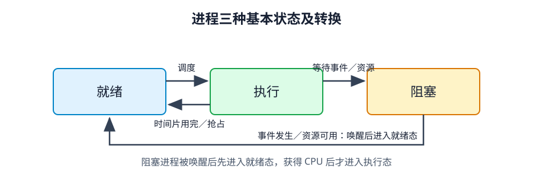
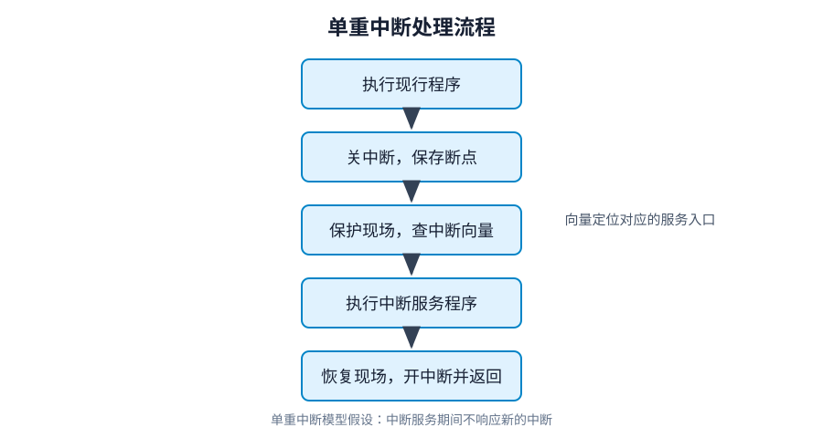
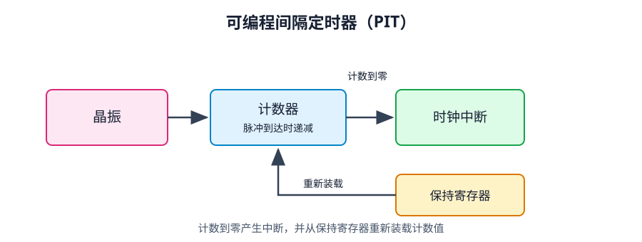
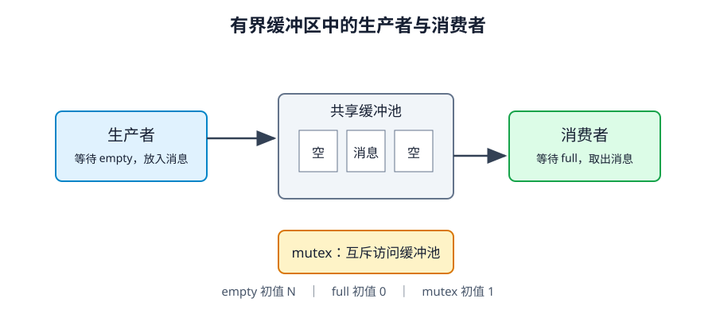

# 第 2 章 进程管理

> 依据：《操作系统概论（2017年版）》第二章、书前自学考试大纲、附录习题答案。编号沿用大纲“考核内容与考核要求”。代码为便于理解的伪代码；P＝wait，V＝signal。教材中的 Linux 版本和硬件实例用于说明原理，不代表当前实现。教材明确说明本章 Linux 内核代码不作为考试内容。

## 复习导航

| 大纲条目 | 层次 | 笔记位置与要求 |
|---|---|---|
| 1.1 顺序执行；1.2 并发执行 | 识记；领会 | 第 1 节：对比特点，解释结果为何可能不同 |
| 2.1 进程定义与结构；2.2 PCB | 识记 | 第 2 节：定义、组成、PCB 的作用与信息 |
| 2.3 三态及转换；2.4 组织 | 识记 | 第 3 节：状态、转换条件、链接与索引 |
| 3.1—3.4 进程控制 | 识记 | 第 4 节：创建、撤销、阻塞、唤醒的条件与步骤 |
| 4.1 内核；4.2 中断定义 | 识记 | 第 5 节：内核功能、中断含义 |
| 4.3 中断处理 | 领会 | 第 5 节：断点、现场、中断入口与返回 |
| 4.4 两种执行态、系统调用；4.5 调用过程 | 识记；领会 | 第 6 节：态转换及系统调用与函数调用的区别 |
| 4.6 时钟体系；4.7 时钟机制 | 识记；领会 | 第 7 节：RTC、PIT、时钟驱动程序 |
| 5.1 线程概念与比较；5.2 线程控制 | 领会 | 第 8 节：进程与线程、两种线程实现、控制过程 |
| 6.1 同步基本概念与四条准则 | 领会 | 第 9 节：临界资源、临界区与协调 |
| 6.2 整型信号量；6.3 记录型信号量 | 综合应用 | 第 10 节：会设初值、写 P/V、跟踪数值和阻塞 |
| 6.4 生产者—消费者、读者—写者 | 综合应用 | 第 11 节：能独立建立同步程序 |
| 6.5 管程及两类应用 | 领会 | 第 12 节：条件变量、缓冲池、哲学家进餐 |
| 6.6 进程通信 | 识记 | 第 13 节：共享存储器、管道、消息缓冲队列 |

重点：进程及其控制、内核机制、同步和线程。信号量部分结合代码理解。

## 1 顺序执行与并发执行（1.1、1.2）

| 执行方式 | 特点 | 理解 |
|---|---|---|
| 顺序执行 | 顺序性 | 前一操作结束，才能进行后一操作 |
| 顺序执行 | 封闭性 | 在教材的独占资源模型中，运行环境的资源状态仅由本程序改变 |
| 顺序执行 | 可再现性 | 初始条件和环境相同，重复执行得到相同结果 |
| 并发执行 | 间断性 | 因共享有限资源，执行过程可能暂停再继续 |
| 并发执行 | 失去封闭性 | 共享数据和系统状态可由其他进程改变 |
| 并发执行 | 不可再现性 | 缺乏适当控制时，指令交错顺序不同可能产生不同结果 |

并发指多个程序在同一时间间隔内推进；单核上是交替执行，不是同一时刻都在 CPU 上执行。

初值为 0，两个进程各执行一次 `counter++`。这条语句可能分成“读入寄存器、加 1、写回”三步。两个进程都先读到 0 时，最终值可能是 1；一个进程完成后另一个再读，最终值为 2。高级语言语句不一定是原子操作，并发也不等于必然出错。

## 2 进程与进程控制块（2.1、2.2）

**进程定义：** 进程是允许并发执行的程序在某个数据集合上的运行过程。也可从结构上描述为正文段、用户数据段和进程控制块共同组成的执行环境。

- 正文段：被执行的机器指令。
- 用户数据段：执行时直接操作的数据。
- PCB：描述运行环境，供操作系统管理和控制进程。

某一时刻进程内容的集合称为**进程映像**。进程的特征是并发性、动态性、独立性、异步性和结构特征。传统未引入线程的模型中，进程是独立运行及资源调度的基本单位；引入线程后，需要区分资源分配单位与调度单位。

| 比较 | 程序 | 进程 |
|---|---|---|
| 性质 | 静态指令集合 | 程序的一次动态执行过程 |
| 存在时间 | 可长期保存在外存 | 创建后存在，结束时撤销 |
| 实体 | 程序代码 | 正文段、用户数据段、PCB |
| 对应关系 | 同一程序可供多个进程执行 | 一个进程也可先后执行不同程序 |

**PCB（Process Control Block）** 包含描述进程情况及控制运行所需的信息，每个进程有唯一 PCB。PCB 是系统感知进程存在的唯一标志。

| 信息类别 | 主要内容 | 用途 |
|---|---|---|
| 标识符信息 | 本进程、父进程、子进程标识 | 识别进程及关系 |
| 处理机状态信息 | 通用寄存器、PC、PSW、栈指针等 | 保存与恢复执行现场 |
| 调度信息 | 状态、优先级、调度所需数据 | 决定何时运行、运行多久 |
| 控制信息 | 程序和数据地址、同步通信、资源清单、链接指针 | 管理资源、通信及队列 |

**领会：** CPU 寄存器由多个进程轮流使用。换出进程前保存寄存器值，换入时恢复，进程才可能从上次暂停处接着执行。

## 3 三种基本状态与进程组织（2.3、2.4）

| 状态 | 已满足的条件 | 还在等待什么 |
|---|---|---|
| 就绪态 | 具备运行条件 | CPU |
| 执行态 | 已获得 CPU | 正在执行 |
| 阻塞态 | 因资源或事件暂不能运行 | I/O 完成、数据到达、资源可用等 |



| 转换 | 原因 |
|---|---|
| 就绪 → 执行 | 被调度并获得 CPU |
| 执行 → 就绪 | 时间片用完或被抢占 |
| 执行 → 阻塞 | 等待资源或事件 |
| 阻塞 → 就绪 | 等待条件满足，被唤醒 |

唤醒只会使进程进入就绪态，不会立即运行。三态模型中没有“阻塞→执行”或“就绪→阻塞”的基本转换。单 CPU 同时只能有一个进程执行，N 个 CPU 最多有 N 个；就绪队列可以为空，也可以包含全部进程。

操作系统通过组织 PCB 来组织进程：**链接方式**利用 PCB 的链接字段，把同状态进程串成队列；**索引方式**按状态建立索引表，各表项指向 PCB。就绪队列可按优先级分成多个；阻塞队列可按等待原因分成多个。

## 4 进程控制（3.1—3.4）

| 操作 | 触发条件 | 教材的一般步骤 |
|---|---|---|
| 创建 | 用户登录、作业调度、提供服务、应用请求 | 申请空白 PCB → 分配资源 → 初始化 PCB → 插入就绪队列 |
| 阻塞 | 请求服务未满足、等待操作完成、数据未到达、等待消息等 | 状态改阻塞 → 插入相应阻塞队列 → 转进程调度 |
| 唤醒 | 所等待的事件发生或资源可用 | 移出阻塞队列 → 改就绪态 → 插入就绪队列 |
| 撤销 | 正常结束、其他进程请求终止等；异常也可能导致结束 | 读取状态 → 若在执行则停止 → 按系统策略处理子孙进程 → 释放资源 → 移出 PCB |

创建者为父进程，被创建者为子进程；同一父进程的子进程互为兄弟。父子可以并发执行，也可以父进程等待子进程。子进程地址空间可共享，也可独立，不能一概而论。

父进程终止时，系统可能级联终止子孙进程；UNIX 也可能把子进程交给其他进程接管，因此不能简单地说“父进程结束，子进程必结束”。`fork` 用于创建进程，`execve` 使现有进程执行新的程序代码。

## 5 操作系统内核与中断（4.1—4.3）

内核是计算机硬件的第一次扩充，执行与硬件密切相关、执行频率高的模块，常驻内存。其功能包括：

- 支撑功能：中断处理、时钟管理、原语操作。
- 资源管理功能：进程管理、存储器管理、设备管理。

**原语**是一组在执行过程中不能被中断的操作，强调原子性。应用程序的一般代码不自动具有这种性质。

**中断**是改变处理器执行指令顺序的一种事件。CPU 暂停当前程序，转去处理事件，之后按相应机制返回。中断支持 CPU 与设备并行工作，提高利用率，也支持系统异步性。

| 类型 | 来源 | 例子 |
|---|---|---|
| 同步中断／内部中断／异常 | 与当前指令执行有关 | 除零、溢出、调试等 |
| 异步中断／外部中断 | 外部硬件产生 | I/O 完成、时钟等 |
| 外部可屏蔽中断 | 可受中断屏蔽控制 | 常见 I/O 中断 |
| 外部不可屏蔽中断 | 紧急硬件事件 | 某些硬件故障 |

“关中断”不等于所有异常和不可屏蔽中断都不再响应。教材模型中，外部中断在一条指令执行完后检查；异常不一定发生在指令执行完毕之后。

**单重中断处理过程：** 本次处理期间不响应新的中断，教材假定处理后返回原断点。

1. 关中断，保护断点，保存下一条待执行指令地址。
2. 转入中断处理程序，保存相关寄存器等硬件上下文，即保护现场。
3. 根据中断向量查找入口信息，执行对应中断服务子例程。
4. 恢复现场、开中断，返回断点继续执行。



**断点与现场：** 断点主要回答“回到哪里”，现场回答“恢复哪些执行状态”。中断向量标识中断源，中断描述符表 IDT 保存入口相关信息；教材 32 位 x86 实例中表项地址为 `IDT 基址＋8×中断向量`，8 字节是该实例的表项大小。

## 6 用户态、系统态与系统调用（4.4、4.5）

用户态是执行用户空间代码时的状态；系统态又称核心态，执行内核代码并具有相应特权。**系统调用是操作系统提供给应用程序、用于取得内核服务的程序接口。**

| 比较 | 用户程序的一般函数调用 | 系统调用 |
|---|---|---|
| 执行状态 | 通常保持用户态 | 进入系统态执行内核服务 |
| 入口方式 | 转移到函数入口 | 通过受控的陷入／系统调用入口 |
| 查找依据 | 函数地址 | 系统调用号等 |
| 开销 | 常规调用开销 | 另有执行态转换、现场处理等开销 |

**执行过程：** 用户程序调用库函数接口 → 准备系统调用号和参数 → 执行陷入指令进入内核 → 保存上下文并检查、分派请求 → 执行服务例程 → 返回结果、恢复用户态。

教材以 `getpid()` 间接调用 `sys_getpid()`、传统 x86 的 `int 0x80` 为例。不同平台的入口指令可能不同，但都需要通过调用号定位服务并从用户态进入系统态。库函数不等于系统调用；系统调用也不等于进程切换。

教材列举系统调用类型：进程控制、文件操作、设备管理、信息维护和通信。其作用是封装内核服务，使程序通过统一、受控的入口使用系统资源。

## 7 时钟体系与时钟机制（4.6、4.7）

时钟用于维护日期时间、记录文件和网络数据的时间戳、定时与报警、CPU 使用记账以及时间片控制，防止进程长期独占 CPU。

| 部分 | 作用 |
|---|---|
| RTC／CMOS 时钟 | 电池供电，为开机获取初始日期时间提供依据 |
| OS 时钟 | 开机后由操作系统控制，教材通过 PIT 周期中断说明 |
| PIT 可编程间隔定时器 | 晶振、计数器、保持寄存器构成，周期性产生中断 |
| 时钟驱动程序 | 响应时钟中断，维护时间及定时相关数据 |

**PIT 工作过程：** 晶振产生固定频率脉冲 → 每个脉冲使计数器减 1 → 减到 0 产生中断 → 保持寄存器重新装入计数器 → 重复计数。



时钟驱动程序四项功能：**维护日期和时间；递减时间片剩余量并检查是否耗尽；CPU 使用记账；递减报警计数器。** 时间片减到零时需要重新调度，进程不因此被撤销。

例如每秒产生 100 次时钟中断时，一次滴答为 10 ms，50 ms 时间片对应 5 次滴答。这个数值只用于说明计算方法。Linux 2.4 的 `jiffies` 表示系统启动后的滴答数，不是日期时间。

## 8 线程（5.1、5.2）

**线程**是进程中的实体，是独立调度和分派的基本单位。引入线程是为了提高并发性，减少创建、撤销和切换的时空开销。线程有自己的 PC、寄存器和栈等少量运行资源，同一进程的线程共享进程地址空间及其他资源。

| 比较角度 | 进程 | 同一进程中的线程 |
|---|---|---|
| 基本角色 | 资源拥有的基本单位 | 执行、调度与分派的基本单位 |
| 地址空间 | 进程间通常相互独立 | 共享所属进程地址空间 |
| 通信 | 使用进程通信机制 | 可直接访问共享变量，仍需同步 |
| 并发 | 不同进程间可以并发 | 同一进程内不同线程也可以并发 |
| 开销 | 创建、撤销、切换开销较大 | 通常较小，尤其同进程线程切换 |

线程控制块 **TCB** 包含线程标识、处理机状态、调度及记账信息，可按状态链接成队列。线程也有就绪、运行、阻塞三态，其转换逻辑与进程三态相同。

| 比较 | 用户级线程（教材的纯用户线程模型） | 内核级线程 |
|---|---|---|
| 谁管理 | 用户空间线程库，内核不知道具体线程 | 内核建立 TCB 并管理 |
| 谁调度 | 内核调度进程，线程库在进程内调度 | 内核按线程调度 |
| 切换 | 通常不需进入内核，较快 | 需要内核参与，开销较大 |
| 阻塞式系统调用 | 可能阻塞整个所属进程 | 通常只阻塞调用线程 |
| CPU 时间分配 | 同进程线程分享进程的份额 | 以线程为调度对象 |
| 多处理器利用 | 教材模型中同进程用户线程不能同时用多个 CPU | 同进程多个线程可分配到不同 CPU 并行 |

上表采用教材的两种线程模型；用户级线程的结论以“内核只看到所属进程”为前提。

**线程控制：** 创建时申请并初始化 TCB、加入就绪线程队列；终止原因有正常结束、异常结束、外界干预，过程为定位 TCB、停止运行并设置调度标志、移出队列并保留待收集的信息；阻塞时保存现场、改阻塞态并入相应队列，再调度其他线程；唤醒时移出阻塞队列、改就绪态并入就绪队列。用户级由线程库负责，内核级由内核负责。

## 9 同步与互斥的基本概念（6.1）

同步机制有两个任务：使共享临界资源的进程互斥访问；使相互合作的进程按需要的先后关系协调执行。

| 概念 | 含义 |
|---|---|
| 临界资源 | 必须互斥访问的共享资源，如共享计数器 |
| 临界区 | 进程中访问临界资源的代码段 |
| 进入区 | 检查并取得进入许可的代码 |
| 退出区 | 释放访问权、允许其他进程进入的代码 |
| 互斥 | 同一临界资源一次只允许一个进程访问 |
| 协调／狭义同步 | 合作进程满足执行先后条件，如先产生数据再消费 |

基本原理是在临界区前检查和取得许可，退出时归还许可，保证相关临界区互斥执行。

四条准则：**空闲让进**，临界资源空闲时允许进入；**忙则等待**，已有进程使用时其他进程等待；**有限等待**，请求者在有限时间内能进入；**让权等待**，不能进入时释放 CPU，避免忙等。忙则等待不等于让权等待，忙等也属于等待，却持续消耗 CPU。

## 10 信号量与 P/V 操作（6.2、6.3，综合应用）

信号量表示资源数量、使用状况或事件关系。除初始化外，通过原子的 P/V 操作修改；以下操作均针对共享的同一个信号量对象。

### 10.1 整型信号量

```text
P(S):
    while S <= 0:
        忙等
    S = S - 1

V(S):
    S = S + 1
```

P 中的检查与取得资源必须由机制保证原子性；这段是语义伪代码，不能把普通循环直接当成正确的多核锁。互斥信号量初值为 1，N 个同类资源初值为 N。整型机制的问题是**忙等，不满足让权等待**。

### 10.2 记录型信号量

```text
S = { value: 整数, L: 阻塞队列 }

P(S):
    S.value = S.value - 1
    if S.value < 0:
        把当前进程加入 S.L 并阻塞，放弃 CPU

V(S):
    S.value = S.value + 1
    if S.value <= 0:
        从 S.L 唤醒一个进程
```

**判定时机：P 先减，再看是否小于 0；V 先加，再看是否小于等于 0。** 阻塞的是调用 P 的当前进程。唤醒的进程转为就绪，不等于立即取得 CPU，也不应重新执行一次已经完成扣减的 P。

- value ≥ 0：表示当前可用资源数量。
- value < 0：其**绝对值**表示该信号量队列中的等待进程数。教材相关句子省略绝对值，理解时需补全。

| 操作示例，初值 1 | 操作后 value | 结果 |
|---|---|---|
| A 执行 P | 0 | A 取得许可 |
| B 执行 P | −1 | B 阻塞 |
| C 执行 P | −2 | C 阻塞 |
| A 执行 V | −1 | 唤醒一个等待者 |
| 获许可者完成并 V | 0 | 唤醒另一个等待者 |
| 最后一个完成并 V | 1 | 无等待者，许可归还 |

### 10.3 两种基本建模

互斥：`mutex = 1`，每个访问同一资源的进程都执行 `P(mutex) → 临界区 → V(mutex)`。

先后关系：要求 A 的 S1 完成后，B 才能执行 S2，设 `done = 0`；A 执行 `S1 → V(done)`，B 执行 `P(done) → S2`。同步用的 P/V 可以位于不同进程，不能误记为必须在同一进程配对。

写同步题时，先确定资源和先后关系，再定义信号量、写初值、标出临界区并安排 P/V。记录型信号量消除了忙等，但错误的 P/V 顺序仍可能造成死锁，也不保证公平。

教材另介绍 AND 型信号量，用一次操作同时申请多个资源；大纲 6.2、6.3 明确列出的应用重点是整型和记录型机制。

## 11 两个经典同步模型（6.4，综合应用）

### 11.1 生产者—消费者

N 个缓冲区，生产者放入，消费者取出。需要同时解决互斥与协调：缓冲池操作互斥；满时不能放，空时不能取。

| 信号量 | 含义 | 初值 |
|---|---|---|
| mutex | 缓冲池访问许可 | 1 |
| empty | 可申请的空缓冲区 | N |
| full | 可申请的消息 | 0 |

生产者循环：

```text
在私有变量中生产 item
P(empty)
P(mutex)
buffer[in] = item
in = (in + 1) mod N
V(mutex)
V(full)
```

消费者循环：

```text
P(full)
P(mutex)
从 buffer[out] 取到私有变量 item
out = (out + 1) mod N
V(mutex)
V(empty)
在临界区外消费 item
```



必须先申请资源，再申请互斥权。缓冲池已满时，若生产者先 P(mutex) 再 P(empty)，它会占着 mutex 等待空位；消费者拿不到 mutex，无法取走消息，双方就会死锁。缓冲池为空时，消费者反过来也会遇到同样的问题。

生产和消费放在临界区外，临界区只保护缓冲区及共享指针。P/V 执行过程中，资源可能已被预留但尚未发布，因此不能在任意时刻用 `empty.value + full.value = N` 判断状态；稳定状态下，实际空位数和消息数之和才是 N。

### 11.2 读者—写者

要求：读读可并行；读写互斥；写写互斥。设 `readcount = 0`，`rmutex = 1` 保护计数器，`wmutex = 1` 控制共享数据区。

读者：

```text
P(rmutex)
if readcount == 0: P(wmutex)
readcount++
V(rmutex)

读共享数据

P(rmutex)
readcount--
if readcount == 0: V(wmutex)
V(rmutex)
```

写者：

```text
P(wmutex)
写共享数据
V(wmutex)
```

第一个读者为读者群申请数据区，最后一个读者归还；其他读者不必逐个申请 `wmutex`。`readcount` 的增减受 `rmutex` 保护，实际读操作不应放在 `rmutex` 临界区内，否则读者会被串行化。

这是读者优先模型：已有读者时，新读者可以继续加入，写者可能饥饿。若题目要求写者优先，需要另设同步方案。

### 11.3 教材综合题：单缓冲区读文件并打印

pA 每次从磁盘读一条记录到公共缓冲区，pB 每次取出并打印一条；缓冲区只容一条。它是 N＝1 的生产者—消费者问题，设 `empty=1, full=0, mutex=1`。

`pA` 循环：

```text
从文件读记录到私有变量
P(empty)
P(mutex)
写入公共缓冲区
V(mutex)
V(full)
```

`pB` 循环：

```text
P(full)
P(mutex)
从公共缓冲区复制到私有变量
V(mutex)
V(empty)
打印私有变量中的记录
```

与附录一致，取出到私有变量后就可以归还 empty，不必等待打印完成；如果直接从公共缓冲区打印，则必须保证打印结束前不会被覆盖。终止协议由题目另外约定，以上表达逐条交替的同步关系。

## 12 管程（6.5，领会）

管程是描述共享资源的数据结构和在其上的管理过程的集合，包括变量定义、初始化代码和操作共享资源的过程。其特点：资源封装在管程内部，外部不能直接访问；进程通过入口过程使用资源；任意时刻只有一个进程在管程内活跃执行，互斥由语言及相应机制保证。

**条件变量**支持等待条件：`x.wait()` 将进程加入该条件的等待队列，阻塞并释放管程的执行权；`x.signal()` 唤醒等待者，若无人等待则没有效果。条件变量不积累“资源许可”，与信号量的 V 不同。

### 12.1 管程实现生产者—消费者

把缓冲区、count、放入和取出过程集中在一个管程。教材将“缓冲池满”的条件变量命名 full，将“缓冲池空”的条件变量命名 empty，与上节资源信号量的含义不同。

- 放入：满则在 full 条件上等待；允许放入后写缓冲区、count 加 1，通知在 empty 条件上等待的消费者。
- 取出：空则在 empty 条件上等待；允许取出后读缓冲区、count 减 1，通知在 full 条件上等待的生产者。

教材用 `if` 展示条件等待。若采用唤醒者继续、等待者稍后重新进入的语义，应以 `while` 重查条件；不能把教材伪代码不加说明地视为任何语言都可直接运行的代码。

### 12.2 哲学家进餐

5 人围坐，每人进餐需要左右两支筷子。若所有人各拿一支再等另一支，可能死锁。教材管程为每人设置 `thinking、hungry、eating` 状态和条件变量 `self[i]`，左右邻居下标是 `(i+4) mod 5`、`(i+1) mod 5`。

```text
test(i):
    if state[i] == hungry and 左右邻居都不是 eating:
        state[i] = eating
        self[i].signal()

pickup(i):
    state[i] = hungry
    test(i)
    if state[i] != eating:
        self[i].wait()

putdown(i):
    state[i] = thinking
    test(左邻居)
    test(右邻居)
```

哲学家在管程外思考和进餐，进入管程只是检查、改变状态。该方法不让相邻两人同时进餐，并避免“各占一支筷子再等待”的死锁模式；若没有额外公平策略，不能据此宣称每个人都必定有限等待。

## 13 进程通信（6.6，识记）

通信用于进程间交换信息，教材先介绍共享存储器、消息传递和管道，再介绍消息缓冲队列机制。

| 方式 | 主要思想 | 注意 |
|---|---|---|
| 共享存储器 | 共享数据结构或一块存储区，通过读写交换数据 | 共享不自动保证互斥与同步 |
| 消息传递 | 经操作系统提供的发送、接收功能交换格式化消息 | 可直接发给目标，也可经信箱间接传递 |
| 管道 | 连接读写进程的特殊文件，以字符流传递数据 | 记住流式读写，不把“特殊文件”推断成必然实际落盘 |
| 消息缓冲队列 | 发送方申请缓冲区并入接收方消息队列，接收方取出复制 | 消息队列本身也需互斥及资源同步 |

消息缓冲区通常含发送进程标识、消息长度、正文和下一缓冲区指针；PCB 相应增加队列指针、互斥信号量、资源信号量等信息。按大纲尤其记住共享存储器、管道、消息缓冲队列三项。

## 14 教材习题：题目与答案

题目取自教材第二章习题，答案依据教材附录。

### 14.1 单项选择题

**1. 下列选项中，操作系统提供给应用程序的接口是（ ）。**

A. 系统调用　B. 中断　C. 库函数　D. 原语

**答案：A。** 系统调用是应用程序取得内核服务的程序接口；库函数可能只是对系统调用的封装。

**2. `wait(s)` 操作中的 `block(s, L)` 阻塞的进程是（ ）。**

A. 申请资源的进程　B. 申请临界资源的进程　C. 调用 `wait(s)` 的进程　D. 提供 `wait(s)` 操作的系统进程

**答案：C。** 执行 P 操作后发现资源不可用时，当前调用 P 的进程进入阻塞队列。

**3. 在一个单处理机系统中存在 5 个进程，处于就绪队列中的就绪进程数最多为（ ）。**

A. 0 个　B. 4 个　C. 5 个　D. 6 个

**答案：C。** 题目只问就绪队列，5 个进程可以全部处于就绪态；单处理机最多同时执行其中 1 个，并不意味着必须有 1 个执行态进程。

**4. 若记录型信号量 `s` 初值为 2，当前值为 −1，则 `s` 的阻塞队列中有（ ）个进程。**

A. 0 个　B. 1 个　C. 2 个　D. 3 个

**答案：B。** 记录型信号量值为负时，负值的绝对值表示阻塞队列中的进程数。

### 14.2 填空题

**1.** 进程是由正文段、___和___构成的实体。

答案：**用户数据段；进程控制块**。

**2.** 进程的 3 种基本状态是执行态、___态和___态。

答案：**就绪；阻塞**。

**3.** 整型信号量的值只能被___和___改变。

答案：**`wait` 操作；`signal` 操作**。

**4.** 临界区是指访问___的代码。

答案：**临界资源**。

### 14.3 简答题

**1. 什么是进程？说明进程与程序的区别和联系。**

答案：进程是允许并发执行的程序在某个数据集合上的运行过程，由正文段、用户数据段和 PCB 组成。程序是静态的指令集合，进程是动态的执行过程；程序可长期保存在外存，进程有创建和撤销；一个程序可以对应多个进程，一个进程通常对应一次程序执行。

**2. 操作系统在什么时候创建进程？如何创建？**

答案：用户登录、作业调度、提供服务、应用请求时可创建。步骤为：申请空白 PCB → 分配资源 → 初始化 PCB → 插入就绪队列。

**3. 时钟中断信号如何产生？时钟驱动程序有什么功能？**

答案：PIT 的晶振产生固定频率脉冲，计数器随脉冲递减，减到 0 后产生时钟中断，并从保持寄存器重新装载计数值。时钟驱动程序维护日期时间，递减并检查当前进程时间片，记录 CPU 使用情况，递减报警计数器。

**4. 请说明单重中断的处理过程。**

答案：关中断并保护断点 → 保存寄存器等现场 → 根据中断向量找到服务程序 → 执行中断服务 → 恢复现场、开中断并返回断点。

**5. 进程具有哪些特征？**

答案：**并发性、动态性、独立性、异步性、结构特征**。

**6. 什么是线程？为什么要引入线程？**

答案：线程是进程中的实体，是独立调度和分派的基本单位，拥有 PC、寄存器、栈等少量资源并共享所属进程资源。引入线程可以减少进程创建、撤销和切换的开销，提高并发程度。

**7. 实现进程互斥的基本原理是什么？**

答案：把访问临界资源的代码置于临界区；进入前申请访问许可，临界区内一次只允许一个进程，退出时释放许可并唤醒等待者，同时满足空闲让进、忙则等待、有限等待、让权等待。

### 14.4 综合应用题

**题目：** 有两个进程 `pA`、`pB` 合作解决文件打印问题：`pA` 将文件记录从磁盘读入主存缓冲区，每次读一个记录；`pB` 将缓冲区内容打印出来，每次打印一个记录。缓冲区大小等于一个记录大小。请用记录型信号量的 `wait(s)` 和 `signal(s)` 保证正确打印，并写出同步代码。

**答案：** 设置 `mutex` 保护缓冲区，`empty` 表示空缓冲区，`full` 表示已有记录。初值为：

```text
mutex.value = 1
empty.value = 1
full.value = 0
```

`pA`：

```text
while 还有记录:
    从磁盘读一条记录到私有变量
    wait(empty)
    wait(mutex)
    将私有变量中的记录写入公共缓冲区
    signal(mutex)
    signal(full)
```

`pB`：

```text
while 还有记录:
    wait(full)
    wait(mutex)
    从公共缓冲区复制一条记录到私有变量
    signal(mutex)
    signal(empty)
    打印私有变量中的记录
```

要点：三个信号量的含义和初值正确；生产者先申请 `empty`，消费者先申请 `full`；访问公共缓冲区时使用 `mutex`；取出记录后释放 `empty`。


