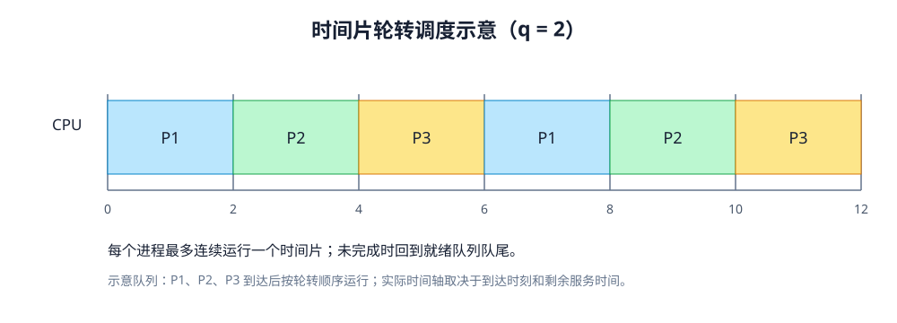
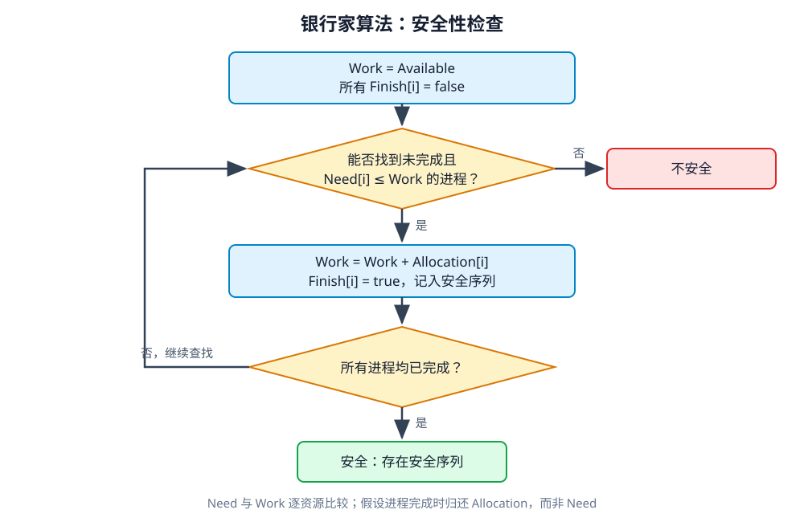

# 第 3 章 进程调度与死锁

> 依据：《操作系统概论（2017年版）》第三章、书前自学考试大纲、附录习题答案。大纲能力层次以“考核内容与考核要求”为准。调度和银行家算法中的数值均按题目给定条件推演；算法名称缩写沿用教材。

## 复习导航

| 大纲条目 | 层次 | 笔记位置与目标 |
|---|---|---|
| 1.1 进程调度功能；1.2 调度时机 | 识记 | 第 1 节：能定义、列出调度入口时机 |
| 2.1 选择准则 | 识记 | 第 2 节：能说明各种指标的侧重点 |
| 2.2 周转、平均周转、平均带权周转 | 简单应用 | 第 3 节：会算单作业和平均值 |
| 2.3 六种算法及抢占时机 | 领会 | 第 4 节：说明规则、适用情形及局限 |
| 2.4 实时条件、EDF、LLF | 领会 | 第 5 节：说明条件并跟踪截止时间／松弛度 |
| 2.5 多处理机类型、分配与调度 | 识记 | 第 6 节：区分分类与三种调度方式 |
| 3.1—3.3 死锁定义、原因、必要条件 | 领会 | 第 7 节：用资源等待关系分析四个条件 |
| 4.1 死锁预防 | 识记 | 第 8 节：说明破坏哪个必要条件 |
| 4.2 安全／不安全状态 | 识记 | 第 9 节：会判断安全序列，区分不安全和死锁 |
| 4.2 银行家算法 | 简单应用 | 第 10 节：会算 Need、试分配和安全性 |
| 4.3 检测、解除，死锁定理 | 识记 | 第 11 节：会化简资源图并说出解除方式 |

大纲将平均时间计算和银行家算法列为应用题；调度算法要求理解规则与实现思路，多处理机调度要求识记。

## 1 调度功能与时机（1.1、1.2）

**进程调度**由内核中的调度程序完成：从就绪态进程中选择一个，把 CPU 分配给它。它解决的是“下一个由谁运行”，不是从外存后备队列挑作业进入内存的作业调度。

教材列出的重新调度时机：当前进程正常或异常结束、进程阻塞、中断返回、抢占式系统中新高优先级进程到来、当前时间片用完。具体系统还受调度策略和中断处理规则影响，考试按教材口径作答。

## 2 调度准则（2.1）

| 准则 | 含义／关注点 |
|---|---|
| 周转时间短 | 从提交到完成经过的总时间；用户等待体验 |
| 响应时间快 | 从请求提交到首次得到响应；交互系统关注 |
| 保证截止时间 | 最迟开始或完成的时限；实时系统关注 |
| 吞吐量高 | 单位时间完成的作业数 |
| CPU 利用率好 | 尽量减少处理机空闲 |

这些目标可能冲突，算法应按系统目标选择。

## 3 周转时间与计算（2.2，简单应用）

对作业 i：

```text
周转时间 Ti = 完成时刻 - 提交时刻
平均周转时间 T = ΣTi / n
带权周转时间 Wi = Ti / 服务时间 Tsi
平均带权周转时间 W = Σ(Ti / Tsi) / n
```

服务时间是作业在 CPU 上执行的总时间。周转时间包含后备队列等待、就绪队列等待、CPU 执行和 I/O 等待；因此 `Ti >= Tsi`。若有时间片切换，执行时间要累计；跨越时间单位或时刻格式时，先统一换算。

### 自编核算例

单 CPU，非抢占 FCFS，P1、P2 分别在 0、1 到达，服务时间为 3、2。P1 运行区间 `[0,3]`，P2 为 `[3,5]`。

| 进程 | 到达 | 开始 | 完成 | 服务 | 周转 | 带权周转 |
|---|---:|---:|---:|---:|---:|---:|
| P1 | 0 | 0 | 3 | 3 | 3 | 1 |
| P2 | 1 | 3 | 5 | 2 | 4 | 2 |

平均周转时间为 `(3+4)/2=3.5`，平均带权周转时间为 `(1+2)/2=1.5`。P2 等待时间是 `3−1=2`，周转时间则是 `5−1=4`。

## 4 进程调度算法（2.3，领会）

| 算法 | 选择规则 | 优点与局限 |
|---|---|---|
| FCFS 先来先服务 | 选最先进入就绪队列者，通常非抢占 | 简单；长进程在前会使短进程等待很久；偏有利于 CPU 繁忙进程 |
| SPF 短进程优先 | 在就绪进程中选估计服务时间最短者，教材描述为运行到完成或阻塞再调度 | 可降低平均等待／周转；长进程可能饥饿；运行时间依赖估计，不保证紧迫任务优先 |
| 优先权 | 选优先级最高的就绪进程 | 可按任务重要性调度；定义须看系统是数值大优先还是数值小优先 |
| RR 时间片轮转 | 就绪队列按 FIFO；运行一个时间片，未完成则放队尾 | 适合分时交互；片太短切换开销大，太长响应变慢；片足够大时近似 FCFS |
| 多级队列 | 按属性固定分入不同就绪队列，各队列可有自己的优先级和算法 | 开销较低；分类固定、灵活性差，低优先级队列可饥饿 |
| 多级反馈队列 | 进程可按反馈规则在不同优先级队列间移动；教材典型规则为高优先级队列时间片较短 | 兼顾短作业响应与长作业进展；规则较复杂，具体实现因系统而异 |

### 抢占、非抢占与优先级

- 非抢占式：进程获得 CPU 后一直运行，直到完成或阻塞／主动放弃；新来的高优先级进程先等待。
- 抢占式：符合抢占条件时剥夺当前进程 CPU。教材列出立即抢占，或等待最近一次时钟中断再抢占。
- 静态优先级：创建时确定，运行中不变。动态优先级：随执行进展或等待时间等因素改变。
- 饥饿：就绪进程长期得不到 CPU。老化（等待越久逐步提高优先级）是教材列出的缓解方法。

RR 推演时，每次从队首取进程，运行 `min(时间片, 剩余服务时间)`；未完成则放回队尾，并记录到达、完成和空闲区间。新进程入队时机按题目约定；题目未说明时注明采用的规则。



SPF 每次只比较已经到达且可运行的进程。教材所述 SPF 是非抢占算法，不等同于短剩余时间优先。

## 5 实时系统调度（2.4，领会）

实现实时调度需要：必要的调度信息（就绪时间、开始／完成截止时间、处理时间、资源要求、优先级）；足够的系统处理能力；适当的抢占机制；快速中断响应和快速进程切换。

周期任务的处理能力条件：

```text
单处理机：Σ(Ci / Pi) <= 1
n 个处理机：Σ(Ci / Pi) <= n
```

其中 Ci 为任务处理时间，Pi 为周期时间。

| 算法 | 优先依据 | 执行规则 |
|---|---|---|
| EDF 最早截止时间优先 | 截止时间最早者优先 | 就绪队列按截止时间排序；可用于抢占或非抢占 |
| LLF 最低松弛度优先 | 松弛度最小者优先 | `L = 截止时间 T − 当前时刻 Tc − 剩余处理时间 Ts`；选 L 最小者 |

LLF 中剩余处理时间会变化，所以松弛度也会变化；相同松弛度的平局处理按题目约定。不得把 EDF 的截止时间排序规则误写成按到达时间排序。

## 6 多处理机调度（2.5，识记）

| 分类角度 | 类型 | 含义 |
|---|---|---|
| 耦合程度 | 紧密耦合 | 多处理机共享主存和 I/O，由统一 OS 管理 |
| 耦合程度 | 松弛耦合 | 多台计算机各有本地存储与 I/O，可独立工作并通信 |
| 处理器控制关系 | 对称多处理（SMP） | 处理器地位对等，调度和工作分配较分布 |
| 处理器控制关系 | 非对称多处理 | 主处理器控制系统，其他处理器执行分配任务 |

多处理机调度方式：

- **自调度：** 处理器从共享就绪队列自行选取工作。实现较简单、负载可动态分配；共享队列竞争、调度不匹配等会带来开销，合作线程也不一定同时获得处理器。
- **成组调度：** 把同一应用的一组相关线程同时调度到多个处理器，减少相互等待和调度频率；需要协调分配多个 CPU。
- **专用处理器分配：** 应用执行期间为其线程专门分配处理器，减少切换、可加速执行；线程阻塞时对应处理器可能空闲，资源利用率低。

## 7 死锁定义、原因与四个必要条件（3.1—3.3，领会）

**死锁：** 多个进程竞争共享资源，因各自等待其他进程占有的资源而都不能继续推进的僵持状态。原因是**竞争共享资源且分配资源的顺序不当**。

死锁发生必须同时满足四个必要条件：

| 条件 | 含义 | 典型破坏思路 |
|---|---|---|
| 互斥 | 资源一次只允许一个进程使用 | 允许共享，但许多临界资源无法取消互斥 |
| 请求和保持 | 已持有资源，同时等待新资源 | 一次申请全部资源，或申请新资源前释放已有资源 |
| 不剥夺 | 已分配资源不能强行收回 | 不能立即满足新请求时，按规则收回已有资源 |
| 环路等待 | 存在循环等待链 | 对资源类型编号，按同一顺序申请 |

四项是“必要条件”：若发生死锁，四项同时成立。排除任一项可预防死锁；但单独观察到某些资源互斥，并不能据此断言必然死锁。


**小例：** P1 持有 B 并等 A，P2 持有 A 并等 B。若 A、B 不可共享、已持有资源不剥夺，则形成请求和保持、环路等待；需再确认资源申请和进程等待确实构成闭环，才能判断死锁。

## 8 死锁预防（4.1，识记）

死锁预防通过保证至少一个必要条件不成立来工作。互斥通常是某些资源的固有属性，不适合一概取消，因此教材重点讲摒弃其余三个条件：

| 摒弃的条件 | 做法 | 代价／限制 |
|---|---|---|
| 请求和保持 | 运行前一次性申请所需资源；或申请新资源前释放已有资源 | 资源需求难以预知，资源可能闲置，并发性下降 |
| 不剥夺 | 新申请无法满足时，按策略释放／抢占已持资源 | 实现复杂；某些资源不适合抢占，可能要回滚 |
| 环路等待 | 资源类型排序，进程按递增次序申请 | 限制申请顺序、降低灵活性，可能浪费资源 |

这三种是**预防**，不等于银行家算法的动态**避免**。预防从制度上限制申请方式；避免则允许申请，但每次分配前检查安全性。

## 9 安全状态与不安全状态（4.2，识记）

若能找到一个进程序列，使每个进程在轮到自己时都可由当前可用资源加上前面进程完成后释放的资源满足其剩余需求，则系统处于安全状态，该序列称**安全序列**。不存在安全序列则是不安全状态。

**不安全不等于已经死锁。** 不安全说明不能保证存在安全完成次序，系统可能进一步进入死锁；安全状态则可避免进入死锁。

单一资源类型下可用的直观判法：逐个寻找 `Need <= Available` 的进程，假设其完成后归还已占资源 `Allocation`，更新可用量，继续检查。

## 10 银行家算法（4.2，简单应用）

设有 n 个进程、m 类资源：

| 数据 | 含义 |
|---|---|
| Available[j] | 当前 j 类资源可用数量 |
| Max[i,j] | 进程 i 对 j 类资源的最大需求 |
| Allocation[i,j] | 已分给进程 i 的 j 类资源 |
| Need[i,j] | 进程 i 尚需资源，`Need = Max − Allocation` |
| Requesti | 进程 i 本次提出的请求向量 |

向量不等式逐项比较，`X <= Y` 表示每一种资源都不超过对应分量；不是把各分量求和后比较。

### 10.1 安全性检查

1. `Work = Available`；所有 `Finish[i] = false`。
2. 找一个 `Finish[i] = false` 且 `Need[i] <= Work` 的进程。
3. 假设它运行完毕：`Work = Work + Allocation[i]`，置 `Finish[i] = true`，记下进程序列。
4. 重复检查。若所有进程 Finish 为 true，安全；否则若找不到可继续者，不安全。



### 10.2 资源请求检查

进程 i 请求 `Requesti` 时：

1. 若 `Requesti > Needi`，超过声明的最大需求，拒绝该请求。
2. 若 `Requesti > Available`，现有资源不足，进程等待。
3. 否则做试分配：`Available -= Requesti`；`Allocation[i] += Requesti`；`Need[i] -= Requesti`。
4. 对试分配后的状态运行安全性检查。安全则确认分配；不安全则撤销试分配，令进程等待。

### 10.3 教材例题状态核对

教材的 A、B、C 三类资源例题中，初始 `Available=(3,3,2)`，安全序列为 `<p1,p3,p4,p2,p0>`。p1 请求 `(1,0,2)` 后，`Available=(2,3,0)`、`Need1=(0,2,0)`，试分配状态仍安全，因此可以分配。

**自检表：** 每步写清所用 Work、待检 Need、被假设完成的进程、归还的 Allocation、新 Work。常见错误是安全序列中只加 Need、不加 Allocation，或把“目前 Available 不足”误写成“系统不安全”。

## 11 死锁检测、资源分配图与解除（4.3，识记）

死锁检测允许系统先分配资源，之后定期或在特定条件下检测；何时检测要权衡死锁频率、受影响进程数和检测开销。教材的资源分配图中：圆圈表示进程，方框表示资源类型，方框内小圆圈表示该类资源的实例；请求边由进程指向资源，分配边由资源实例指向进程。

**死锁定理：** 系统处于死锁状态，当且仅当资源分配图不可完全简化。化简时反复找一个既不阻塞又非孤立、其剩余请求可满足的进程，假设它完成并释放所占资源，消去与它相关的边。全部进程都能消去则可完全简化；仍有无法消去的进程则图不可完全简化。不可把“图上有环”无条件当成死锁，资源类型有多个实例时须按化简条件分析。

检测到死锁后的解除方式：

- 终止所有死锁进程；或逐个终止，直到死锁解除。选择牺牲进程时考虑优先级、已经运行时间、还需时间、资源类型及数量、需要终止多少进程、是否交互式等代价。
- 抢占部分进程所占资源，打破等待环。需决定抢占对象、必要时回滚到安全状态，并避免反复抢同一进程造成饥饿。

## 12 教材习题：题目与答案

题目取自教材第三章习题，答案依据教材附录。

### 12.1 单项选择题

**1. 影响时间片大小选择的主要因素有（ ）。**

A. 系统的响应时间　B. 系统的周转时间　C. 系统在单位时间内处理的作业量　D. 进程需要 CPU 服务的总时间

**答案：A。** 时间片直接影响轮转系统的响应时间；实际选择还要兼顾进程数和切换开销。

**2. 关于多级队列调度算法，下列说法正确的是（ ）。**

A. 每个就绪队列的优先权不同，调度算法相同

B. 每个就绪队列的优先权相同，调度算法不同

C. 各就绪队列调度算法和优先权都可能不相同

D. 一个进程在运行过程中可能被插入不同的就绪队列

**答案：C。** 多级队列可为各队列配置不同优先权和调度算法；进程固定属于某队列，跨队列移动是多级反馈队列的特点。

**3. 某系统中有 4 个并发进程，都需要同类资源 3 个。该系统不会发生死锁的最少资源数是（ ）。**

A. 6　B. 7　C. 8　D. 9

**答案：D。** 最坏情况是每个进程先各占 2 个，共占 8 个；再有第 9 个资源即可让一个进程取得第 3 个资源并完成、释放资源，随后其他进程依次完成。一般 n 个进程各需 k 个同类资源时，足以保证不死锁的资源数为 `n(k−1)+1`。

### 12.2 填空题

**1.** FCFS 适合___进程，不利于___进程。

答案：**长；短**。

**2.** 采用基于静态优先权的调度算法时，若不断有高优先权进程进入就绪队列，低优先权进程可能进入___状态。

答案：**饥饿**。

**3.** ___算法是用来避免死锁的算法。

答案：**银行家**。

**4.** S 为死锁状态的___条件是当且仅当 S 状态的资源分配图是不可完全简化的。

答案：**充分**。教材附录按此空格给出答案；完整死锁定理的表述见本章第 11 节。

### 12.3 简答题

**1. 进程调度的功能是什么？**

答案：内核调度程序按策略和算法从就绪进程中选择一个，为其分配 CPU，使其进入执行状态。

**2. 说明什么是时间片轮转调度算法。**

答案：就绪进程按先来先服务排队；队首进程运行一个时间片，完成则退出，未完成则回到队尾；时间片到期后重新调度。时间片过短会增加切换开销，过长则响应变慢。

**3. 什么是多级队列调度算法？**

答案：按进程属性将就绪队列划分为多个独立队列，进程进入系统后固定分配到一个队列；各队列可有不同优先级和调度算法。调度开销较低，但灵活性较差，低优先级队列可能饥饿。

**4. 什么是自调度方式？有什么优缺点？**

答案：多个处理器从共享就绪队列自行选择进程或线程。优点是实现简单、可动态分配负载；缺点是队列竞争和调度开销，合作线程也可能因未同时运行而相互等待。

**5. 什么是死锁？引起死锁的原因是什么？**

答案：多个进程竞争共享资源，各自等待其他进程占有的资源而都不能继续推进，这种僵持状态称为死锁。其原因是竞争共享资源且资源分配顺序不当。

### 12.4 简单应用：银行家算法

**题目：** 考虑系统某一时刻的状态，资源列顺序为 A、B、C、D。

| 进程 | Allocation | Max | Available |
|---|---|---|---|
| p0 | (0,0,1,2) | (0,0,1,2) | (1,5,2,0) |
| p1 | (1,0,0,0) | (1,7,5,0) | |
| p2 | (1,3,5,4) | (2,3,5,6) | |
| p3 | (0,6,3,2) | (0,6,5,2) | |
| p4 | (0,0,1,4) | (0,6,5,6) | |

用银行家算法回答：

1. Need 矩阵是什么？
2. 系统是否处于安全状态？
3. 若 p1 请求 `(0,4,2,0)`，能否立即满足？

**（1）计算 Need。** `Need = Max − Allocation`，逐资源列相减：

| 进程 | Need (A,B,C,D) |
|---|---|
| p0 | (0,0,0,0) |
| p1 | (0,7,5,0) |
| p2 | (1,0,0,2) |
| p3 | (0,0,2,0) |
| p4 | (0,6,4,2) |

**（2）检查初始安全性。** 初始 `Work = Available = (1,5,2,0)`。按 `Need[i] <= Work` 逐项比较，并在假设进程完成后加回其 Allocation：

| 步骤 | 进程 | Need | 完成前 Work | 完成后 Work = Work + Allocation |
|---|---|---|---|---|
| 1 | p0 | (0,0,0,0) | (1,5,2,0) | (1,5,3,2) |
| 2 | p2 | (1,0,0,2) | (1,5,3,2) | (2,8,8,6) |
| 3 | p3 | (0,0,2,0) | (2,8,8,6) | (2,14,11,8) |
| 4 | p4 | (0,6,4,2) | (2,14,11,8) | (2,14,12,12) |
| 5 | p1 | (0,7,5,0) | (2,14,12,12) | (3,14,12,12) |

因此存在安全序列 **`<p0,p2,p3,p4,p1>`**，系统处于安全状态。

**（3）检查 p1 的请求。** 请求 `(0,4,2,0)` 不超过 `Need1=(0,7,5,0)`，也不超过 `Available=(1,5,2,0)`，可以试分配：

```text
Available   = (1,5,2,0) - (0,4,2,0) = (1,1,0,0)
Allocation1 = (1,0,0,0) + (0,4,2,0) = (1,4,2,0)
Need1       = (0,7,5,0) - (0,4,2,0) = (0,3,3,0)
```

对试分配状态进行安全性检查：

| 步骤 | 进程 | Need | 完成前 Work | 完成后 Work |
|---|---|---|---|---|
| 1 | p0 | (0,0,0,0) | (1,1,0,0) | (1,1,1,2) |
| 2 | p2 | (1,0,0,2) | (1,1,1,2) | (2,4,6,6) |
| 3 | p3 | (0,0,2,0) | (2,4,6,6) | (2,10,9,8) |
| 4 | p4 | (0,6,4,2) | (2,10,9,8) | (2,10,10,12) |
| 5 | p1 | (0,3,3,0) | (2,10,10,12) | (3,14,12,12) |

仍存在安全序列 **`<p0,p2,p3,p4,p1>`**，所以该请求**可以立即满足**。

