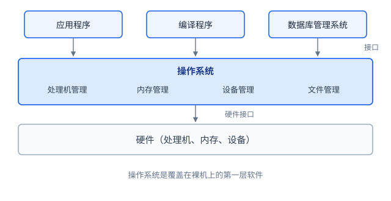
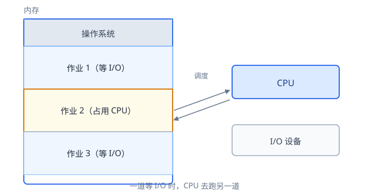
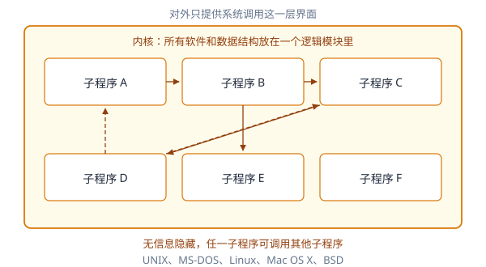
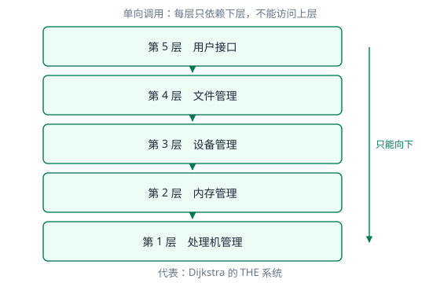
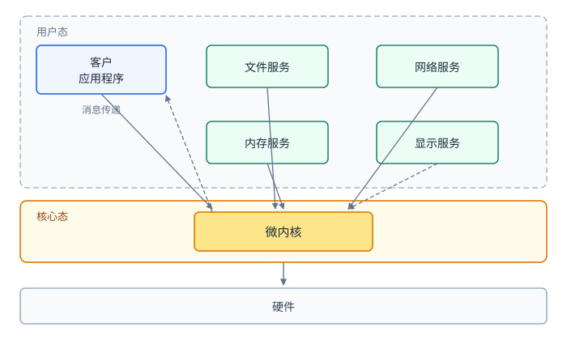
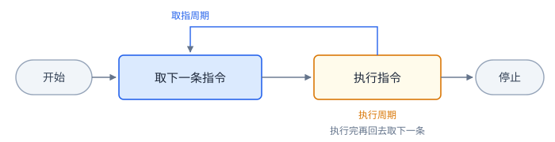
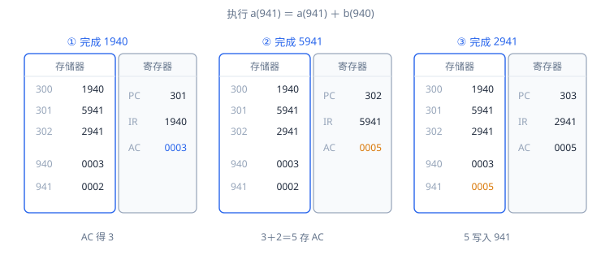

# 第 1 章 操作系统简介

> 依据：《操作系统概论》（2017 年版）第 1 章、配套自考大纲及附录答案。下文编号指大纲“考核内容与考核要求”；标注“自编”的算例为学习辅助，不是真题。

## 复习导航：大纲要求与笔记位置

| 大纲条目 | 层次 | 位置 | 学完应能做到 |
| --- | --- | --- | --- |
| 1.1 用户与硬件的接口、1.2 系统资源的管理者 | 识记 | 第 1 节 | 说明屏蔽硬件细节、提供运行环境的作用，列出处理器、内存、设备、文件及管理目的 |
| 2.1 单道与多道批处理、2.2 分时系统、2.3 实时系统、2.4 主流操作系统及应用 | 识记 | 第 2 节 | 列特点与缺点，解释多道提高利用率的原因；说明交互与多用户共享、时限与应用领域；将教材产品与应用领域配对 |
| 2.5 并发、共享、虚拟、异步 | 领会 | 第 3 节 | 解释并举例，区分并发与并行，说明并发与共享的关系 |
| 2.6 操作系统的功能 | 识记 | 第 4 节 | 列四项资源管理及用户接口，展开子功能 |
| 2.7 三种体系结构 | 识记 | 第 5 节 | 比较组织方式、优点与缺点 |
| 3.1 CPU 的逻辑结构、3.2 机器级表示与指令执行 | 识记、领会 | 第 6 节 | 说明模型机 PC、IR、AC 的作用，逐步追踪指令执行中寄存器和内存的变化 |

第 1、3、4、6 节对应大纲的主要概念；周转时间计算属第 3 章，本章只在第 2 节给出定义，完整推演也放在那里。教材列举的产品、历史“第一”和体系结构代表按教材理解，不作为当前产品现状或完整历史结论。

## 本章学习目标

本章介绍操作系统如何管理硬件、服务应用，以及其发展过程。六节依次讨论作用、发展与主流类型、四个特征、五项功能、三种体系结构，最后用模型机说明指令执行。

也可先学习第 3 节的四个特征和第 4 节的五项功能，再回看多道程序和分时系统为何出现。产品与年代可对照记忆；模型机部分则应先确认编址单位，再计算寻址容量。

## 1 操作系统的作用（1.1、1.2，识记）

操作系统是管理计算机软硬件资源、为应用程序提供运行环境的系统软件，由程序代码、数据结构和初始化文件等组成。按教材模型，它是裸机之上的第一层软件，向下管理硬件，向上提供统一接口。

这层软件身兼两职。往下管硬件，往上供服务，本节的两个小标题说的正是这两件事。

*图1-1 操作系统在计算机系统中的位置*

**1.1 用户与硬件之间的接口。** 接口规定不同部分之间如何交互：USB、串口、并口属于硬件接口，函数调用属于软件接口。应用程序通常通过库函数和系统调用请求操作系统服务，再由内核与设备驱动操作硬件。例如，`printf()` 向终端输出字符时，会通过库函数调用内核服务完成数据传送。教材以读磁盘文件为例：有操作系统时，可调用 `open()`、`fread()`、`fclose()`；在教材的裸机示例中，则需要自行计算柱面号、磁道号和扇区号，并编写汇编代码调用 `int 13h`。

**1.2 资源的管理者。** 操作系统管理四类基本资源：处理器（处理机）、内存（主存）、设备和文件；网络操作系统还要管理网卡和带宽。在本课的单 CPU 模型中，处理器同一时刻只执行一个程序流，由调度程序决定分配给谁。内存管理负责空间分配与回收、地址保护，以及逻辑地址到物理地址的转换。设备管理接收 I/O 请求、分配设备、管理 I/O 缓冲并调用驱动；文件管理负责外存空间的分配与回收、目录组织、按名存取、共享和保护。

## 2 操作系统的发展（2.1–2.4，识记）

操作系统的发展回应了资源利用与使用方式的变化：单道批处理减少人工装卸作业的等待，多道批处理利用 I/O 等待期间的 CPU 空闲，分时与实时系统则分别满足交互和时限要求。

演进主线依次是：无操作系统 → 单道批处理 → 多道程序系统（分化为多道批处理与分时系统），随后出现微机、网络、实时、嵌入式、物联网等分支。教材列出的四个历史“第一”可对照记忆：第一个多道程序系统是 OS/360，第一个通用分时系统是 MIT 的 CTSS，第一个微机操作系统是 CP/M，第一个商用嵌入式操作系统是 VRTX32。

往下看之前先把三个度量词摆正。作业是用户程序连同它要处理的数据；吞吐量指单位时间内系统处理完的作业数；周转时间从作业提交算到完成，各作业周转时间取算术平均就是平均周转时间。

**2.1 单道与多道批处理。** 单道批处理往内存里只放一道作业，成批自动跑完。它有三个特点：

1. 自动性。在监督程序控制下自动装入、运行、撤出，接着装下一道，不用人工插手。
2. 顺序性。外存里的作业按先后排队进内存，先进来的先跑完。
3. 单道性。内存中同一时刻只有一道作业，跑完才能换下一道。

与手工操作的裸机相比，单道批处理减少了等待人工装卸作业的时间。但一道作业仍独占整台机器；它等待慢速 I/O 时，CPU 也无法执行其他作业。

多道批处理的解法是换一种排队方式：作业先在外存排成后备队列，调度程序挑出几道一起放进内存，让它们轮流用 CPU 和外设。特点变成四条：

1. 多道性。内存里同时驻留多道程序，甲去等 I/O，CPU 立刻切去跑乙。
2. 无序性。谁先进内存，不代表谁先上 CPU，更不代表谁先跑完。
3. 调度性。得有两级调度配合：作业调度从外存后备队列挑作业进内存，进程调度再从内存就绪队列挑进程上 CPU。
4. 复杂性。几道程序挤在同一台机器里，处理器给谁、内存怎么隔开、外设和文件怎么轮流用，全得由系统统筹；换成后面讲的分时系统，还得再管一层终端用户。

多道程序设计主要利用作业等待 I/O 的时间。CPU 密集型作业本身就能充分使用处理器；I/O 密集型作业则经常等待磁盘读写或打印完成，单道执行时 CPU 的空闲比例可能达到教材所举的 80%～90%。若内存中有足够多的作业，且它们的计算与 I/O 阶段能相互衔接，CPU 利用率就有可能接近 100%。

代价也跟着来了：系统吞吐量和 CPU、内存、外设的利用率都上去了，但每道作业要和别人分摊机器，平均周转时间反而拉长，而且运行期间用户插不上话，没有交互能力。

*图1-3 内存中有多道作业*

**2.2 分时系统。** 多道批处理解决了机器闲置，却让程序员没法当场调试程序。分时系统把多道技术往交互方向推了一步：一台主机连上多台终端，多个用户同时在线操作。四个特点紧扣这种体验：

1. 多路性。一台主机同时接纳多路联机终端。
2. 独立性。各终端用户各干各的、互不干扰，体感上像自己独占这台主机。
3. 及时性。敲下去的请求在很短时间内就能拿到回应。
4. 交互性。用户能通过终端和系统一问一答，边看结果边改命令。

分时系统利用缓冲区暂存输入，并将各用户任务按短时间片交替调度。当调度及时、系统负载合适时，用户可获得较快响应。

**2.3 实时系统。** 实时系统用于实时控制和实时信息处理。它既要求结果正确，也要求在规定时限内完成；即使计算结果正确，超过截止时间也可能导致任务失败。实时系统既可以建立在实时操作系统上，也可以采用直接在裸机上运行的专用控制程序。

| 特点 | 含义 |
| --- | --- |
| 多路性 | 与分时相同，更突出对多路现场信息的采集、对多个对象或执行机构的控制 |
| 独立性 | 用户之间独立操作；实时控制中信息的采集与对象的控制也互不干扰 |
| 及时性 | 信息处理按人能接受的等待时间定；控制按开始或完成截止时间定 |
| 交互性 | 只限于访问系统某些特定的专用服务程序 |
| 可靠性 | 要求比分时高得多，出错可能造成重大损失甚至危及生命，常靠多级容错兜底 |

表格最后两行需要对照理解：分时系统和实时系统都具有多路性、独立性、及时性与交互性，但实时系统的交互通常限于特定服务程序，且对**可靠性**要求很高。典型应用包括工业控制、智能机器人、海底探测、航空航天、锅炉温压控制和重症监护。批处理、分时、实时是操作系统的三种基本类型，实际系统也可结合其中两种方式。

**2.4 主流操作系统及其应用领域。** 本节的分类采用了不同口径：按服务方式分为批处理、分时、实时三类；按教材的演进顺序介绍微机、网络、实时、嵌入式、物联网五类；按运行平台则区分主机、服务器、微机、嵌入式和物联网系统。做题时先确定题干的分类依据，再选择对应类别。

| 类型 | 用途与代表 |
| --- | --- |
| 主机 | 三类服务：批处理（保险索赔、连锁店销售报告）、事务处理（银行支票、航班预定，每秒成百上千笔）、分时；代表 OS/360、OS/390 |
| 服务器 | 在网络上同时为众多用户服务，提供打印、文件、Web 服务；Solaris、FreeBSD、Linux、Windows Server |
| 微机 | 支持多任务，为单个用户提供应用环境与开发环境；Windows 系列、Linux 发行版、Macintosh、Chrome OS |
| 嵌入式 | 宿主在非计算机设备中；VxWorks、QNX、WinCE、Android；用于手机、数码相机、ATM、工业控制、军工、医疗 |
| 物联网 | 本质是嵌入式操作系统；iOS、Android Things、Windows 10 IoT Core、FreeRTOS |

嵌入式操作系统的特征包括小巧、实时性、可装卸、代码固化、弱交互性、强稳定性、接口统一和低能耗。可结合相机、ATM 或工控设备，理解这些要求分别解决什么问题。

## 3 现代操作系统的特点（2.5，领会）

一旦多道程序住进同一台机器，程序的跑法和资源的用法就全变了。现代操作系统用四个词概括这种常态：并发、共享、虚拟、异步。

**并发**指两个或多个事件在同一时间间隔内发生，**并行**则要求在同一时刻发生。例如，单核 CPU 上同时听歌和编辑文档，两个进程交替获得 CPU，宏观上同时推进，任一时刻却只有一个程序流在执行，这属于并发；多个核心在同一时刻执行不同程序流，才属于并行。

**共享**指内存中的多个并发进程共用系统资源，可分为两种方式。互斥共享要求一段时间内只允许一个进程使用资源，例如打印机；“同时”共享则允许多个进程在宏观上同时使用资源，例如多个进程读写磁盘，底层仍可由磁盘驱动器交替处理请求。

并发和共享相互依赖：多个进程并发推进，需要合理共享 CPU、内存和设备；共享机制若不能协调访问，又会破坏并发执行。因此，教材将两者列为操作系统的两个最基本特征。

**虚拟**指把一个物理实体转换为若干逻辑上的对应物，由软硬件共同实现，例如虚拟打印机、虚拟内存和虚拟 CPU。对进程而言，系统提供的是独立使用 CPU 和地址空间的运行环境，而物理资源实际上由多个进程共享。

**异步**指进程以不可预知的速度间歇推进。CPU 分配、I/O 等待和中断都会影响执行时机，具体交错次序通常无法预先确定；程序仍需依靠正确的同步机制保证结果。

结合单核实例理解：听歌与编辑文档交替推进体现并发，多个进程使用同一磁盘体现共享，为进程提供独立 CPU 的逻辑抽象体现虚拟，而等待设备和处理中断使进度不确定，体现异步。

## 4 操作系统的功能（2.6，识记）

操作系统的功能包括四类资源管理（**内存、进程、设备、文件**）和**用户接口**。

**内存管理**为多道程序分配和保护内存，并通过虚拟存储支持按需装入。主要包括四项工作：

- **分配**：为程序划分内存空间。静态分配预先确定分区的大小和数量；动态分配则根据请求调整。两种方式都需要记录空闲空间，并处理分配与回收。
- **保护**：限制程序访问内核空间和其他程序的地址空间。常见做法是用一对界限寄存器记录合法地址范围，访问越界时由硬件发出异常或中断。
- **地址映射**：程序使用逻辑地址，主存访问使用物理地址。运行时，操作系统与硬件地址变换机构配合，将逻辑地址转换为物理地址。
- **扩充**：虚拟存储允许程序先装入部分页面或段，再按需调入其余部分。主存空间不足时，系统可将暂时不用的部分换出到外存。

其余功能如下：

- **进程管理**有五项：描述与组织进程，控制进程的创建、撤销、阻塞和唤醒，协调进程同步与通信，以及调度。
- **设备管理**包括缓冲、设备分配、设备处理、设备独立性和虚拟设备。设备驱动程序负责与控制器通信；设备独立性使程序不必绑定某一具体设备，虚拟设备则可将独占设备转为多个用户共享的逻辑设备。
- **文件管理**包括存储空间管理、目录管理、文件读写和存取控制。目录项通常记录文件名、属性及外存位置；存取控制用于限制未授权操作。
- **用户接口**分为命令接口、图形用户接口和程序接口。命令接口包括逐条接收命令的联机方式，以及根据作业控制说明书批量执行的脱机方式；程序接口主要通过系统调用提供。

`printf()` 等 C 标准库函数不一定对应系统调用。库函数可在用户态完成部分工作；需要内核服务时，才通过系统调用进入内核。因此，普通函数调用不一定引起执行态切换。

## 5 体系结构（2.7，识记，大纲明确列出三种）

操作系统的各个管理模块如何组织、相互调用，由体系结构决定。大纲要求对比**单体结构、层次结构、微内核（客户/服务器）结构**。

**单体结构**把管理模块和数据结构放在同一个内核空间，对外提供系统调用接口。模块之间没有严格的层次限制，可以直接调用所需子程序，信息隐藏程度较低。优点是实现直接、内核内部调用效率较高；缺点是模块依赖复杂，可能出现循环调用甚至死锁，修改底层函数也容易影响其他模块。教材将 UNIX、MS-DOS、Linux、Mac OS X、BSD 列为代表，并把“模块化”视为单体结构的工程改良，而非第四种体系结构。

*图1-6 单体结构：所有功能在一个逻辑模块里*

**层次结构**把系统自底向上划分为若干层，并规定单向依赖：每层只调用相邻下层的接口，下层不能反向调用上层。在接口保持一致的前提下，各层可独立编码、调试和替换内部实现，有利于提高可读性、可靠性与可移植性。难点在于合理划分功能、避免循环依赖；请求逐层传递也会增加调用开销。经典代表是 Dijkstra 主持设计的 THE 系统。

*图1-7 层次结构：单向调用，只能向下*

**客户/服务器与微内核结构**尽量缩小内核，将文件系统、网络协议、设备驱动等服务移到用户态，作为独立服务器进程运行；内核保留处理器调度、基本内存管理和消息通信等核心功能。客户进程通过消息请求服务，微内核负责通信。这有利于隔离服务故障、维护和扩展系统，也便于支持分布式应用。代价是消息传递与上下文切换带来的开销，工程上可通过优化通信，或将部分高频服务移回内核来权衡。教材列出的代表有 Windows NT、COS-IX V2.3、Mach 和 VxWorks。

*图1-8 客户/服务器结构的微内核操作系统*

层次结构侧重在**内核内部**约束模块的调用依赖；微内核则跨越**特权级边界**，将较多服务置于用户态，通过消息传递协作。两者的划分依据不同。

## 6 CPU 的逻辑结构与指令的执行（3.1、3.2，识记、领会）

操作系统最终依靠硬件执行指令。教材用一台简化模型机演示 CPU 的工作过程，重点跟踪三个寄存器：**PC**（程序计数器）保存下一条指令的地址，**IR**（指令寄存器）保存刚取出的当前指令，**AC**（累加器）暂存运算数据和结果。

高级语言代码编译后会变成一串机器指令，每条指令都属于该处理器的指令集。CPU 跑程序的过程就是周而复始地走**指令周期**，每个指令周期拆成**取指周期**和**执行周期**两步。

*图1-9 指令周期：取指周期与执行周期*

取指周期中，CPU 按 PC 给出的地址从内存取出指令，送入 IR，并将 PC 更新为下一条指令的地址。执行周期中，CPU 对 IR 中的指令译码，完成相应操作，主要包括 CPU 与内存之间的数据传送、CPU 与 I/O 设备之间的数据传送、算术逻辑运算，以及跳转等控制操作。

教材这台模型机的指令和数据都是 16 位宽。指令切成两段：高 4 位是操作码，最多表示 $2^4 = 16$ 种操作；低 12 位是地址码，能表示 $2^{12} = 4096$ 个地址，写法上正好是 3 位十六进制数。

这里需要先核对编址单位。教材原文写“4096 字节”，又说存储器按 16 位单元或字组织，两处表述不一致。按这台模型机的**按字编址**设定，一个地址单元是一个 16 位字，而非一个 8 位字节。因此，12 位地址对应 4096 个字，折合 8192 字节；只有按字节编址时，才对应 4096 字节。容量换算前应先确认编址单位。

按字编址也解释了本节“顺序取指时 PC 加 1”的含义：地址增加一个单元，正好跨过一条 16 位指令。若改为按字节编址，顺序执行一条 16 位指令后应加 2，一条 32 位指令后应加 4。因此，“PC 加 1”成立依赖本模型的编址方式和指令长度，不能直接推广到其他机器。

下面的加法实例用到三种操作码：`0001`（十六进制 `1`）从内存取数装入 AC；`0101`（十六进制 `5`）把内存单元的值加到 AC 上；`0010`（十六进制 `2`）把 AC 的结果存回内存。

*图1-10 模型机的指令和数据格式*

实例要把内存 `940H` 和 `941H` 两个单元里的数相加，结果写回 `941H`。设两单元初值分别是 3 和 2，三条指令依次放在 `300H`、`301H`、`302H`：

| 指令 | 地址 | 动作 | 执行后 |
| --- | --- | --- | --- |
| 1940 | 300 | 0001，从 940 取数送 AC | AC＝3 |
| 5941 | 301 | 0101，AC 与 941 的值相加 | AC＝5 |
| 2941 | 302 | 0010，把 AC 存入 941 | 941＝5 |

全程下来，PC 从 `300` 一路递增到 `301`、`302`、`303`，IR 依次装过 `1940`、`5941`、`2941`。

表中有三类不同的数：`300` 是指令的存储地址，`1940` 中的 `940` 是操作数的存储地址，实际送入 AC 参与运算的则是 `940` 号单元中的数值 `3`。注意区分指令地址、操作数地址和操作数本身。

`940H` 与 `941H` 是相邻的两个字地址，各存一个完整的 16 位字，内容分别为 3 和 2。加法读取的是这两个单元中的数值。若按字节编址，一个地址单元只存 8 位，相邻地址才可能分别存放同一个 16 位字的两个字节。

| 执行的指令 | 取指后的 PC | IR | 执行后的 AC | 执行后的内存 941 |
| --- | --- | --- | --- | --- |
| 300 单元的指令 | 301 | 1940 | 3 | 2 |
| 301 单元的指令 | 302 | 5941 | 5 | 2 |
| 302 单元的指令 | 303 | 2941 | 5 | 5 |

可将执行过程概括为：取指阶段按 PC 访存，把指令送入 IR，并更新 PC；执行阶段对 IR 译码，按操作码和地址码完成数据传送、算术逻辑运算或跳转，随后进入下一轮取指—执行循环。本模型按字编址，且一条指令占一个字，所以顺序执行时 PC 加 1；执行转移指令时，PC 则更新为目标地址。

*图1-11 程序执行过程的实例*

CPU 执行的是其指令集体系结构（ISA）规定的指令。用户程序和操作系统内核最终都要编译或编写为硬件能够译码的指令，由 PC、IR 和通用寄存器等配合完成执行。

## 7 考核要求

本章共 11 条考核条目，其中 2.5（并发、共享、虚拟、异步）与 3.2（机器级表示与指令执行）要求领会，其余 9 条均为识记。复习重点是操作系统在计算机系统中的位置、四个特征、五大功能模块，以及模型机取指—执行过程中的寄存器变化。并发与共享的相互依赖，以及按字编址下 PC 与内存地址的换算，需要结合实例理解。

## 8 教材本章习题

题目取自教材第 1 章“习题”（共 13 题），答案取自教材附录“参考答案”（全部收录）。

### 8.1 单项选择题

**1. Linux 操作系统是【　】**

A. 单用户单任务操作系统　B. 单用户多任务操作系统　C. 多用户单任务操作系统　D. 分时操作系统

**答案：D。** 按教材口径，Linux 属于分时操作系统。题目中的“多用户多任务”不在选项中。

**2. 操作系统内核中文件系统模块的主要功能是【　】**

A. 实现虚拟存储　B. 保存系统文档和用户文档　C. 保护系统数据　D. 实现对文件的按名存取和文件的存储

**答案：D。** 文件系统负责文件的按名存取和存储管理。

**3. 下列关于批处理系统的叙述中，正确的是【　】**

A. 批处理系统允许多个用户与计算机直接交互　B. 批处理系统分为单道批处理系统和多道批处理系统　C. 单道批处理系统也可能同时是分时系统　D. 多道程序系统就是指多道批处理系统

**答案：B。** 批处理分为单道和多道。批处理缺乏交互能力；多道程序系统还包括分时系统。

### 8.2 填空题

**4. 单道批处理系统的内存中只能驻留___道用户作业。**

答案：**一**。

**5. 单道批处理系统与无操作系统的计算机系统相比而言，减少了___的时间。**

答案：等待人工操作。

**6. 操作系统是一组控制和管理计算机___和___资源、合理地对各类作业进行调度，以及方便用户的程序集合。**

答案：硬件；软件。

**7. 并发是指两个或两个以上的事件在同一___内发生。**

答案：时间间隔。

**8. 现代操作系统的特征包括并发、___、虚拟和异步。**

答案：共享。

### 8.3 简答题

**9. 请说明操作系统的作用和功能。**

答案：操作系统提供用户与硬件之间的接口，并管理计算机资源。主要功能包括内存管理、进程管理、设备管理、文件管理和提供用户接口。

**10. 请说明单道批处理系统、多道批处理系统、分时系统的特点及优缺点。**

答案：单道批处理具有自动性、顺序性、单道性，减少人工等待，但 I/O 期间 CPU 空闲。多道批处理具有多道性、无序性、调度性、复杂性，提高资源利用率和吞吐量，但平均周转时间较长、缺乏交互。分时系统具有多路性、独立性、及时性、交互性，便于多个用户通过终端共享主机。

**11. 内存管理有哪些主要功能？**

答案：内存分配、内存保护、地址映射、内存扩充。具体说明见本章第 4 节。

**12. 请说明指令执行的过程。**

答案：根据 PC 从内存取指令并放入 IR；更新 PC；译码并执行指令；重复取指与执行。模型机中，PC、IR、AC 分别保存指令地址、当前指令和运算数据。

**13. 操作系统具有哪些特征？**

答案：并发、共享、虚拟、异步。含义与实例见本章第 3 节。

## 9 闭卷复习与跨章联系（补充）

**一、闭卷自答（合上书逐题口述）**

1. 操作系统替硬件挡了哪些细节，又给应用程序留了什么接口？
2. 单道批处理、多道批处理、分时、实时各有什么特点，多道为什么能提高利用率？
3. 并发、共享、虚拟、异步各举一例，并发与并行的分界在哪？
4. 四类资源管理各含哪些子功能，用户接口分几种？
5. 单体、层次、微内核三种结构怎么划分功能与通信，代价各是什么？
6. 模型机里 PC、IR、AC 各存什么，一条指令的取指与执行怎么走？

**二、本章易错**

1. 940H 与 941H 的“相邻”只是地址相邻，不是同一个字的两个字节（第 6 节）。
2. 教材原文写“4096 字节”，按字编址应折合 8192 字节，算容量前先问编址单位（第 6 节）。
3. 模块化是单体结构的改良，不算第四种体系结构（第 5 节）。

**三、本章骨架**

一句话串起来：裸机 → 操作系统（挡硬件、留接口）→ 四类系统与产品形态 → 并发、共享、虚拟、异步 → 四类资源管理与用户接口 → 三种体系结构 → 模型机与指令周期，依次对应第 1 到第 6 节。

**四、跨章指路**

1. 平均周转时间的完整推演见第 3 章，本章不展开。
2. 本章第 4 节列出的五大功能，将在后续各章逐一拆开：进程管理见第 2 章，处理器调度与死锁见第 3 章，内存管理见第 4 章，文件系统见第 5 章，I/O 设备管理见第 6 章。
