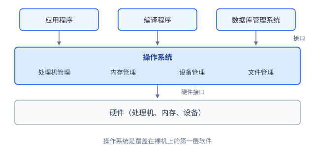
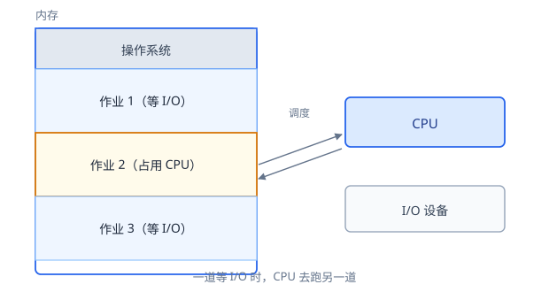
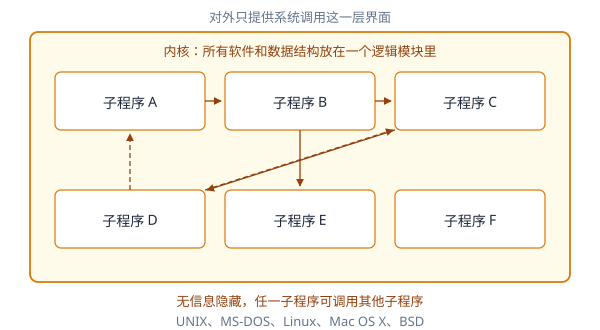
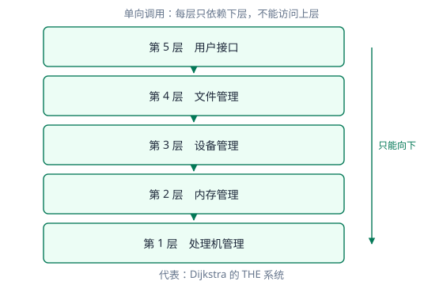
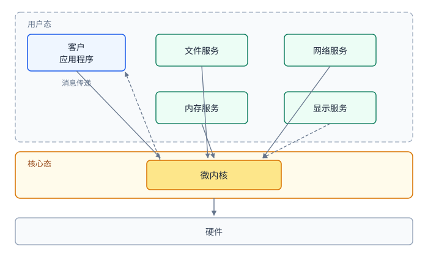
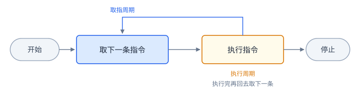
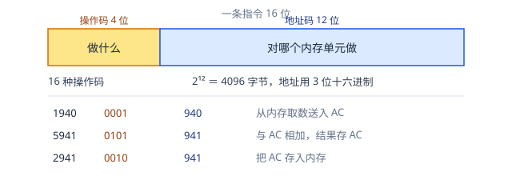
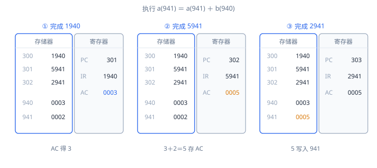

# 第 1 章 操作系统简介

> 校订依据：本目录《操作系统概论（2017年版）》第一章、书前自学考试大纲和附录答案。产品、历史“第一”和体系结构代表按教材列举理解，不作为当前产品现状或完整历史结论。下表编号指大纲“考核内容与考核要求”。

## 复习导航：大纲要求与笔记位置

| 大纲条目 | 层次 | 位置 | 学完应能做到 |
|---|---|---|---|
| 1.1 用户与硬件的接口 | 识记 | 第 1 节 | 说明屏蔽硬件细节、提供运行环境的作用 |
| 1.2 系统资源的管理者 | 识记 | 第 1 节 | 列出处理机、内存、设备、文件及管理目的 |
| 2.1 单道与多道批处理 | 识记 | 第 2 节 | 列特点与缺点，解释多道提高利用率的原因 |
| 2.2 分时系统 | 识记 | 第 2 节 | 列四个特点，说明交互与多用户共享的优点 |
| 2.3 实时系统 | 识记 | 第 2 节 | 说明时间约束、五个特点及应用领域 |
| 2.4 主流操作系统及应用 | 识记 | 第 2 节 | 将教材产品与应用领域配对 |
| 2.5 并发、共享、虚拟、异步 | 领会 | 第 3 节 | 解释并举例，区分并发与并行，说明并发与共享的关系 |
| 2.6 操作系统的功能 | 识记 | 第 4 节 | 列四项资源管理及用户接口，展开子功能 |
| 2.7 三种体系结构 | 识记 | 第 5 节 | 比较组织方式、优点与缺点 |
| 3.1 CPU 的逻辑结构 | 识记 | 第 6 节 | 说明模型机 PC、IR、AC 的作用 |
| 3.2 机器级表示与指令执行 | 领会 | 第 6 节 | 逐步追踪指令执行中寄存器和内存的变化 |

第 1、3、4、6 节对应大纲的主要概念；周转时间计算属第 3 章，本章只在第 2 节给出定义，完整推演也放在那里。

## 1 操作系统的作用（1.1、1.2，识记）

操作系统是一套系统软件，管着计算机的软硬件资源，也给应用程序备好运行环境。它本身由程序代码、数据结构和初始化文件组成。按教材口径，它是覆盖在裸机上的第一层软件：往下把硬件的细节压住，往上留出一组干净的接口。应用程序要碰计算机资源，走的都是这一层。

这层软件身兼两职。往下管硬件，往上供服务，本节的两个小标题说的正是这两件事。

  
*图1-1 操作系统在计算机系统中的位置*

**1.1 用户与硬件之间的接口。** 接口规定了不同组成部分之间的交互方式。USB、串口和并口属于硬件接口，函数调用接口属于软件接口。应用程序通常通过库函数和系统调用请求操作系统服务，由内核与设备驱动完成具体的硬件操作。例如，`printf()` 输出到终端时，会通过相应的库函数和内核服务完成数据传送。教材以读取磁盘文件为例作对比：有操作系统时只需 `open()`、`fread()`、`fclose()` 三个函数；裸机上则须自行计算柱面号、磁道号、扇区号，再以汇编调用 `int 13h`。

操作系统的任务因此分为两方面：控制底层可编程硬件；为应用程序建立执行环境，并分配、管理所需资源。

**1.2 资源的管理者。** 管理对象是处理机、内存、设备、文件，网络操作系统还包括网卡和带宽。在本课采用的单 CPU 模型中，处理机在任意时刻执行一个程序流，其使用权由调度程序分配。内存在多任务下不是独占的。系统要为各程序分配空间，保证地址空间互不干扰、用完回收，还要完成逻辑地址到物理地址的转换。设备方面须接受 I/O 请求、分配设备、管理 I/O 缓存、驱动设备。文件方面须完成外存空间的分配回收、按名存取、文件组织和共享保护。

## 2 操作系统的发展（2.1–2.4，识记）

操作系统的发展与资源利用方式的变化有关。早期系统着重减少人工干预，多道程序提高了资源利用率，分时和实时系统则进一步满足交互和时限要求。

发展顺序为：无操作系统、单道批处理、多道程序系统（含多道批处理和分时）。此后相继出现微机、网络、实时、嵌入式、物联网操作系统。教材列举的四个历史代表是：多道程序系统的第一个 OS/360；通用分时系统的第一个，MIT 的 CTSS；微机操作系统的第一个，CP/M；商用嵌入式操作系统的第一个，VRTX32。

作业由用户程序及其处理的数据组成。吞吐量是单位时间处理的作业量；周转时间从作业提交算至完成，平均周转时间为各作业周转时间的算术平均值。

**2.1 单道批处理。** 内存中只驻留一道作业，能自动成批处理。三个特点：

1. 自动性。操作系统控制下自动装入作业、运行、撤销，再装入下一道。
2. 顺序性。外存中的作业按顺序装入，先进内存的先运行完。
3. 单道性。任何时刻内存中只有一道作业，该作业结束后才能装入下一道。

相对无操作系统的系统，减少了等待人工操作的时间。缺点是作业独占 CPU 和内存，作业进行 I/O 时 CPU 只能空等。

多道批处理的做法是：作业先在外存排成后备队列。调度程序按策略选择若干道调入内存，使它们共享 CPU 和其他资源。四个特点：

1. 多道性。内存驻留多道程序，一道等待 I/O 时 CPU 转去运行另一道。
2. 无序性。作业完成的先后与进入内存的先后无严格对应，先进的不一定先被调度，也不一定先完成。
3. 调度性。需要作业调度（从后备队列选择作业进入内存）与进程调度（从就绪队列选择进程执行）两级。
4. 复杂性。作业共享 CPU、内存、外设和文件，处理机、内存、I/O、文件、作业均需管理；分时系统另多一层终端用户管理。

提出多道程序的背景与作业类型有关。通用机运行 CPU 操作密集型作业时利用率高；运行输入输出密集型作业时，CPU 频繁等待 I/O，浪费最高达 80%~90%。若内存能同时容纳足够多作业，CPU 利用率可接近 100%。

优点为提高 CPU、内存和 I/O 设备的利用率，提高系统吞吐量；缺点为平均周转时间长，缺乏交互能力。

  
*图1-3 内存中有多道作业*

**2.2 分时。** 多个用户通过终端同时使用一台主机，是多道程序系统的自然延伸。四个特点：

1. 多路性。一台主机同时连接多台联机终端。
2. 独立性。各终端用户独立操作、互不干扰，感觉如同独占主机。
3. 及时性。用户请求在很短时间内得到响应。
4. 交互性。用户可通过终端与系统广泛对话。

分时系统通过轮流分配处理机时间，使多个用户能够交互地使用主机。教材另在实时系统中列出可靠性要求，两类系统的特点应分别理解。

为及时接收命令，系统用缓冲区暂存尚未处理的请求。为及时处理请求，教材模型把用户任务保留在内存中，再以短时间片轮转，使各任务都能较快轮到一次。

**2.3 实时。** 用于实时控制和实时信息处理两个领域。实时任务的正确性取决于结果和完成时间。即使计算结果正确，超过规定的截止时间也可能造成任务失败。实时系统可以由实时操作系统管理，也可以采用无操作系统的专用实现。

| 特点 | 含义 |
|---|---|
| 多路性 | 与分时相同，更突出对多路现场信息的采集、对多个对象或执行机构的控制 |
| 独立性 | 用户之间独立操作；实时控制中信息的采集与对象的控制也互不干扰 |
| 及时性 | 信息处理按人能接受的等待时间定；控制按开始或完成截止时间定 |
| 交互性 | 只限于访问系统某些特定的专用服务程序 |
| 可靠性 | 要求比分时高，错误可能造成重大损失甚至危及生命，靠多级容错 |

应用领域：工业现场控制、智能机器人、海底探测、航空航天、锅炉温度压力控制、重病监测。批处理、分时、实时是三种基本的操作系统类型，一个实际系统也可能兼有其中两者的功能。

**2.4 主流操作系统及其应用领域。** 教材从不同角度对操作系统分类。按功能分为批处理、分时、实时三类；第二节开头按出现顺序列出微机、网络、实时、嵌入式、物联网五类；第七小节按产品形态讲的是主机、服务器、微机、嵌入式，外加物联网。这些分类分别描述服务方式、发展过程和应用领域。比较时需要采用相同的分类依据。

| 类型 | 用途与代表 |
|---|---|
| 主机 | 三类服务：批处理（保险索赔、连锁店销售报告）、事务处理（银行支票、航班预定，每秒成百上千笔）、分时；代表 OS/360、OS/390 |
| 服务器 | 在网络上同时为众多用户服务，提供打印、文件、Web 服务；Solaris、FreeBSD、Linux、Windows Server |
| 微机 | 支持多任务，为单个用户提供应用环境与开发环境；Windows 系列、Linux 发行版、Macintosh、Chrome OS |
| 嵌入式 | 宿主在非计算机设备中；VxWorks、QNX、WinCE、Android；用于手机、数码相机、ATM、工业控制、军工、医疗 |
| 物联网 | 本质是嵌入式操作系统；iOS、Android Things、Windows 10 IoT Core、FreeRTOS |

嵌入式操作系统的特征：小巧、实时性、可装卸、代码固化、弱交互性、强稳定性、接口统一、低能耗。教材明确列出了这些特征，应与应用领域一起记忆。

## 3 现代操作系统的特点（2.5，领会）

多道程序共享硬件后，程序的执行关系和资源使用方式随之改变。并发、共享、虚拟和异步从不同方面概括了这些变化。

并发是两个或多个事件在同一时间间隔内发生，并行是同一时刻发生。在单 CPU 单核上同时听歌与编辑文档，实为快速轮流交替，任意时刻只有一个程序流在 CPU 上。

共享指资源可供内存中多个并发进程共同使用，分两种。互斥共享为任意时刻只给一个进程，如打印机；同时共享为宏观上可被多个进程同时访问，如磁盘，微观上仍是轮流访问。

并发与共享相互依赖。并发执行使多个进程产生共享资源的需要，合理的资源共享机制又为并发执行提供条件。

虚拟是把一个物理实体变成若干逻辑上的对应物。物理实体真实存在，逻辑对应物由系统的软件和硬件机制提供；虚拟打印机、虚拟内存、虚拟 CPU 均属此类。落到进程身上，它看到的是独占的 CPU 和完整的一片内存——当然是错觉，可这个错觉正是虚拟要的效果。没有它，每个进程都得自己盘算还剩几个时间片、内存被别人占了多少。

异步性是进程以不可预知的速度向前推进，何时执行、何时暂停、推进快慢、完成时间均不可知；键盘鼠标中断这类事件同样是随机到达的。

例如，单核上听歌与编辑文档交替推进，这是并发；多个进程轮流使用磁盘，是共享；每个进程都以为自己独占 CPU，这是虚拟；资源等待和中断使推进时机、速度难以预知，则是异步。这些特征可以同时出现在一个运行场景中，分别描述进程的执行关系、资源使用方式和运行进度。

## 4 操作系统的功能（2.6，识记）

内存管理的任务有四项。目标是为多道程序提供运行环境，方便用户使用内存，提高利用率，并从逻辑上扩充内存以实现虚拟存储。

- 分配。为每道程序分配空间，允许运行中的程序申请附加内存。分静态分配（分区大小、数量固定）和动态分配（按请求分配，大小数量可变）。还需有记录使用状况的数据结构、分配算法和回收功能。
- 保护。内核空间不被用户随意访问，各用户程序只在自身空间内运行。做法是用界限寄存器存允许访问的上下限，越界即发中断停止该程序。
- 地址映射。CPU 访问内存时将逻辑地址转换为物理地址，需要硬件支持。编译链接后相对程序起始地址计算的地址是逻辑地址，其范围称地址空间；内存单元的地址是物理地址，其范围称内存空间，物理地址须送地址总线才能选中单元。
- 扩充。借助虚拟存储从逻辑上扩充容量。请求调入指装入一部分即启动，访问到尚未装入的部分时再调入；置换指空间不足时把部分内容换出到外存。

进程管理五项：进程的描述与组织；控制（创建、撤销、唤醒、阻塞）；同步（多个进程运行的协调与互斥）；通信（进程之间交换信息）；调度（从可执行进程中选择一个，将处理机分配给它）。

设备管理四项：缓冲管理；设备分配；设备处理，由驱动程序实现 CPU 与设备控制器之间的通信；设备独立性和虚拟设备。前者使应用程序不依赖具体物理设备，后者把一个物理设备变成多个逻辑设备供多用户共享。

文件管理三项：文件的存储空间管理；目录管理，为每个文件建目录项，目录项含文件名、属性和地址；读写管理和存取控制，用来防止未核准的用户存取、冒名顶替，以及以不正确的方式使用文件。

用户接口三类：命令接口，分联机（键盘命令加命令解释程序）和脱机（批处理用户接口）；图形用户接口，通过窗口、菜单、对话框、滚动条、图标操作；程序接口，即系统调用。

操作系统的主要功能可概括为内存管理、进程管理、设备管理、文件管理和提供用户接口。内存管理包括分配、保护、地址映射和扩充。界限寄存器是教材介绍的一种保护方式；`printf()` 等库函数可间接请求内核服务，但不等同于系统调用。

## 5 体系结构（2.7，识记，大纲明确列出三种）

操作系统需要实现多项管理功能，体系结构规定这些功能如何划分、依赖和通信。大纲要求掌握单体、层次和微内核三种组织方式。

单体结构把所有软件和数据结构放在一个逻辑模块里，对外只留系统调用的界面。各功能之间缺少严格的层次边界，内部子程序可以相互调用，信息隐藏程度较低。优点是结构简单、便于理解和实现，集中在一个内核里效率高。问题在于互相调用容易形成循环调用和死锁；改动一个子程序往往牵动多处，可修改性和可维护性差。代表为 UNIX、MS-DOS、Linux、Mac OS X、BSD。教材提到的模块化是单体结构的改良，不算第四种模型。

  
*图1-6 单体结构：所有功能在一个逻辑模块里*

层是怎么来的？把一个大系统按“只依赖下面”切成若干层，层间只留严格接口，调用方向单向下行，谁也伸手够不到上层。好处是每层都能单独实现、调试和测试：改一层，只要保证它跟上下的邻层说得上话，可读性、可靠性、可移植性都由此而来。

麻烦也在这儿。层怎么划没有公式可循，划不好就冒出循环依赖，前面那份整齐全白费。功能调用还得一层层穿过去，性能开销跑不掉。代表是 Dijkstra 的 THE 系统。

  
*图1-7 层次结构：单向调用，只能向下*

客户/服务器与微内核结构把核心功能外移。文件系统、网络、驱动程序均移至内核之外，做成用户态的服务器进程；微内核只保留处理机调度、内存管理和消息通信，服务器之间靠它传递消息。优点是灵活、可靠、易维护，也适合分布式。代价是消息传递的开销远高于直接系统调用，效率下降；缓解办法有两种，优化消息传递机制，或扩大微内核、把关键服务移回内核。代表为 Windows NT、COS-IX V2.3、Mach、VxWorks。

  
*图1-8 客户/服务器结构的微内核操作系统*

层次结构主要通过调用层次约束模块之间的依赖；微内核结构则把部分服务放到内核之外，通过消息传递协调这些服务。两者的组织依据不同。

## 6 CPU 的逻辑结构与指令的执行（3.1、3.2）

本节通过模型机说明 CPU 如何执行指令。模型机使用三个主要寄存器：PC 存指令地址，IR 存正在执行的指令，AC 作临时存储和累加。复习重点是三个寄存器的作用及其配合；这一简化模型仅用于说明指令执行过程。

在机器级表示中，高级语言程序被编译成指令集合，每条指令都属于该计算机体系结构的指令集。处理器按这些指令规定的操作执行程序。一条指令所需的处理称为指令周期，分取指周期和执行周期两步。

  
*图1-9 指令周期：取指周期与执行周期*

取指时，每个周期开始从存储器取一条指令；PC 存着下一条待取指令的地址，取完自动递增。取到的指令放入 IR，处理器译码后执行。动作分四类：CPU 与存储器之间传送指令或数据；CPU 与 I/O 设备之间传送；算术或逻辑运算；控制操作（修改指令执行顺序）。

教材的模型机中，指令和数据均为 16 位，由 4 位操作码和 12 位地址组成。这样最多有 16 种操作码，地址字段可表示 4096 个地址，地址用 3 位十六进制表示。

读这段最容易被绊住的是单位。教材原文写“4096 字节”，转身又说存储器按 16 位单元或字组织，两处对不上。症结在于这台模型机是**按字编址**的小型机模型：一个地址单元就是一个 16 位字，不是 8 位的字节。所以 12 位地址能指到 4096 个字，折合 8192 字节；“4096 字节”这个说法，只有把编址单位当成字节时才成立。做容量换算，先问一句编址单位是什么，再动笔。

按字编址这个前提一立，本节末尾那句“顺序取指时 PC 加 1”就站得住了：加 1 加的是一个地址单元，正好是一条 16 位指令的宽度。换成今天按字节编址的机器，同样 16 位长的指令要加 2，32 位要加 4。教材后面不再强调这一点，是因为整台模型机从头到尾都按字编址，加 1 一直成立。离开这个前提，“PC 加 1”就不再是通例。

下面的加法实例用到三种操作码。0001 从内存取数送入 AC；0101 将内存中的数与 AC 相加，结果留在 AC；0010 把 AC 的内容存回内存。

  
*图1-10 模型机的指令和数据格式*

实例把 940 单元的内容与 941 单元的内容相加，结果送回 941。两处初值分别为 3 和 2，三条指令存于 300、301、302。

| 指令 | 地址 | 动作 | 执行后 |
|---|---|---|---|
| 1940 | 300 | 0001，从 940 取数送 AC | AC＝3 |
| 5941 | 301 | 0101，AC 与 941 的值相加 | AC＝5 |
| 2941 | 302 | 0010，把 AC 存入 941 | 941＝5 |

PC 依次为 300、301、302、303，IR 依次装入 1940、5941、2941。

以上指令和地址沿用教材的十六进制写法。1940 中的 1 是操作码，940 是数据所在的地址，不是装入 AC 的常数。300 是指令所在的地址，二者不可混淆。

940H 与 941H 的“相邻”也只是地址相邻，不是同一个字的两个字节。按字编址的机器里，每个地址单元各存一个完整的 16 位字：3 住在 940H，2 住在 941H，两笔数据分属两个字，加法把两个单元的内容读进 AC 相加。若这是按字节编址的机器，940H 与 941H 才会成为同一个字的高低两半，那时一个单元只装 8 位。

| 执行的指令 | 取指后的 PC | IR | 执行后的 AC | 执行后的内存 941 |
|---|---|---|---|---|
| 300 单元的指令 | 301 | 1940 | 3 | 2 |
| 301 单元的指令 | 302 | 5941 | 5 | 2 |
| 302 单元的指令 | 303 | 2941 | 5 | 5 |

指令执行过程可表述为：根据 PC 到内存取指令并放入 IR；顺序取指时更新 PC，使其指向下一条指令。处理器随后对 IR 中的指令译码，按操作码及地址完成传送、运算或控制操作，再重复取指与执行。模型机按字编址、指令定长，每取一条指令 PC 加 1；遇到转移则按控制要求改变执行顺序。这条“加 1”依赖编址单位和指令长度两个前提，别推广成所有机器、所有指令的固定规则。

  
*图1-11 程序执行过程的实例*

程序执行是反复取指、译码和执行的过程。PC 用于确定后续取指位置，执行指令则可能改变寄存器或内存中的数据。由于这些操作由具体硬件实现，程序和操作系统需要与处理器的指令集体系结构相适应。

## 7 考核要求

四个能力层次递升。识记要求能识别和记忆术语、定义、特点、分类、组成、过程、功能、作用。领会要求理解其工作方式、与硬件和应用程序开发的关系，以及功能实现所用的策略和算法。简单应用要求用原理分析解决问题，大纲举的例子是银行家算法和平均周转时间计算。综合应用要求综合运用原理、方法和技术，例子是信号量机制的应用和进程调度算法的设计。

第一章的 11 条考核条目中，只有 2.5（四个特征的含义）和 3.2（机器级表示与指令执行）属领会。其余均为识记。

本章重点为四个特征、基本功能、操作系统在计算机系统中的地位和作用、程序自动执行的过程；难点为四个特征的理解，以及 CPU 逻辑结构与指令执行的关系。

命题规定：闭卷笔试 150 分钟；识记 30%、领会 35%、简单应用 20%、综合应用 15%；难度按易、较易、较难、难 3:3:3:1；重点内容不少于 60%；题型有单选、填空、简答和综合。

## 8 教材本章习题

题目取自教材第一章习题，答案依据教材附录与本章正文。

### 8.1 单项选择题

**1. Linux 操作系统是【　】**

A.单用户单任务操作系统　B. 单用户多任务操作系统　C. 多用户单任务操作系统　D. 分时操作系统

**答案：D。** 按教材口径，Linux 属于分时操作系统。题目中的“多用户多任务”不在选项中。

**2. 操作系统内核中文件系统模块的主要功能是【　】**

A.实现虚拟存储　B. 保存系统文档和用户文档　C. 保护系统数据　D. 实现对文件的按名存取和文件的存储

**答案：D。** 文件系统负责文件的按名存取和存储管理。

**3. 下列关于批处理系统的叙述中，正确的是【　】**

A.批处理系统允许多个用户与计算机直接交互　B. 批处理系统分为单道批处理系统和多道批处理系统　C. 单道批处理系统也可能同时是分时系统　D. 多道程序系统就是指多道批处理系统

**答案：B。** 批处理分为单道和多道。批处理缺乏交互能力；多道程序系统还包括分时系统。

### 8.2 填空题

**1. 单道批处理系统的内存中只能驻留＿＿道用户作业。**

答案：**一**。

**2. 单道批处理系统与无操作系统的计算机系统相比而言，减少了＿＿的时间。**

答案：等待人工操作。

**3. 操作系统是一组控制和管理计算机＿＿和＿＿资源、合理地对各类作业进行调度，以及方便用户的程序集合。**

答案：硬件；软件。

**4. 并发是指两个或两个以上的事件在同一＿＿内发生。**

答案：时间间隔。

**5. 现代操作系统的特征包括并发、＿＿、虚拟和异步。**

答案：共享。

### 8.3 简答题

**1. 请说明操作系统的作用和功能。**

答案：操作系统提供用户与硬件之间的接口，并管理计算机资源。主要功能包括内存管理、进程管理、设备管理、文件管理和提供用户接口。

**2. 请说明单道批处理系统、多道批处理系统、分时系统的特点及优缺点。**

答案：单道批处理具有自动性、顺序性、单道性，减少人工等待，但 I/O 期间 CPU 空闲。多道批处理具有多道性、无序性、调度性、复杂性，提高资源利用率和吞吐量，但平均周转时间较长、缺乏交互。分时系统具有多路性、独立性、及时性、交互性，便于多个用户通过终端共享主机。

**3. 内存管理有哪些主要功能？**

答案：内存分配、内存保护、地址映射、内存扩充。具体说明见本章第 4 节。

**4. 请说明指令执行的过程。**

答案：根据 PC 从内存取指令并放入 IR；更新 PC；译码并执行指令；重复取指与执行。模型机中，PC、IR、AC 分别保存指令地址、当前指令和运算数据。

**5. 操作系统具有哪些特征？**

答案：并发、共享、虚拟、异步。含义与实例见本章第 3 节。

## 9 闭卷复习与跨章联系（补充）

操作系统通过统一管理资源、提供用户接口，为应用程序建立运行环境。并发、共享、虚拟和异步描述了这一环境中的运行特征；后续章节将分别说明进程、处理机、内存、文件和设备的具体管理机制。

复习时可结合具体运行场景解释并发、共享、虚拟和异步。比较单体、层次与微内核结构时，从功能位置、模块依赖和通信方式三个方面入手。教材中的产品现状属于 2017 年版本背景，考试复习按教材理解，不作为当前产品市场报告。

本章讲的是概念和模型机，调度算法的具体计算不在这里。平均周转时间的完整推演见第 3 章，本章不展开。
