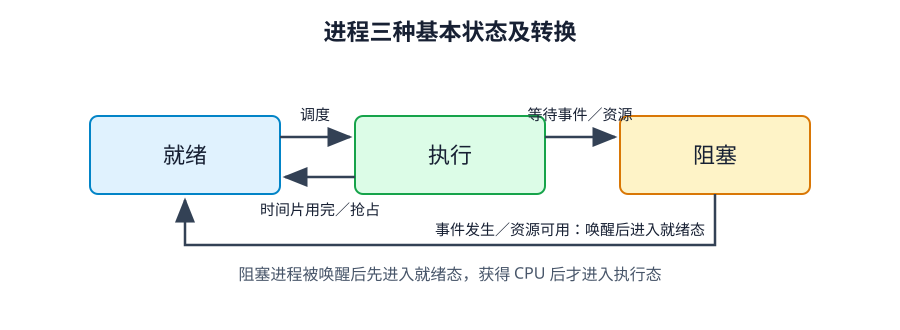
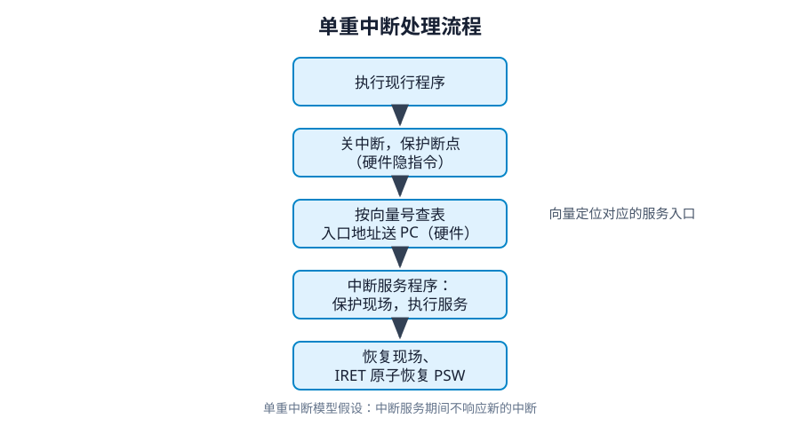
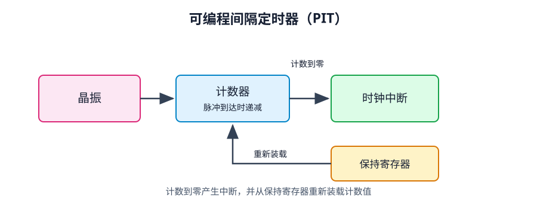
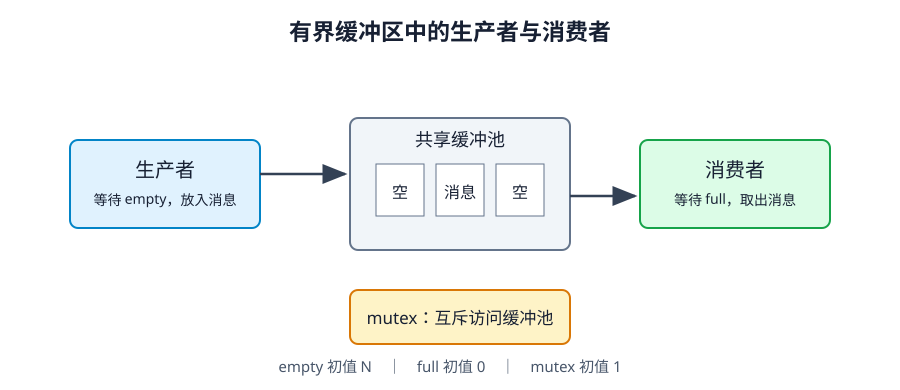

# 第 2 章 进程管理

> 依据：《操作系统概论》（2017 年版）第 2 章、配套自考大纲及附录答案。下文编号指大纲“考核内容与考核要求”；标注“自编”的算例为学习辅助，不是真题。

## 复习导航：大纲要求与笔记位置

| 大纲条目 | 层次 | 位置 | 学完应能做到 |
| --- | --- | --- | --- |
| 1.1 顺序执行、1.2 并发执行 | 识记、领会 | 第 1 节 | 对比特点，解释结果为何可能不同 |
| 2.1 进程定义与结构、2.2 PCB | 识记 | 第 2 节 | 定义、组成、PCB 的作用与信息 |
| 2.3 三态及转换、2.4 组织 | 识记 | 第 3 节 | 状态、转换条件、链接与索引 |
| 3.1–3.4 进程控制 | 识记 | 第 4 节 | 创建、撤销、阻塞、唤醒的条件与步骤 |
| 4.1 内核、4.2 中断定义、4.3 中断处理 | 识记、领会 | 第 5 节 | 内核功能、中断含义；断点、现场、中断入口与返回 |
| 4.4 两种执行态、系统调用、4.5 调用过程 | 识记、领会 | 第 6 节 | 态转换及系统调用与函数调用的区别 |
| 4.6 时钟体系、4.7 时钟机制 | 识记、领会 | 第 7 节 | RTC、PIT、时钟驱动程序 |
| 5.1 线程概念与比较、5.2 线程控制 | 领会 | 第 8 节 | 进程与线程、两种线程实现、控制过程 |
| 6.1 同步基本概念与四条准则 | 领会 | 第 9 节 | 临界资源、临界区与协调 |
| 6.2 整型信号量、6.3 记录型信号量 | 综合应用 | 第 10 节 | 会设初值、写 P/V、跟踪数值和阻塞 |
| 6.4 生产者—消费者、读者—写者 | 综合应用 | 第 11 节 | 能独立建立同步程序 |
| 6.5 管程及两类应用 | 领会 | 第 12 节 | 条件变量、缓冲池、哲学家进餐 |
| 6.6 进程通信 | 识记 | 第 13 节 | 共享存储器、管道、消息缓冲队列 |

全章十三节分四块铺开：第 1–4 节定义进程、PCB、三态转换与控制原语；第 5–7 节讲内核支撑机制（中断、系统调用、时钟）；第 8 节把调度单位拆到线程；第 9–13 节处理并发协作，涵盖信号量 P/V、管程与进程通信。教材另说明，本章出现的 Linux 内核源码片段不纳入考核范围。

## 本章学习目标

程序一旦并发，每次执行到哪儿、手里占了哪些资源，就得有套机制替它记账：进程是记账的单位，PCB 是账本，三态转换规定账本怎么翻页；内核再用中断、时钟和系统调用接管执行流，进程之间要打配合，就落到同步与通信上。

读的时候先把三态图和 PCB 的四类信息练成条件反射，后面的控制、调度、阻塞唤醒全都建在这上面。信号量是本章唯一动笔算大题的地方：光看懂现成代码不够，得自己设初值、写 P/V、一格一格跟 `value` 的变化，换个缓冲区大小或售票规则还能推得下去才算过关。

## 1 顺序执行与并发执行（1.1、1.2，识记、领会）

| 执行方式 | 特点 | 理解 |
| --- | --- | --- |
| 顺序执行 | 顺序性 | 前一操作结束，才能进行后一操作 |
| 顺序执行 | 封闭性 | 在教材的独占资源模型中，运行环境的资源状态仅由本程序改变 |
| 顺序执行 | 可再现性 | 初始条件和环境相同，重复执行得到相同结果 |
| 并发执行 | 间断性 | 因共享有限资源，执行过程可能暂停再继续 |
| 并发执行 | 失去封闭性 | 共享数据和系统状态可由其他进程改变 |
| 并发执行 | 不可再现性 | 缺乏适当控制时，指令交错顺序不同可能产生不同结果 |

并发指多个程序在同一时间间隔内推进；单核上靠快速交替实现，并不是同一时刻都在 CPU 上跑。

拿共享变量 `counter`（初值 0）来说，两个进程各跑一次 `counter++`。这行高级语言代码落到机器级往往拆成“读入寄存器、加 1、写回内存”三拍：要是甲刚读到 0 就被切走，乙也读到 0 并写回 1，等甲恢复后再写回，两次自增只涨到 1；要是甲一口气跑完三拍才轮到乙，结果又是正常的 2。高级语言的一行语句未必是原子操作，而并发出错最恼人的地方正在于此——它不是每次必错，而是看调度和中断凑巧插在哪一拍，结果时对时错，这就叫“失去封闭性”与“不可再现性”。

## 2 进程与进程控制块（2.1、2.2，识记）

光有静态的程序代码，没法描述并发时“谁跑到哪一行、谁占着哪块数据”。为此引入进程：进程是允许并发执行的程序在某个数据集合上的一次运行过程。实体由三部分拼成：

- 正文段：被执行的机器指令。
- 用户数据段：执行时直接操作的数据。
- PCB（进程控制块）：记录运行环境与管理信息，供操作系统控制进程。

某一时刻进程在内存中的全部内容合称**进程映像**。进程具备并发性、动态性、独立性、异步性和结构特征五项属性。在未引入线程的传统模型里，进程一身兼两职，既是资源分配的基本单位，也是 CPU 调度运行的基本单位；引入线程后，这两项职责才拆开（第 8 节详述）。

| 比较 | 程序 | 进程 |
| --- | --- | --- |
| 性质 | 静态指令集合 | 程序的一次动态执行过程 |
| 存在时间 | 可长期保存在外存 | 创建后存在，结束时撤销 |
| 实体 | 程序代码 | 正文段、用户数据段、PCB |
| 对应关系 | 同一程序可供多个进程执行 | 一个进程也可先后执行不同程序 |

PCB 里装着操作系统识别和控制进程所需的全部账目，每个进程有且仅有一个。操作系统感知不到“一段正在跑的代码”，它只认 PCB——创建进程就是建 PCB，撤销进程就是收回 PCB，所以教材强调 **PCB 是进程存在的唯一标志**。

| 信息类别 | 主要内容 | 用途 |
| --- | --- | --- |
| 标识符信息 | 本进程、父进程、子进程标识 | 识别进程及关系 |
| 处理机状态信息 | 通用寄存器、PC、PSW、栈指针等 | 保存与恢复执行现场 |
| 调度信息 | 状态、优先级、调度所需数据 | 决定何时运行、运行多久 |
| 控制信息 | 程序和数据地址、同步通信、资源清单、链接指针 | 管理资源、通信及队列 |

全系统就那么一组物理 CPU 寄存器，所有进程轮流用。切走旧进程时，内核先把它的通用寄存器、PC、PSW 抄进它的 PCB；换新进程上台时，再从新进程的 PCB 里把当初存下的值装回 CPU，程序就能严丝合缝地接着上次停下的那条指令往下跑。

## 3 三种基本状态与进程组织（2.3、2.4，识记）

进程跑起来以后走走停停，PCB 里的状态字段专门记它眼下卡在什么环节。三态模型按“差不差其他条件”和“有没有拿到 CPU”把进程分成**就绪、执行、阻塞**三态。

| 状态 | 已满足的条件 | 还在等待什么 |
| --- | --- | --- |
| 就绪态 | 具备运行条件 | CPU |
| 执行态 | 已获得 CPU | 正在执行 |
| 阻塞态 | 因资源或事件暂不能运行 | I/O 完成、数据到达、资源可用等 |



*图2-1 进程状态转换图*

| 转换 | 原因 |
| --- | --- |
| 就绪 → 执行 | 被调度并获得 CPU |
| 执行 → 就绪 | 时间片用完或被抢占 |
| 执行 → 阻塞 | 等待资源或事件 |
| 阻塞 → 就绪 | 等待条件满足，被唤醒 |

三态图上最常考两条“画不出来的箭头”：为什么没有**阻塞 → 执行**，也没有**就绪 → 阻塞**？想通道理不用死背。阻塞进程等到了 I/O 完成，唤醒原语只负责把它挪回就绪队列排队，至于什么时候能上 CPU，还得等调度程序挑中它，所以没法一步跨进执行态；反过来，就绪态进程根本没在 CPU 上跑指令，连发起 I/O 请求或执行 `wait` 的机会都没有，自然不会无缘无故自己变成阻塞态。另外留神数量关系：单核 CPU 同一时刻最多 1 个进程处于执行态（N 核最多 N 个），但当这个进程阻塞或尚未调度时，执行态可以是 0 个，就绪队列既可能全空，也可能塞满全部进程。

操作系统管进程，落到数据结构上就是管 PCB。常用两种排法：**链接方式**靠 PCB 里的指针把同状态的进程串成链表（就绪队列常按优先级拆成多条，阻塞队列常按等待的事件拆成多条）；**索引方式**则按状态各建一张索引表，表项里存各个 PCB 的地址。

## 4 进程控制（3.1–3.4，识记）

三态之间的每一次跳变，加上进程的一生一死，都由内核里的**进程控制原语**操刀，执行期间不可中断，免得队列指针改到一半乱套。

| 操作 | 触发条件 | 教材的一般步骤 |
| --- | --- | --- |
| 创建 | 用户登录、作业调度、提供服务、应用请求 | 申请空白 PCB → 分配资源 → 初始化 PCB → 插入就绪队列 |
| 阻塞 | 请求服务未满足、等待操作完成、数据未到达、等待消息等 | 状态改阻塞 → 插入相应阻塞队列 → 转进程调度 |
| 唤醒 | 所等待的事件发生或资源可用 | 移出阻塞队列 → 改就绪态 → 插入就绪队列 |
| 撤销 | 正常结束、其他进程请求终止等；异常也可能导致结束 | 读取状态 → 若在执行则停止 → 按系统策略处理子孙进程 → 释放资源 → 移出 PCB |

创建进程的叫父进程，生出来的叫子进程，同一父进程下的子进程互称兄弟。父子之间既可以各跑各的，也可以由父进程等着子进程收尾；子进程既能共享父进程的资源，也能另辟独立的地址空间，具体看系统实现。

选择题常设一个坑：“父进程结束，子进程必定跟着终止。”这话太绝对。有些系统确实做级联终止，一撤撤一串；但 UNIX 一脉的做法是把失去父进程的孤儿进程过继给 `init` 进程接管，子进程照跑不误。顺带分清 UNIX 里的两个调用：`fork` 负责把新进程生出来，而让这个进程换上全新程序代码去跑，靠的是 `execve`。

## 5 操作系统内核与中断（4.1–4.3，识记、领会）

操作系统并不是整包代码都长驻内存。紧贴硬件、每秒要跑成百上千次的那批最底层模块常驻内存，合称**内核**，算是裸机硬件往上的第一层扩充。它干两类活：

- 支撑功能：中断处理、时钟管理、原语操作。
- 资源管理功能：进程管理、存储器管理、设备管理。

其中**原语**是由若干条指令组成的原子操作序列，一经启动必须一气呵成、中途不许打断；普通用户态代码天生没有这层保护。

**中断**则是打断 CPU 顺序取指、让它转去处理突发事件的机制，处理完再按规矩回原处接着跑。有了中断，CPU 就不必守着慢速外设空转，设备干完活自己发中断报信即可，多道并发和系统异步性全靠它撑着。

| 类型 | 来源 | 例子 |
| --- | --- | --- |
| 同步中断／内部中断／异常 | 与当前指令执行有关 | 除零、溢出、调试等 |
| 异步中断／外部中断 | 外部硬件产生 | I/O 完成、时钟等 |
| 外部可屏蔽中断 | 可受中断屏蔽控制 | 常见 I/O 中断 |
| 外部不可屏蔽中断 | 紧急硬件事件 | 某些硬件故障 |

别把“关中断”理解成捂住耳朵什么都不听。清掉中断允许位拦住的只是**外部可屏蔽中断**；要是当前指令自己除以零触发了内部异常，或者掉电、内存校验错发来了不可屏蔽中断（NMI），CPU 照样得立刻响应。另外，外部中断一般在一条指令跑完的间隙采样检查，而内部异常往往在指令执行半途就会爆出来。

单重中断处理过程：本次处理期间不响应新的中断，教材假定处理后返回原断点。

整个过程分两段，中间那条线是硬件与软件的分界。顺序不能颠倒，也常有人在这里把两段的动作记串。

**第一段：硬件的中断隐指令。全自动，不可被打断。**

1. 关中断。清除 PSW 中的中断允许位 IF，此后到达的可屏蔽中断只能排队等着。
2. 保护断点。把当前 PC（下一条待执行指令的地址）和 PSW 压入内核栈。
3. 按中断向量号索引中断向量表，取出该中断服务程序的入口地址（32 位 x86 上是 IDT）。
4. 入口地址送 PC。程序计数器一改，CPU 下一条取的就是服务程序的第一条指令。

这四步由硬件完成，没有一条属于操作系统代码。查表同样是硬件查的：向量号由中断控制器随中断请求送来，硬件拿它当表项下标算出地址。此刻软件还没上场，谈不上“软件去查中断向量表”。

**第二段：软件的中断服务程序 ISR。**

1. 保护通用寄存器现场。断点 PC 和 PSW 已由硬件压栈，通用寄存器的值要软件自己存。
2. 执行具体的设备服务，比如把网卡收到的帧搬进缓冲区、把键盘扫描码翻译成字符。
3. 恢复通用寄存器现场。
4. 执行中断返回指令（如 `IRET`）。它从栈里弹回 PSW 与 PC，处理器回到断点。

开中断就在这最后一步里完成。`IRET` 恢复的 PSW 本来就带着原先进程的 IF 位，一条指令原子地把中断允许恢复回去。所以别写成“软件里先开中断、再执行返回指令”：中间那个窗口里中断已经能被响应，可现场还没收拾干净，栈上还压着断点。教材把两段合成四步叙述，答题时按“硬件隐指令四步 + ISR 四步”分开写更稳。

**口径说明。** 教材 §6 把查中断向量排在保护现场之后，教材 §7 又写 CPU 按中断号取得中断向量值，两处次序本身不一致。本笔记正文按 §7 的硬件口径讲：查表由硬件在第 3 步完成，软件在拿到入口之后才上场。考试作答按教材 §6 的四步写更稳，不必展开这份细节；图2-8 按正文口径画，硬件段两个框、软件段两个框。



*图2-8 单重中断处理流程*

断点记录程序该从哪儿恢复执行，现场则是恢复执行所需的寄存器状态。中断向量标识中断源，中断描述符表 IDT 存着各服务程序的入口信息。教材 32 位 x86 实例里，表项地址是 `IDT 基址＋8×中断向量`，8 字节正好一个表项——第 3 步硬件算的就是这个下标。

## 6 用户态、系统态与系统调用（4.4、4.5，识记、领会）

要是让任意用户程序都能直接关中断、改页表、读写磁盘扇区，整个系统瞬间就会乱套。硬件因此把 CPU 执行状态劈成两档：**用户态**只能跑普通非特权指令、访问用户空间；**系统态**（又称核心态）拥有全部硬件特权，专门用来跑操作系统内核。用户程序想办越权的事，唯一的正门就是**系统调用**。

| 比较 | 用户程序的一般函数调用 | 系统调用 |
| --- | --- | --- |
| 执行状态 | 通常保持用户态 | 进入系统态执行内核服务 |
| 入口方式 | 转移到函数入口 | 通过受控的陷入／系统调用入口 |
| 查找依据 | 函数地址 | 系统调用号等 |
| 开销 | 常规调用开销 | 另有执行态转换、现场处理等开销 |

一次系统调用走完的链路很固定：用户程序调外层库函数 → 把系统调用号和参数放进约定位置 → 执行陷入指令（如传统 x86 的 `int 0x80`）切入系统态 → 内核保存现场、按调用号查表分派 → 跑完内核服务例程（如 `getpid()` 背后的 `sys_getpid()`）→ 带回结果、恢复用户态。

初学者常把“库函数、系统调用、进程切换”三件事揉成一团。其实像 `strcpy()` 这样的库函数全程在用户态里转，压根不进内核；即便调了 `getpid()` 触发系统调用进了内核，那也只是**当前进程自己**从用户态切到系统态去跑一段内核代码，办完事默认还回到当前进程——除非这次调用因为等资源阻塞了，或者返回前撞上调度时机，否则并不会发生进程切换。

教材把系统调用归成五类：进程控制、文件操作、设备管理、信息维护和通信，作用都是把内核服务收拢到统一且带权限检查的入口后面。

## 7 时钟体系与时钟机制（4.6、4.7，识记、领会）

没有时钟定期打断，一个死循环进程就能把单核 CPU 霸占到关机。除了盯紧时间片防止长期独占，操作系统还得靠时钟维护日常日期时间、给文件和网络包打时间戳、处理定时报警，并给每个进程的 CPU 用量记账。

| 部分 | 作用 |
| --- | --- |
| RTC／CMOS 时钟 | 电池供电，断电也不停，开机时供系统读取初始日期时间 |
| OS 时钟 | 开机后由操作系统接手维护，教材用 PIT 周期中断来说明 |
| PIT 可编程间隔定时器 | 由晶振、计数器、保持寄存器构成，周期性向 CPU 发时钟中断 |
| 时钟驱动程序 | 响应每次时钟中断，更新系统时间与各类定时计数 |

PIT 的硬件节奏很简单：晶振按固定频率吐出脉冲，每来一个脉冲计数器减 1；减到 0 就触发一次时钟中断，同时把保持寄存器里的初值重新装回计数器，周而复始。



*图2-12 PIT 的逻辑结构*

每次时钟中断一到，时钟驱动程序就上来干四件事：更新日期和时间；把当前进程的时间片余量减 1，减到 0 就挂起调度标志准备换人（只是让出 CPU 回就绪态，不是撤销进程）；给当前进程的 CPU 使用账本记一笔；递减定时报警计数器。

算个小账就能对上号：要是 PIT 每秒发 100 次中断，那每次中断（一个滴答 tick）就是 10 ms，分给进程 50 ms 时间片相当于让它跑满 5 个滴答。教材顺带提到的 Linux 2.4 变量 `jiffies` 存的就是开机以来攒下的总滴答数，不是年月日时分秒。

## 8 线程（5.1、5.2，领会）

前面把进程当成“资源容器＋执行流”的一体包，可一旦同一个应用里要同时干好几件事（比如浏览器一边收网络数据、一边渲染画面、一边响应滚动），每件事都开一个完整进程就太重了——建地址空间、复制页表、来回切换全是开销。于是系统把这两层拆开：**进程留作拥有资源的基本单位，线程独立出来当调度和分派的基本单位**。

同一个进程里的多个线程共享整片地址空间、打开的文件和全局变量，每个线程自己只揣着 PC、一组寄存器和私有栈这点轻便家当，创建、撤销和同进程内切换都轻快得多。

| 比较角度 | 进程 | 同一进程中的线程 |
| --- | --- | --- |
| 基本角色 | 资源拥有的基本单位 | 执行、调度与分派的基本单位 |
| 地址空间 | 进程间通常相互独立 | 共享所属进程地址空间 |
| 通信 | 使用进程通信机制 | 可直接读写共享变量，但仍须同步互斥 |
| 并发 | 不同进程间可以并发 | 同一进程内不同线程也可以并发 |
| 开销 | 创建、撤销、切换开销较大 | 通常较小，尤其同进程线程切换 |

对应 PCB，每个线程也有自己的线程控制块 **TCB**，记着线程标识、寄存器状态、调度优先级和记账信息，照样走就绪、运行、阻塞三态转换，同状态 TCB 串成队列管理。

按“内核知不知道线程存在”，教材对比了两种纯粹的实现模型：

| 比较 | 用户级线程（教材的纯用户线程模型） | 内核级线程 |
| --- | --- | --- |
| 谁管理 | 用户空间线程库管，内核眼里只有外层进程 | 内核亲自建 TCB 并管理 |
| 谁调度 | 内核把 CPU 分给进程，线程库再在进程内部排班 | 内核直接按线程调度 |
| 切换 | 用户态内就能切完，不用陷入内核，快 | 要进出内核态，开销大些 |
| 阻塞式系统调用 | 一个线程发起阻塞调用，整个进程跟着一起挂起 | 只阻塞发起调用的那个线程，同进程其他线程照跑 |
| CPU 时间分配 | 同进程的多个线程合分这一个进程的时间片 | 按线程拿时间片，线程多的进程分到的总时间更多 |
| 多处理器利用 | 内核只按进程派核，同进程线程没法在多核上真并行 | 同进程的多个线程可同时派到不同 CPU 核上并行 |

做题时盯紧用户级线程的那个死穴：因为内核压根看不见里面的线程，只要其中一个线程调了阻塞式系统调用，内核就会把整个外层进程标成阻塞，屋里其他明明能跑的线程也只能陪着干等。

线程控制四步（创建、终止、阻塞、唤醒）的路数跟进程控制一脉相承：创建时配好 TCB 入就绪队列；终止时定位 TCB、停掉执行、移出队列并留好待回收状态；阻塞时存现场入阻塞队列再另挑线程上台；唤醒时移回就绪队列。差别只在于这套动作归谁做——用户级线程归用户态线程库做，内核级线程归操作系统内核做。

## 9 同步与互斥的基本概念（6.1，领会）

不管是多进程还是多线程，只要并发着碰同一份数据，或者甲的下一步得等乙先把结果算出来，放任自流就会像第 1 节那个 `counter++` 一样乱套。**同步机制**要管的正是这两件事：一是让争用临界资源的进程**互斥**进入，二是让合作进程按约定的先后次序**协调**推进（狭义同步）。

| 概念 | 含义 |
| --- | --- |
| 临界资源 | 一次只允许一个进程访问的共享资源，如打印机、共享计数器 |
| 临界区 | 进程中访问临界资源的那段代码 |
| 进入区 | 临界区前面检查并申请进入许可的代码 |
| 退出区 | 临界区后面归还许可、通知等待者的代码 |
| 互斥 | 同一临界资源任意时刻至多一个进程在内 |
| 协调／狭义同步 | 合作进程按逻辑先后推进，如生产者先放数据、消费者再取 |

不管用硬件指令还是信号量，互斥的套路都一样：进临界区前先过进入区拿牌子，出来时在退出区把牌子交回去，牌子只有一块。衡量一套互斥方案合不合格，看四条准则：**空闲让进**（没人用就让进）、**忙则等待**（有人在里面就挡在门外等）、**有限等待**（别让申请者无限期饿死）、**让权等待**（进不去就把 CPU 让出来，别霸着核空转）。

其中“忙则等待”和“让权等待”最容易被读成同一件事。初学者常在这里把两者混为一谈，原因就在字面：都在等，凭什么说要分开？区别在等的方式。忙则等待规定的是非等不可，一个进程进不去临界区，就得等着；让权等待管的是怎么等，等的时候把 CPU 交出去，还是原地空转。整型信号量那句 `while S <= 0: 忙等` 满足了前者，恰恰违反了后者：它在等，也一直占着 CPU 转圈。

## 10 信号量与 P/V 操作（6.2、6.3，综合应用）

信号量表示资源数量、使用状况或事件关系。除初始化外，通过原子的 P/V 操作修改（P 即 wait，V 即 signal）；以下操作均针对共享的同一个信号量对象。

### 10.1 整型信号量

```text
P(S):
    while S <= 0:
        忙等
    S = S - 1

V(S):
    S = S + 1
```

P 操作中的条件检查和资源取得需要由底层机制保证原子性。上述代码仅表示操作语义；若直接用普通循环和赋值实现，多核环境中仍可能出现竞争。互斥信号量初值为 1，N 个同类资源初值为 N。整型机制的问题是忙等，不满足让权等待。

### 10.2 记录型信号量

```text
S = { value: 整数, L: 阻塞队列 }

P(S):
    S.value = S.value - 1
    if S.value < 0:
        把当前进程加入 S.L 并阻塞，放弃 CPU

V(S):
    S.value = S.value + 1
    if S.value <= 0:
        从 S.L 唤醒一个进程
```

记录型 P 操作先将 value 减 1，再根据结果是否小于 0 决定阻塞。V 操作则先加 1，结果小于等于 0 时唤醒等待者。阻塞的是调用 P 的当前进程；被唤醒的进程转为就绪，不等于立即取得 CPU，也不应重新执行一次已经完成扣减的 P。

- value ≥ 0：表示当前可用资源数量。
- value < 0：其绝对值表示该信号量队列中的等待进程数。教材相关句子省略绝对值，理解时需补全。

| 操作示例，初值 1 | 操作后 value | 结果 |
| --- | --- | --- |
| A 执行 P | 0 | A 取得许可 |
| B 执行 P | −1 | B 阻塞 |
| C 执行 P | −2 | C 阻塞 |
| A 执行 V | −1 | 唤醒一个等待者 |
| 获许可者完成并 V | 0 | 唤醒另一个等待者 |
| 最后一个完成并 V | 1 | 无等待者，许可归还 |

### 10.3 两种基本建模

互斥：`mutex = 1`，每个访问同一资源的进程都执行 `P(mutex) → 临界区 → V(mutex)`。

先后关系：要求 A 的 S1 完成后，B 才能执行 S2，设 `done = 0`；A 执行 `S1 → V(done)`，B 执行 `P(done) → S2`。V 位于产生事件的进程，P 位于等待事件的进程，两者配合表达这段先后约束。

写同步题时，先确定资源和先后关系，再定义信号量、写初值、标出临界区并安排 P/V。记录型信号量消除了忙等，但错误的 P/V 顺序仍可能造成死锁，也不保证公平。

教材另介绍 AND 型信号量，用一次操作同时申请多个资源；大纲 6.2、6.3 明确列出的应用重点是整型和记录型机制。

### 10.4 PV 建模五步

考场上现推一套 PV，按这五步走，不容易漏。

1. 找出共享资源与先后约束。把各进程的动作按时间顺序摊开，先圈“谁和谁抢同一个东西”，再圈“谁必须等谁”。
2. 给每条约束配一个信号量并定初值。互斥量给 1；表示可用资源数量的按初始数量给；表示“某事件尚未发生”的同步量给 0。
3. 写出各进程的主体。先不写 P/V，把动作按顺序列清楚，临界区用括号圈出来。
4. 按“先资源后互斥”插入 P/V。申请资源（或等事件）的 P 放在抢互斥的 P 之前，释放的 V 放在放掉互斥之后。顺序一反，就可能抱着锁等资源。
5. 反向检查是否可能死锁。逐对进程问一句：它们会不会各自握着一把对方正在等的锁？可能会，就调整顺序，或者改成一次性申请。

第三步最容易被跳过。很多人一边想逻辑一边写 P/V，写着写着就把“先做哪件事”和“先抢哪把锁”搅在一起。动作顺序单独写一遍，第四步的插入才有依据。

## 11 两个经典同步模型（6.4，综合应用）

### 11.1 生产者—消费者

生产者把数据放入含 N 个槽位的缓冲池，消费者从中取出数据。双方共享缓冲区和读写指针，访问这些状态时需要互斥。缓冲池满时生产者等待，缓冲池空时消费者等待，这又构成资源数量上的同步约束。

| 信号量 | 含义 | 初值 |
| --- | --- | --- |
| mutex | 缓冲池访问许可 | 1 |
| empty | 可申请的空缓冲区 | N |
| full | 可申请的消息 | 0 |

生产者循环：

```text
在私有变量中生产 item
P(empty)
P(mutex)
buffer[in] = item
in = (in + 1) mod N
V(mutex)
V(full)
```

消费者循环：

```text
P(full)
P(mutex)
从 buffer[out] 取到私有变量 item
out = (out + 1) mod N
V(mutex)
V(empty)
在临界区外消费 item
```



*图2-18 生产者—消费者共享缓冲池*

必须先申请资源，再申请互斥权。缓冲池已满时，若生产者先 P(mutex) 再 P(empty)，它会持有 mutex 并等待空位。消费者此时取不到 mutex，也就取不走数据、无法释放空位。双方因此死锁。缓冲池为空时，消费者反过来也会遇到同样的问题。

生产和消费放在临界区外，临界区只保护缓冲区及共享指针。P/V 执行过程中，资源可能已被预留但尚未发布，因此不能在任意时刻用 $\text{empty.value} + \text{full.value} = N$ 判断状态；稳定状态下，实际空位数和消息数之和才是 N。

### 11.2 读者—写者

多个读者可以同时读取数据；只要有写者访问数据区，就需要排除其他读者和写者。设 `readcount = 0`，`rmutex = 1` 保护计数器，`wmutex = 1` 控制共享数据区。

先建个心智模型：把这间数据区想成自习室。`wmutex` 是大门那把锁，`readcount` 是屋里的人数，`rmutex` 是门口登记本自己的锁，防的是两个人同时抢着改人数。

规矩是这样的。读者进门先翻登记本：屋里没人（`readcount == 0`），他顺手把大门反锁，写者进不来了；屋里已经有人，他登记一下就进屋坐下，根本不用碰大门。读者越多，越没人去动那把大门锁，读者能并发的道理就在这儿。最后一个离开的人（`readcount` 减到 0）负责开门，把屋子交还写者。写者简单：进门锁门，写完开门，全程独占，屋里不能有别人。

`rmutex` 只是登记本锁，管的是“别两个人在同一刻改计数”，跟屋里能坐几个人无关。所以真实读操作绝不能塞进 `rmutex` 临界区，一旦塞进去，读者就被迫排成单列，并发全废了。

这套结构可以直接搬去别的题。独木桥、单行桥、窄道会车，都是同一副骨架：同类可以同时通过，异类必须独占，而“计数归零的那个人”负责切换状态。把“读”换成“同向过桥”，把“写”换成“独占过桥”，把 `readcount` 换成桥上人数，P/V 的位置一格都不用动。

读者：

```text
P(rmutex)
if readcount == 0: P(wmutex)
readcount++
V(rmutex)

读共享数据

P(rmutex)
readcount--
if readcount == 0: V(wmutex)
V(rmutex)
```

写者：

```text
P(wmutex)
写共享数据
V(wmutex)
```

第一个读者替整群读者申请数据区，最后一个读者归还；中间进出的读者完全不碰 `wmutex`，这就是读者能并发的来源。而 `readcount` 本身是所有读者共改的共享变量，增减前后那对 `rmutex` 一步也不能省。

注意这套写法是**读者优先**：只要屋里还有读者没走完，后来的读者就能一直插队进来，守在门外的写者可能长期饿死。题目若要求写者优先，就得再加一层拦住后续新读者的锁。

### 11.3 教材综合题：单缓冲区读文件并打印

pA 每次从磁盘读一条记录到公共缓冲区，pB 每次取出并打印一条；缓冲区只容一条。它是 $N=1$ 的生产者—消费者问题，设 `empty=1, full=0, mutex=1`。

`pA` 循环：

```text
从文件读记录到私有变量
P(empty)
P(mutex)
写入公共缓冲区
V(mutex)
V(full)
```

`pB` 循环：

```text
P(full)
P(mutex)
从公共缓冲区复制到私有变量
V(mutex)
V(empty)
打印私有变量中的记录
```

与附录一致，取出到私有变量后就可以归还 empty，不必等待打印完成；如果直接从公共缓冲区打印，则必须保证打印结束前不会被覆盖。终止协议由题目另外约定，以上表达逐条交替的同步关系。

### 11.4 填空式 PV 专项

两卷的综合题压轴都是“给框架补空”：202410 综合 36 是“火车订票”，10 空、每空 1 分；202504 综合 36 是“售票”，5 空、每空 2 分。丢分点通常不是想不出模型，而是多写一次 `wait`、漏一个 `signal`。下面两题自编，题型同 202410/202504 综合 36，题面完整、可直接做。

**自编题一（自编，题型同 202410 综合 36，10 空）：火车订票。** 某车站有两个售票窗口 W1、W2，一个退票窗口 R 和一个统计进程 S，共用一个余票记录 `remain`，初值 100。任何时刻只允许一个进程访问 `remain`。售票窗口在余票为 0 时等待，退票窗口每退回 1 张就唤醒一个等待中的售票窗口，自己不必等待。统计进程每轮读一次 `remain` 并累加，读的时候同样不许别人改。请补齐下面程序中的 ①—⑩，一空只写一个 `wait` 或一个 `signal`。

```text
semaphore mutex = ___①;      /* 保护余票记录 remain */
semaphore tickets = ___②;    /* 当前可售的余票数 */

售票窗口 Wi:
    while (1) {
        取到一个乘客请求;
        ___③;
        ___④;
        remain = remain - 1;
        打印车票;
        ___⑤;
    }

退票窗口 R:
    while (1) {
        收到一张退票;
        ___⑥;
        remain = remain + 1;
        ___⑦;
        ___⑧;
    }

统计进程 S:
    while (1) {
        收到一次统计命令;
        ___⑨;
        读出 remain 并累加;
        ___⑩;
    }
```

**自编题二（自编，题型同 202504 综合 36，5 空）：两个售票点卖同一种票。** 两个售票点 A、B 和一个退票点 R 共用余票记录 `remain`，初值 200，任何时刻只允许一个进程访问；余票为 0 时售票点等待，退票点每退回 1 张就唤醒一个售票点。已知 `semaphore tickets = 200;`、`semaphore mutex = 1;`，退票点末尾的 `signal(tickets)` 已给出，只补 ①—⑤。

```text
售票点 A:
    while (1) {
        ___①;
        ___②;
        售出一张车票，remain = remain - 1;
        ___③;
    }

退票点 R:
    while (1) {
        ___④;
        退回一张车票，remain = remain + 1;
        ___⑤;
        signal(tickets);
    }
```

三条判空规则，考场上按顺序用：

1. 互斥量只在临界区前后成对出现：进入前一个 `wait(mutex)`，退出后一个 `signal(mutex)`；检查每个进程里这个量的 `wait` 与 `signal` 是否配平，只有一处就是漏了。
2. 同步量按“谁等谁”定向：等事件的那方写 `wait`，产生事件的那方写 `signal`；同一个同步量上的 `wait` 与 `signal` 分处两个进程，写在同一进程里必错。
3. 一空只写一个 `wait` 或一个 `signal`：想在一格里既申请资源又申请互斥，说明该拆成两空，格子数不够就是模型还没想清。

**参考答案**

```text
自编题一：
① 1              ② 100            ③ wait(tickets)   ④ wait(mutex)
⑤ signal(mutex)  ⑥ wait(mutex)    ⑦ signal(mutex)   ⑧ signal(tickets)
⑨ wait(mutex)    ⑩ signal(mutex)

自编题二：
① wait(tickets)  ② wait(mutex)    ③ signal(mutex)
④ wait(mutex)    ⑤ signal(mutex)
```

两题的错误答法集中在两处：把 `wait(mutex)` 提到 `wait(tickets)` 之前，或给售票窗口补一个 `signal(tickets)`。前者会在余票为 0 时抱着互斥量等票，退票窗口进不去、票放不回来，双方僵住；后者让余票凭空变多，`tickets` 的计数从此对不上实际票数。

## 12 管程（6.5，领会）

用信号量写大程序有个头疼的地方：P 和 V 散落在各个进程里，哪一处漏写或颠倒了次序，整个系统就可能死锁。**管程**把散装的锁收拢起来：把共享数据结构连同操作它的过程一并封装进一个模块，外部进程不许直接碰里面的变量，只能调管程的入口过程；而管程自身的机制保证**任意时刻最多只有一个进程在管程内部活跃执行**，互斥不用调用者自己操心。

至于“条件没满足先等一等”，管程交给**条件变量**处理：`x.wait()` 把当前进程挂到条件 `x` 的等待队列上阻塞，同时让出管程的独占权，免得堵死别人；`x.signal()` 则唤醒队列里的一个等待者。这里要特别留神它和信号量 `V` 操作的脾气差别：信号量的 `V` 会实打实把计数值加 1，哪怕眼下没人等，这张“通行证”也会存着留给后来者；条件变量本身没有计数值，要是调 `x.signal()` 时队列为空，这次通知就当场作废，不会攒下来。

### 12.1 管程实现生产者—消费者

把缓冲池、计数器 `count` 以及 `put`（放入）、`get`（取出）两个过程装进同一个管程。教材设了两个条件变量 `full` 和 `empty`，名字虽然跟 11.1 节的信号量一模一样，意思却反过来了：信号量里的 `full` 数的是“有几条消息可取”，而管程里的 `full` 代表“缓冲池已满”这个挂起原因——

- 放入过程：见 `count == N` 就在 `full` 上 `wait()`；有空位后写入数据、`count` 加 1，再调 `empty.signal()` 叫醒因池空而等待的消费者。
- 取出过程：见 `count == 0` 就在 `empty` 上 `wait()`；有数据后取出数据、`count` 减 1，再调 `full.signal()` 叫醒因池满而等待的生产者。

教材伪代码在判断 `count == N` 和 `count == 0` 时写的是 `if`，原因马上在 12.2 节揭晓；换成 Java、C++、POSIX 线程库写实际工程代码，等待条件一律得写成 `while` 循环重查。

### 12.2 哲学家进餐

5 人围坐，每人进餐需要左右两支筷子。若所有人各拿一支再等另一支，就会死锁。教材管程改成“左右两支都空闲才一次拿走”：为每人设 `thinking、hungry、eating` 三种状态和条件变量 `self[i]`，左右邻居下标分别是 $(i+4) \bmod 5$ 与 $(i+1) \bmod 5$。

```text
test(i):
    if state[i] == hungry and 左右邻居都不是 eating:
        state[i] = eating
        self[i].signal()

pickup(i):
    state[i] = hungry
    test(i)
    while state[i] != eating:
        self[i].wait()

putdown(i):
    state[i] = thinking
    test(左邻居)
    test(右邻居)
```

`test` 里那个 `if` 是对的：它只是检查并改状态，检查完就结束。要改的是 `pickup` 里等条件的那处，把 `if` 换成 `while`。差别来自管程的两种唤醒语义。

| 语义 | signal 之后 | 典型实现 | 等待处写什么 |
| --- | --- | --- | --- |
| Hoare，signal-and-wait | 唤醒者立刻让出管程，被唤醒者马上接手运行，条件此时必然成立 | 教材未命名语义；其 `if` 写法隐含 Hoare 式不可抢占假设（据代码推断） | `if` 够用 |
| Mesa，signal-and-continue | 唤醒者继续把管程过程跑完，被唤醒者只回到就绪队列重新抢锁 | Java、C++、POSIX 条件变量的实际实现 | 必须 `while` |

Mesa 下必须重查，理由有三条。`signal` 发出到被唤醒者真正抢回管程锁之间隔着时间窗，别的哲学家完全可能趁机把筷子又拿走了，条件再度失效；被唤醒者重新进场时看到的状态早已不是被叫醒那一刻的状态；再加上操作系统和运行时都允许条件变量发生“虚假唤醒”（没有收到 `signal` 也从 `wait` 返回）。

落到实际代码里还写 `if` 就会出事：从 `wait` 醒来不验条件直接往下走，哪怕 `state[i]` 还不是 `eating` 也照样端碗动筷。教材写 `if` 能自圆其说，靠的是 Hoare 语义下唤醒者立刻交权、中间没人插足。考试默写教材模型写 `if` 不算错，自己写工程代码则雷打不动用 `while`。

留意哲学家思考和吃饭都在管程外头，进管程只为改状态、验邻居。由于相邻两人绝不可能同时进入 `eating` 状态，这套方案根除了“人手一支筷子互等”的死锁；但若左右邻居轮番交替进餐，夹在中间的人仍可能长期轮不上，光靠这三段代码还不能保证绝对不饥饿。

## 13 进程通信（6.6，识记）

信号量和管程传递的只是“能不能走”的信号，真要在进程之间搬运成块的数据，得靠**进程通信（IPC）**机制。大纲点名要求识记共享存储器、管道和消息缓冲队列三项，教材另把消息传递作为大类一并交代：

| 方式 | 主要思想 | 注意 |
| --- | --- | --- |
| 共享存储器 | 划出共享数据结构或共享内存区，各进程直接读写交换数据 | 系统只给场地，读写互斥与先后同步得由进程自己用 P/V 等机制兜底 |
| 消息传递 | 调用操作系统提供的 `send`/`receive` 原语收发格式化消息 | 分直接通信（点名发给目标进程）和间接通信（发往中间信箱） |
| 管道 | 连接读写进程的特殊文件（pipe 文件），按先进先出的字节流传送 | 虽挂着“文件”名头，实则在内存缓冲区周转，不等于落盘保存；半双工、读空写满会阻塞 |
| 消息缓冲队列 | 发送方申请消息缓冲区填好正文，挂入接收方 PCB 下的消息队列 | 队列本身是临界资源，挂入和摘取同样离不开互斥信号量与消息计数信号量 |

消息缓冲区里一般装着四样东西：发送进程标识、消息长度、消息正文和指向下一缓冲区的指针；接收进程的 PCB 里则要相应配齐消息队列队首指针、保护队列的互斥信号量，以及统计队列里现有几条消息的资源信号量。

## 14 考核要求

本章共 25 条考核条目：识记 14 条、领会 8 条、综合应用 3 条，是整门课分量最重的一章。3 条综合应用全部压在 6.2–6.4（整型与记录型信号量、生产者—消费者、读者—写者），每年大题必见。复习时先拿稳进程组成、三态转换、单重中断两段八步、线程两类模型的对比，再集中火力练熟 PV 建模五步与填空判空规则，顺带理清管程条件变量与信号量在“是否攒计数”和“唤醒后是否重查”上的分界。

## 15 教材本章习题

题目取自教材第 2 章“习题”（共 16 题），答案取自教材附录“参考答案”（全部收录）。

### 15.1 单项选择题

**1. 下列选项中，操作系统提供给应用程序的接口是【　】。**

A. 系统调用　B. 中断　C. 库函数　D. 原语

**答案：A。** 系统调用是应用程序取得内核服务的程序接口；库函数可能只是对系统调用的封装。

**2. `wait(s)` 操作中的 `block(s, L)` 阻塞的进程是【　】。**

A. 申请资源的进程　B. 申请临界资源的进程　C. 调用 `wait(s)` 的进程　D. 提供 `wait(s)` 操作的系统进程

**答案：C。** 执行 P 操作后发现资源不可用时，当前调用 P 的进程进入阻塞队列。

**3. 在一个单处理机系统中存在 5 个进程，处于就绪队列中的就绪进程数最多为【　】。**

A. 0 个　B. 4 个　C. 5 个　D. 6 个

**答案：C。** 题目只问就绪队列，5 个进程可以全部处于就绪态；单处理机最多同时执行其中 1 个，并不意味着必须有 1 个执行态进程。

**4. 若记录型信号量 `s` 初值为 2，当前值为 −1，则 `s` 的阻塞队列中有【　】个进程。**

A. 0 个　B. 1 个　C. 2 个　D. 3 个

**答案：B。** 记录型信号量值为负时，负值的绝对值表示阻塞队列中的进程数。

### 15.2 填空题

**5. 进程是由正文段、___和___构成的实体。**

答案：用户数据段；进程控制块。

**6. 进程的 3 种基本状态是执行态、___态和___态。**

答案：就绪；阻塞。

**7. 整型信号量的值只能被___和___改变。**

答案：`wait` 操作；`signal` 操作。

**8. 临界区是指访问___的代码。**

答案：临界资源。

### 15.3 简答题

**9. 什么是进程？说明进程与程序的区别和联系。**

答案：进程是允许并发执行的程序在某个数据集合上的运行过程，由正文段、用户数据段和 PCB 组成。程序是静态的指令集合，进程是动态的执行过程；程序可长期保存在外存，进程有创建和撤销；一个程序可以对应多个进程，一个进程通常对应一次程序执行。

**10. 操作系统在什么时候创建进程？如何创建？**

答案：用户登录、作业调度、提供服务、应用请求时可创建。步骤为：申请空白 PCB → 分配资源 → 初始化 PCB → 插入就绪队列。

**11. 时钟中断信号如何产生？时钟驱动程序有什么功能？**

答案：PIT 的晶振产生固定频率脉冲，计数器随脉冲递减，减到 0 后产生时钟中断，并从保持寄存器重新装载计数值。时钟驱动程序维护日期时间，递减并检查当前进程时间片，记录 CPU 使用情况，递减报警计数器。

**12. 请说明单重中断的处理过程。**

答案：硬件阶段先关中断（清 IF），把断点 PC 与 PSW 压栈，再按中断向量号索引中断向量表取出服务程序入口，入口送 PC；随后进入软件阶段，保护通用寄存器，执行设备服务，恢复现场，最后执行中断返回指令，由硬件原子恢复 PSW 与 PC。教材把这两段合成四步叙述，顺序上硬件响应在前、软件处理在后。

**13. 进程具有哪些特征？**

答案：并发性、动态性、独立性、异步性、结构特征。

**14. 什么是线程？为什么要引入线程？**

答案：线程是进程中的实体，是独立调度和分派的基本单位，拥有 PC、寄存器、栈等少量资源并共享所属进程资源。引入线程可以减少进程创建、撤销和切换的开销，提高并发程度。

**15. 实现进程互斥的基本原理是什么？**

答案：把访问临界资源的代码置于临界区；进入前申请访问许可，临界区内一次只允许一个进程，退出时释放许可并唤醒等待者，同时满足空闲让进、忙则等待、有限等待、让权等待。

### 15.4 综合应用

**16. 有两个进程 `pA`、`pB` 合作解决文件打印问题：`pA` 将文件记录从磁盘读入主存缓冲区，每次读一个记录；`pB` 将缓冲区内容打印出来，每次打印一个记录。缓冲区大小等于一个记录大小。请用记录型信号量的 `wait(s)` 和 `signal(s)` 保证正确打印，并写出同步代码。**

**答案：** 设置 `mutex` 保护缓冲区，`empty` 表示空缓冲区，`full` 表示已有记录。初值为：

$$
\text{mutex.value} = 1,\qquad \text{empty.value} = 1,\qquad \text{full.value} = 0
$$

`pA`：

```text
while 还有记录:
    从磁盘读一条记录到私有变量
    wait(empty)
    wait(mutex)
    将私有变量中的记录写入公共缓冲区
    signal(mutex)
    signal(full)
```

`pB`：

```text
while 还有记录:
    wait(full)
    wait(mutex)
    从公共缓冲区复制一条记录到私有变量
    signal(mutex)
    signal(empty)
    打印私有变量中的记录
```

要点：三个信号量的含义和初值正确；生产者先申请 `empty`，消费者先申请 `full`；访问公共缓冲区时使用 `mutex`；取出记录后释放 `empty`。

## 16 闭卷复习与跨章联系（补充）

**一、闭卷自答（合上书逐题口述）**

1. 顺序执行与并发执行在封闭性、可再现性上差在哪，为什么同一段程序并发执行结果可能不同？
2. 进程由哪三部分组成，PCB 的四类信息各在什么时候用到？
3. 三态之间的四条基本转换各由什么事件触发，被唤醒的进程一定在运行吗？
4. 中断隐指令四步与中断服务程序四步分别是什么，开中断在哪一步完成、由谁完成？
5. 用户级线程与内核级线程在被谁调度、阻塞式系统调用上的表现有什么差别？
6. 记录型信号量 value 为负时绝对值表示什么，写 PV 时为什么必须先申请资源再申请互斥？

**二、本章易错**

1. 忙则等待管的是“进不去必须等”，让权等待管的是“等的时候要把 CPU 让出去”；整型信号量忙等满足前者，却违反后者（第 9 节）。
2. 查中断向量表由硬件隐指令完成，开中断则随中断返回指令（如 `IRET`）恢复 PSW 一并原子完成，别写成软件里先开中断再返回（第 5 节）。
3. 记录型信号量 `P` 操作阻塞的是调用它的当前进程；被 `V` 唤醒的进程只是回到就绪队列，不会立刻抢到 CPU，醒来后也不再重复扣减 `value`（第 10.2 节）。

**三、本章骨架**

| 层 | 一句话 |
| --- | --- |
| 记账单位 | 进程＝正文段＋用户数据段＋PCB，PCB 是系统感知进程存在的唯一标志 |
| 状态 | 就绪、执行、阻塞，只走四条基本转换，唤醒只回到就绪 |
| 接管 | 内核用中断隐指令、时钟中断和系统调用控制执行过程 |
| 并发协作 | 信号量 P/V 表达互斥与先后，记录型消除忙等，管程用条件变量封装等待 |
| 拆分 | 线程是调度与分派单位，进程是资源拥有单位 |

**四、跨章指路**

1. 与后续章节的衔接：就绪队列选谁上 CPU 见第 3 章；访存缺页触发阻塞等 I/O 见第 4 章；设备公共缓冲池的管理直接复用本章的资源信号量与队列互斥套路，见第 6 章。
