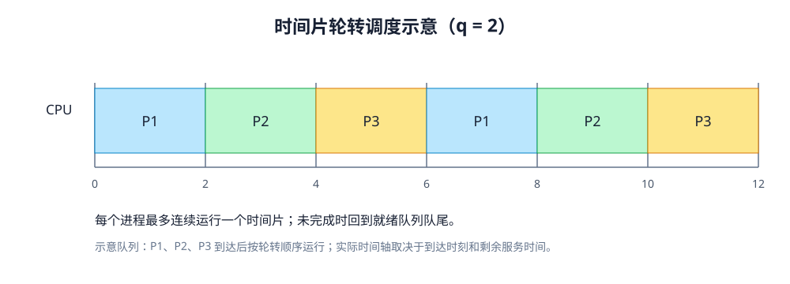
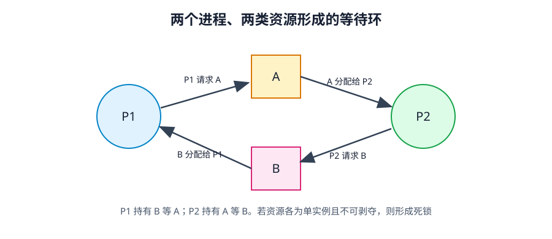
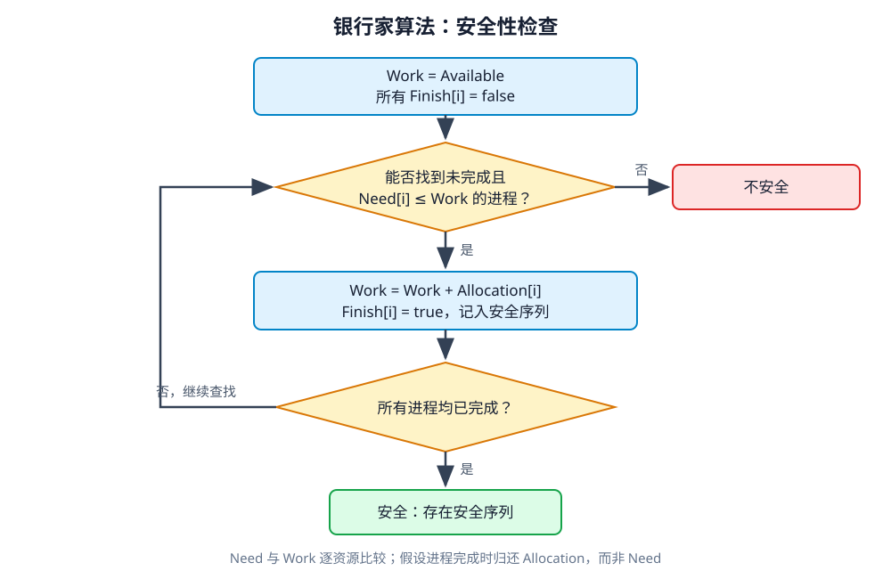

# 第 3 章 进程调度与死锁

> 依据：《操作系统概论》（2017 年版）第 3 章、配套自考大纲及附录答案。下文编号指大纲“考核内容与考核要求”；标注“自编”的算例为学习辅助，不是真题。

## 复习导航：大纲要求与笔记位置

| 大纲条目 | 层次 | 位置 | 学完应能做到 |
| --- | --- | --- | --- |
| 1.1 进程调度功能、1.2 调度时机 | 识记 | 第 1 节 | 能定义、列出调度入口时机 |
| 2.1 选择准则 | 识记 | 第 2 节 | 能说明各种指标的侧重点 |
| 2.2 周转、平均周转、平均带权周转 | 简单应用 | 第 3 节 | 会算单作业和平均值 |
| 2.3 六种算法及抢占时机 | 领会 | 第 4 节 | 说明规则、适用情形及局限 |
| 2.4 实时条件、EDF、LLF | 领会 | 第 5 节 | 说明条件并跟踪截止时间／松弛度 |
| 2.5 多处理机类型、分配与调度 | 识记 | 第 6 节 | 区分分类与三种调度方式 |
| 3.1–3.3 死锁定义、原因、必要条件 | 领会 | 第 7 节 | 用资源等待关系分析四个条件 |
| 4.1 死锁预防 | 识记 | 第 8 节 | 说明破坏哪个必要条件 |
| 4.2 安全／不安全状态 | 识记 | 第 9 节 | 会判断安全序列，区分不安全和死锁 |
| 4.2 银行家算法 | 简单应用 | 第 10 节 | 会算 Need、试分配和安全性 |
| 4.3 检测、解除，死锁定理 | 识记 | 第 11 节 | 会化简资源图并说出解除方式 |

大纲将平均时间计算和银行家算法列为应用题；调度算法要求理解规则与实现思路，多处理机调度要求识记。

## 本章学习目标

本章分为调度与死锁两部分。前半介绍调度准则、周转时间、六种算法、实时调度和多处理机调度；后半从死锁四个必要条件，讲到预防、避免、检测与解除。

调度算法需按规则逐步画时间轴，检查到达时刻和入队顺序，再计算完成时间。银行家算法则需完整填写安全性表，尤其确认 Work 增加的是 Allocation，而不是 Need。

## 1 调度功能与时机（1.1、1.2，识记）

外存后备队列中的作业与内存就绪队列中的进程，分别由两级调度处理。**作业调度**从外存选择作业，将其装入内存并建立进程；**进程调度**从就绪队列选择进程，分配 CPU 使用权。本章主要讨论进程调度。

教材列出五类可能触发进程调度的时机：

1. 当前进程正常结束或因异常终止。
2. 当前进程因等待资源或 I/O 转为阻塞。
3. 中断处理完成并准备返回。
4. 抢占式系统中出现优先级更高的就绪进程。
5. 当前进程的时间片用完。

## 2 调度准则（2.1，识记）

| 准则 | 含义／关注点 |
| --- | --- |
| 周转时间短 | 从提交到完成经过的总时间；用户等待体验 |
| 响应时间快 | 从请求提交到首次得到响应；交互系统关注 |
| 保证截止时间 | 最迟开始或完成的时限；实时系统关注 |
| 吞吐量高 | 单位时间完成的作业数 |
| CPU 利用率好 | 尽量减少处理器空闲 |

不同调度指标可能相互制约：短作业等待减少，长作业可能等待更久；时间片缩短可改善响应，却会增加切换开销。选择算法时，应结合批处理、分时或实时系统的目标权衡。

## 3 周转时间与计算（2.2，简单应用）

对作业 i：

$$
\begin{aligned}
\text{周转时间 } T_i &= \text{完成时刻} - \text{提交时刻}\\
\text{平均周转时间 } T &= \frac{\sum T_i}{n}\\
\text{带权周转时间 } W_i &= \frac{T_i}{Ts_i}\\
\text{平均带权周转时间 } W &= \frac{\sum (T_i / Ts_i)}{n}
\end{aligned}
$$

服务时间 $Ts_i$ 是作业实际占用 CPU 的总时长。周转时间 $T_i$ 则从提交时刻算到完成时刻，包含等待调入、等待 CPU、执行和等待 I/O 的时间，因此 $T_i \ge Ts_i$，带权周转时间 $W_i \ge 1$。若作业分多段执行，服务时间要累加各段 CPU 时间。题目若混用钟点时刻和分钟数，应先换成同一单位。

### 3.1 自编核算例

单 CPU，非抢占 FCFS，P1、P2 分别在 0、1 到达，服务时间为 3、2。P1 运行区间 `[0,3]`，P2 为 `[3,5]`。

| 进程 | 到达(提交) | 服务 | 开始 | 完成 | 等待 | 周转 | 带权周转 |
| --- | ---: | ---: | ---: | ---: | ---: | ---: | ---: |
| P1 | 0 | 3 | 0 | 3 | 0 | 3 | 1 |
| P2 | 1 | 2 | 3 | 5 | 2 | 4 | 2 |

平均周转时间为 `(3+4)/2=3.5`，平均带权周转时间为 `(1+2)/2=1.5`。P2 等待时间是 `3−1=2`，周转时间则是 `5−1=4`。

表头按八列统一。卷面口径：202410 综合 37 的阅卷表六列（含等待，每列 1 分），202504 综合 37 五列（无等待），两个平均值都在表外另算；考场上按题目给的列裁剪，别自己加列也别漏掉题目要的那列。

### 3.2 教材综合题：单作业平均周转时间（2016 年 4 月，未经原卷核验）

这题源自本地一份题目讲解资料，标为 2016 年 4 月综合题（年份与分值沿用该资料标注，未经官方原卷核验），正好对应大纲 2.2 的简单应用。题干只问单个作业的周转时间 $T_i = \text{完成时刻} - \text{提交时刻}$ 和算术平均值 $T = \frac{1}{n}\sum T_i$，不考带权周转时间；书写时注意别把单个作业的 $T_i$ 和总平均 $T$ 混用符号。

**原题。**

> 51. 有一个单道作业的操作系统，若在一段时间内先后到达 4 个作业，它们的提交时间和估计运行时间见下表。系统采用短作业优先（SJF）算法。
> 要求：
> （1）列表给出 4 个作业的开始执行时间、完成时间、周转时间；
> （2）计算平均作业周转时间。

| 作业 | 提交时间 | 估计运行时间（分钟） |
| --- | --- | --- |
| J1 | 8:00 | 60 |
| J2 | 8:20 | 35 |
| J3 | 8:25 | 25 |
| J4 | 8:30 | 20 |

单道是这题的前提：一次只装一道作业，选中的那道跑完才轮到下一道，中途不会被切走。所以不用考虑轮转和抢占，排出顺序、沿时间轴往下推就行。

**要求（1）：排开始、完成、周转。**

8:00 只有 J1 到达，让它跑。60 分钟后 9:00 结束，周转时间 9:00−8:00＝60。这一步容易误选 J4：它只要 20 分钟，看着最该优先，可 8:30 才提交，8:00 时还没进候选集。短作业优先挑的是“当前已到达的作业里最短的那个”，不是全局最短。

9:00 时 J2、J3、J4 都到了，运行时间分别是 35、25、20。选 J4，9:00 开始，9:20 完成，周转时间 9:20−8:30＝50。基准是提交时刻 8:30，不是开始时刻 9:00，中间等的这 30 分钟要算进周转时间。这里最容易丢分：按开始时刻算会得出 20。

9:20 只剩 J2 和 J3，取较短的 J3，9:45 完成，周转时间 9:45−8:25＝80。

9:45 时只剩 J2，J2 于 10:20 完成，周转时间为 10:20−8:20＝120 分钟。J2 在 J1 后面的三道作业中最早提交，却最后完成；这段差额来自排队等待，不是运行中主动让出 CPU。

| 作业 | 到达(提交) | 服务 | 开始 | 完成 | 等待 | 周转 | 带权周转 |
| --- | --- | --- | --- | --- | --- | --- | --- |
| J1 | 8:00 | 60 | 8:00 | 9:00 | 0 | 60 | 1 |
| J4 | 8:30 | 20 | 9:00 | 9:20 | 30 | 50 | 2.5 |
| J3 | 8:25 | 25 | 9:20 | 9:45 | 55 | 80 | 3.2 |
| J2 | 8:20 | 35 | 9:45 | 10:20 | 85 | 120 | 3.43 |

表按执行顺序排，不是按作业编号排。等待与带权周转两列按八列体例补出，本题原问只有开始、完成、周转三项；带权周转 J2 为 120÷35，除不尽，取 3.43。

**要求（2）：算平均值。**

平均周转时间 ＝(60＋50＋80＋120) ÷ 4 ＝ 310 ÷ 4 ＝ 77.5 分钟。

可用完成时刻总和减提交时刻总和核对周转时间总和：换算为分钟后，前者为 2305，后者为 1995，差值为 310，与表中周转时间之和一致。

**作答与扣分点。** 讲解资料标注这题 10 分，表格 6 分、平均周转时间 4 分；这份评分细则同样未经官方试卷核验。

计算时检查以下五点：

1. 拿全局最短的作业当候选，忘了 J4 在 8:00 还没提交。
2. 周转、等待、运行三个时间混着用。J4 的完成减提交是 50，开始减提交是 30，完成减开始是 20。本题没有 I/O，中间那 30 分钟就是等待。
3. 把非抢占的 SJF 当成可抢占，中途换作业；或者凭空给 CPU 塞一段空闲。本题四道作业首尾相接，没有空闲——别的题里若还没有作业到达，CPU 是可以闲着的。
4. 求平均忘了除以作业数，拿总周转时间当平均值。
5. 单位没统一到分钟，把 9:00−8:00 记成 1。

## 4 进程调度算法（2.3，领会）

调度准则确定评价目标，调度算法规定每次从就绪集合中选哪个进程。规则不同，执行顺序就不同，等待、响应和周转时间也随之改变。

| 算法 | 选择规则 | 优点与局限 |
| --- | --- | --- |
| FCFS 先来先服务 | 选最先进入就绪队列者，通常非抢占 | 简单；长进程在前会使短进程等待很久；偏有利于 CPU 繁忙进程 |
| SPF 短进程优先 | 在就绪进程中选估计服务时间最短者，教材描述为运行到完成或阻塞再调度 | 可降低平均等待／周转；长进程可能饥饿；运行时间依赖估计，不保证紧迫任务优先 |
| 优先权 | 选优先级最高的就绪进程 | 可按任务重要性调度；定义须看系统是数值大优先还是数值小优先 |
| RR 时间片轮转 | 就绪队列按 FIFO；运行一个时间片，未完成则放队尾 | 适合分时交互；片太短切换开销大，太长响应变慢；片足够大时近似 FCFS |
| 多级队列 | 按属性固定分入不同就绪队列，各队列可有自己的优先级和算法 | 开销较低；分类固定、灵活性差，低优先级队列可饥饿 |
| 多级反馈队列 | 进程可按反馈规则在不同优先级队列间移动；教材典型规则为高优先级队列时间片较短 | 兼顾短作业响应与长作业进展；规则较复杂，具体实现因系统而异 |

### 4.1 抢占、非抢占与优先级

- 非抢占式：进程获得 CPU 后持续执行，直到完成、阻塞或主动让出。期间即使有优先级更高或服务时间更短的进程到达，也要等待当前进程让出 CPU。教材中的 **SPF（短进程优先）默认采用非抢占方式**，每次从已到达的就绪进程中选择服务时间最短者；不要将其与可抢占的“短剩余时间优先”混淆。
- 抢占式：满足条件就剥夺当前进程的 CPU，教材给出两种时机——要么新进程到达时立即抢占，要么等到最近一次时钟中断再切换。
- 静态优先级与动态优先级：前者在创建时定死、全程不变；后者随运行时间增长或等待时间变长动态调整。
- 饥饿与老化：就绪进程长期抢不到 CPU 叫饥饿，教材给出的解法是**老化**——等得越久，逐步把它的优先级往上提。

再来看 **RR（时间片轮转）** 的推演规矩：每次从队首取出一个进程，运行 `min(时间片, 剩余服务时间)`；跑完就撤出，没跑完就放回队尾，同时把各进程的到达、空闲和完成时刻记清。

*图3-1 时间片轮转调度时间轴*

照配图走一遍完整的。图设三个进程、时间片 q＝2，三者在 0 时刻同时就绪，各需 4 个时间单位（图上 P1、P2、P3 各出现两次、每次占 2 格，没有第三次出现）。初始就绪队列 `P1, P2, P3`，各剩 4。

| 区间 | 队首 | 该进程剩余 | 跑多久 | 结果 | 之后队列 |
| --- | --- | --- | --- | --- | --- |
| 0–2 | P1 | 4 | 2 | 用满一片未完成，剩 2，回队尾 | `P2, P3, P1` |
| 2–4 | P2 | 4 | 2 | 剩 2，回队尾 | `P3, P1, P2` |
| 4–6 | P3 | 4 | 2 | 剩 2，回队尾 | `P1, P2, P3` |
| 6–8 | P1 | 2 | 2 | 跑完，剩 0，撤销 | `P2, P3` |
| 8–10 | P2 | 2 | 2 | 跑完 | `P3` |
| 10–12 | P3 | 2 | 2 | 跑完 | 空 |

完成时刻依次是 8、10、12。三者在 0 时刻到达，周转时间就等于完成时刻：T1＝8、T2＝10、T3＝12，平均周转时间 (8＋10＋12)÷3＝10。带权周转时间分别是 8÷4＝2、10÷4＝2.5、12÷4＝3，平均 2.5。

这一遍里有四个动作值得记牢。

- 队列一直在转，但每个进程每轮只拿一片。P1 在 6–8 拿到第二片，是队列轮到它，不是“别人跑完了补给它”。
- 时间片用满而没跑完，叫时间片到期：进程回队尾，状态回到就绪。跑完了才撤销。这两种结果在推演表里要分开记，混了就会多算一轮。
- 队首若只剩不到一个时间片，跑完就撤，不会空占满整片。本例每个进程每次都恰好用满 2 格，没撞上这种情形；换一组数据就可能遇到。
- 到达时刻一旦错开，第一轮队列里就只有已到达的那几个，新进程在到达时插入队尾。图上三者同时到达，所以从第一轮起队列就是满的。

推演 RR 时，每次运行 `min(时间片, 剩余服务时间)`；若进程未完成，就放回队尾。队列顺序出错时，先核对到达时刻和入队规则。

还有一个边界要留神：就绪队列空了的时候，正在运行的进程通常不会被强行切走，它可以把剩下的时间片用完甚至直接跑完。教材模型没有要求“到点必换”。本例不会撞上这种情形，题目一旦给出错开的到达时刻，就得判清楚。

## 5 实时系统调度（2.4，领会）

实时系统光靠普通优先级不够，必须满足四项前提才能兑现截止时间承诺：手头有齐全的调度信息（就绪时间、开始或完成截止时间、处理时间、资源需求、优先级）；系统总处理能力兜得住；配有抢占机制；中断响应和上下文切换足够快。

拿周期性硬实时任务来说，怎么算“处理能力兜得住”？设任务 $i$ 的周期为 $P_i$、每次处理耗时 $C_i$，那它吃掉的处理器时间比例就是 $C_i / P_i$。所有任务加起来不能超出总算力：

$$
\begin{aligned}
\text{单处理机：}\quad &\sum \frac{C_i}{P_i} \le 1\\
\text{n 个处理机：}\quad &\sum \frac{C_i}{P_i} \le n
\end{aligned}
$$

大纲重点考两种动态实时调度算法：

| 算法 | 优先依据 | 执行规则 |
| --- | --- | --- |
| EDF 最早截止时间优先 | 谁的截止时间早谁先上 | 就绪队列按截止时间从早到晚排；抢占与非抢占场景都能用 |
| LLF 最低松弛度优先 | 谁的“富余时间”少谁先上 | 松弛度 $L = \text{截止时间 } T - \text{当前时刻 } T_c - \text{剩余处理时间 } T_s$，挑 $L$ 最小者 |

EDF 根据截止时刻决定优先级，不按到达先后排序。LLF 则要随时间更新松弛度。任务执行 1 个时间单位时，当前时刻 $T_c$ 增加 1、剩余处理时间 $T_s$ 减少 1，因此该任务的 $L$ 不变；等待中的任务处理时间不变，松弛度会逐渐减小。若其松弛度降到 0，再延迟执行就会错过截止时间。

## 6 多处理机调度（2.5，识记）

机器里不止一颗 CPU 时，先看硬件怎么连、内核怎么管，再看线程怎么往多颗核上派：

| 分类角度 | 类型 | 含义 |
| --- | --- | --- |
| 耦合程度 | 紧密耦合 | 多个处理机共享主存和 I/O 设备，归同一个操作系统统一管理 |
| 耦合程度 | 松弛耦合 | 多台机器各有独立内存与 I/O，能各自单干，靠通信链路互联协作 |
| 处理器控制关系 | 对称多处理（SMP） | 各处理器地位平等，都能自己跑内核代码、自己挑任务调度 |
| 处理器控制关系 | 非对称多处理 | 指定一颗主处理器统管内核与任务分派，其余从处理器只管干活 |

往多颗处理器上派活，教材讲了三种路数：

- **自调度**：全系统共用一条就绪队列，各处理器空闲时从队列中取任务。任务可由空闲处理器继续领取，有利于分散负载；多个处理器同时访问队列会增加锁竞争。同一应用中相互依赖的线程也可能无法同时运行，导致处理器等待。
- **成组调度**：在同一时间片内，将同一应用中密切协作的一组线程分配到多个处理器并行执行，减少线程相互等待和切换的开销；代价是调度器需要协调多个处理器的分配。
- **专用处理器分配**：应用运行期间，为每个线程分配专用处理器，减少切换开销；但线程等待 I/O 时，其处理器也可能闲置，整体利用率较低。

## 7 死锁定义、原因与四个必要条件（3.1–3.3，领会）

调度算法决定就绪进程的执行次序，但无法直接解决死锁。若一组进程中的每个进程都在等待其他进程持有的资源，且这些资源只有由等待中的进程释放后才能获得，这组进程就无法继续推进，形成**死锁**。其主要原因是资源竞争和不当的申请、释放次序。

死锁要想成立，下面**四个必要条件**缺一不可：

| 条件 | 含义 | 典型破坏思路 |
| --- | --- | --- |
| 互斥 | 资源一次只允许一个进程独占 | 改成可共享访问，但打印机、写锁这类资源天生没法取消互斥 |
| 请求和保持 | 手里占着已分到的资源不放，同时伸手要新资源 | 开跑前一次性要齐全部资源，或者要新资源前先把旧资源全退回 |
| 不剥夺 | 分出去的资源只能由进程自己用完释放，别人不能硬抢 | 新申请得不到满足时，按规则强行收回或让出已占资源 |
| 环路等待 | 存在 `P0 等 P1、P1 等 P2 … Pn 等 P0` 的闭环等待链 | 给所有资源类型统一编号，硬性规定只能按编号递增顺序申请 |

死锁发生时，四个必要条件必须同时成立；破坏其中任意一个，就可阻止这类资源死锁。但单独满足某一条件不能证明已死锁，例如互斥访问本身并不意味着发生死锁。

*图3-2 资源分配图中的等待环*

图3-2 就是最典型的双进程死锁：资源 A、B 各只有 1 个实例，互斥且不可剥夺；P1 占着 B 等 A，P2 占着 A 等 B，四条条件全齐，谁也退不出来。

## 8 死锁预防（4.1，识记）

死锁预防的思路是保证至少一个必要条件不成立。互斥通常是某些资源的固有属性，不适合一概取消，教材因此重点讲摒弃其余三个条件：

| 摒弃的条件 | 做法 | 代价／限制 |
| --- | --- | --- |
| 请求和保持 | 运行前一次性申请所需资源；或申请新资源前释放已有资源 | 资源需求难以预知，资源可能闲置，并发性下降 |
| 不剥夺 | 新申请无法满足时，按策略释放／抢占已持资源 | 实现复杂；某些资源不适合抢占，可能要回滚 |
| 环路等待 | 资源类型排序，进程按递增次序申请 | 限制申请顺序、降低灵活性，可能浪费资源 |

死锁预防通过限制申请或占有方式，使至少一个必要条件不成立；死锁避免则允许动态申请，但在分配前检查新状态是否安全。银行家算法属于后者。

## 9 安全状态与不安全状态（4.2，识记）

若能找到一个进程序列，使每个进程轮到自己时都能被满足，系统就处于安全状态。满足它的是当前可用资源，加上前面进程完成后释放的资源；该序列称安全序列。找不到这样的序列，就是不安全状态。

不安全状态不等于已经死锁。安全状态存在一条安全序列，按该序列分配资源，可以保证所有进程在其最大需求范围内完成；不安全状态表示缺少这种保证，后续可能发生死锁，但当前未必已经死锁。判断时应区分“能否保证完成”和“是否已经相互等待”。

单一资源类型下有直观判法。逐个寻找 `Need <= Available` 的进程，假设它完成并归还已占资源 `Allocation`，更新可用量，再继续检查。

## 10 银行家算法（4.2，简单应用）

银行家算法把安全状态的判断用于每一次资源申请。它先试算请求获准后的状态，再检查是否仍存在让全部进程完成的安全序列。

先约定记号：n 个进程、m 类资源。

| 数据 | 含义 |
| --- | --- |
| Available[j] | 当前 j 类资源可用数量 |
| Max[i,j] | 进程 i 对 j 类资源的最大需求 |
| Allocation[i,j] | 已分给进程 i 的 j 类资源 |
| Need[i,j] | 进程 i 尚需资源，`Need = Max − Allocation` |
| Requesti | 进程 i 本次提出的请求向量 |

向量不等式逐项比较。`X <= Y` 表示每一种资源都不超过对应分量，不是把各分量求和后再比较。

### 10.1 安全性检查

1. `Work = Available`；所有 `Finish[i] = false`。
2. 找一个 `Finish[i] = false` 且 `Need[i] <= Work` 的进程。
3. 假设它运行完毕：`Work = Work + Allocation[i]`，置 `Finish[i] = true`，记下进程序列。
4. 重复检查。若所有进程 Finish 为 true，安全；否则若找不到可继续者，不安全。

*图3-3 银行家算法安全性检查*

### 10.2 资源请求检查

进程 i 请求 `Requesti` 时：

1. 若 `Requesti > Needi`，超过声明的最大需求，拒绝该请求。
2. 若 `Requesti > Available`，现有资源不足，进程等待。
3. 否则做试分配：`Available -= Requesti`；`Allocation[i] += Requesti`；`Need[i] -= Requesti`。
4. 对试分配后的状态运行安全性检查。安全则确认分配；不安全则撤销试分配，令进程等待。

### 10.3 教材例题状态核对

教材的 A、B、C 三类资源例题中，初始 `Available=(3,3,2)`，安全序列为 `<p1,p3,p4,p2,p0>`。p1 请求 `(1,0,2)` 后，`Available=(2,3,0)`、`Need1=(0,2,0)`。试分配后的状态仍然安全，因此可以分配。

安全性检查的记录应包含三项：每一步的 Work，所选进程的 Need，以及该进程完成后归还的 Allocation。Work 增加的只是原来已经分配给进程的资源。当前可用量满足不了某一个进程，并不表示整个状态不安全，其他进程可能先完成并释放资源。

### 10.4 安全性检查过程表

安全性检查过程表包含六列：`进程 | Work | Need | Allocation | Work+Allocation | Finish`。教材例题初始 `Available=(3,3,2)`，共有五个进程、三类资源，先用 `Need = Max − Allocation` 补齐初始状态：

| 进程 | Allocation | Max | Need |
| --- | --- | --- | --- |
| p0 | (0,1,0) | (7,5,3) | (7,4,3) |
| p1 | (2,0,0) | (3,2,2) | (1,2,2) |
| p2 | (3,0,2) | (9,0,2) | (6,0,0) |
| p3 | (2,1,1) | (2,2,2) | (0,1,1) |
| p4 | (0,0,2) | (4,3,3) | (4,3,1) |

接着逐行推，一行选中一个进程：

| 进程 | Work | Need | Allocation | Work+Allocation | Finish |
| --- | --- | --- | --- | --- | --- |
| p1 | (3,3,2) | (1,2,2) | (2,0,0) | (5,3,2) | true |
| p3 | (5,3,2) | (0,1,1) | (2,1,1) | (7,4,3) | true |
| p4 | (7,4,3) | (4,3,1) | (0,0,2) | (7,4,5) | true |
| p2 | (7,4,5) | (6,0,0) | (3,0,2) | (10,4,7) | true |
| p0 | (10,4,7) | (7,4,3) | (0,1,0) | (10,5,7) | true |

第一行的 Work 取初始 Available，之后每一行的 Work 取上一行的 Work+Allocation，表示已完成进程释放资源后的可用量。五行均满足 `Need <= Work`，因此得到安全序列 `<p1,p3,p4,p2,p0>`。

**Work 增加的是该进程的 Allocation，不是 Need。** 安全性检查假设进程能获得剩余需求、执行完成并归还全部资源，这一过程对 Work 的净增加量是原先已分配的 Allocation。若误写为 `Work + Need`，后续可用量就会失真，安全性判断也会出错。

可用资源总量核对：初始 `Available` (3,3,2) 加上全部 Allocation (7,2,5)，等于 (10,5,7)，即 A、B、C 三类资源的总量。最后一个进程完成后，Work 应等于这个总量，可用来检查表格是否算错。

## 11 死锁检测、资源分配图与解除（4.3，识记）

**死锁检测与解除**允许系统先分配资源，再定期或按需检测死锁。检测过于频繁会增加 CPU 开销，间隔过长则可能使更多进程等待，因此需结合死锁发生概率和检测成本决定频率。

检测工具是**资源分配图**：圆圈画进程，方框画资源类，框里的小圆点代表该类资源有几个实例；从进程指向资源框的有向边叫**请求边**（还要申请），从资源实例小圆点指向进程的有向边叫**分配边**（已经占住）。

**死锁定理**指出：当前状态死锁，当且仅当资源分配图**不可完全简化**。化简时，选择一个非孤立、且当前请求可由空闲资源满足的进程，假设它完成并释放全部已占资源，删除与它相连的请求边和分配边，再对剩余进程重复这一过程。若所有进程均可化为孤立点，则无死锁；若还有进程未化简却无法继续，则存在死锁。

“有环就死锁”只适用于**每类资源只有单个实例**的情况。若某类资源有多个实例，环外进程可能先完成并释放所需资源，使环中的进程继续执行。因此，多实例资源分配图应通过化简判断，不能只看是否存在环。

一旦查出死锁，解除只有两条路：

- **终止进程**：终止全部死锁进程，或按代价逐个终止，每次重新检测，直到死锁解除。选择进程时，需要考虑优先级、已执行时间、剩余执行时间、占有资源量、对其他进程的影响，以及是否为前台交互任务。
- **剥夺资源**：从部分死锁进程中收回资源，分配给其他进程，以打破等待关系。需要决定剥夺对象、进程回滚的安全检查点，并避免反复选择同一进程而造成饥饿。

## 12 考核要求

本章共 14 条考核条目：识记 7 条、领会 5 条、简单应用 2 条。简单应用包括 2.2 周转时间计算和 4.2 银行家算法。复习时对照各调度准则与六种算法，画出 FCFS、SPF、RR 的时间轴，检查到达时刻与入队顺序；再练习死锁四个必要条件和银行家算法六列安全性检查表。

## 13 教材本章习题

题目取自教材第 3 章“习题”（共 13 题），答案取自教材附录“参考答案”（全部收录）。

### 13.1 单项选择题

**1. 影响时间片大小选择的主要因素有【　】。**

A. 系统的响应时间　B. 系统的周转时间　C. 系统在单位时间内处理的作业量　D. 进程需要 CPU 服务的总时间

**答案：A。** 时间片直接影响轮转系统的响应时间；实际选择还要兼顾进程数和切换开销。

**2. 关于多级队列调度算法，下列说法正确的是【　】。**

A. 每个就绪队列的优先权不同，调度算法相同

B. 每个就绪队列的优先权相同，调度算法不同

C. 各就绪队列调度算法和优先权都可能不相同

D. 一个进程在运行过程中可能被插入不同的就绪队列

**答案：C。** 多级队列可为各队列配置不同优先权和调度算法；进程固定属于某队列，跨队列移动是多级反馈队列的特点。

**3. 某系统中有 4 个并发进程，都需要同类资源 3 个。该系统不会发生死锁的最少资源数是【　】。**

A. 6　B. 7　C. 8　D. 9

**答案：D。** 最坏情况是每个进程先各占 2 个，共占 8 个；再有第 9 个资源即可让一个进程取得第 3 个资源并完成、释放资源，随后其他进程依次完成。一般 n 个进程各需 k 个同类资源时，足以保证不死锁的资源数为 `n(k−1)+1`。

### 13.2 填空题

**4. FCFS 适合___进程，不利于___进程。**

答案：长；短。教材附录此处作“短、长”，与正文相反，按正文与通用结论作答。

**5. 采用基于静态优先权的调度算法时，若不断有高优先权进程进入就绪队列，低优先权进程可能进入___状态。**

答案：饥饿。

**6. ___算法是用来避免死锁的算法。**

答案：银行家。

**7. S 为死锁状态的___条件是当且仅当 S 状态的资源分配图是不可完全简化的。**

答案：充分。教材附录按此空格给出答案；完整死锁定理的表述见本章第 11 节。

### 13.3 简答题

**8. 进程调度的功能是什么？**

答案：内核调度程序按策略和算法从就绪进程中选择一个，为其分配 CPU，使其进入执行状态。

**9. 说明什么是时间片轮转调度算法。**

答案：就绪进程按先来先服务排队；队首进程运行一个时间片，完成则退出，未完成则回到队尾；时间片到期后重新调度。时间片过短会增加切换开销，过长则响应变慢。

**10. 什么是多级队列调度算法？**

答案：按进程属性将就绪队列划分为多个独立队列，进程进入系统后固定分配到一个队列；各队列可有不同优先级和调度算法。调度开销较低，但灵活性较差，低优先级队列可能饥饿。

**11. 什么是自调度方式？有什么优缺点？**

答案：多个处理器从共享就绪队列自行选择进程或线程。优点是实现简单、可动态分配负载；缺点是队列竞争和调度开销，合作线程也可能因未同时运行而相互等待。

**12. 什么是死锁？引起死锁的原因是什么？**

答案：多个进程竞争共享资源，各自等待其他进程占有的资源而都不能继续推进，这种僵持状态称为死锁。其原因是竞争共享资源且资源分配顺序不当。

### 13.4 综合应用

**13. 考虑系统某一时刻的状态，资源列顺序为 A、B、C、D。**

| 进程 | Allocation | Max | Available |
| --- | --- | --- | --- |
| p0 | (0,0,1,2) | (0,0,1,2) | (1,5,2,0) |
| p1 | (1,0,0,0) | (1,7,5,0) | |
| p2 | (1,3,5,4) | (2,3,5,6) | |
| p3 | (0,6,3,2) | (0,6,5,2) | |
| p4 | (0,0,1,4) | (0,6,5,6) | |

用银行家算法回答：

1. Need 矩阵是什么？
2. 系统是否处于安全状态？
3. 若 p1 请求 `(0,4,2,0)`，能否立即满足？

**（1）计算 Need。** `Need = Max − Allocation`，逐资源列相减：

| 进程 | Need (A,B,C,D) |
| --- | --- |
| p0 | (0,0,0,0) |
| p1 | (0,7,5,0) |
| p2 | (1,0,0,2) |
| p3 | (0,0,2,0) |
| p4 | (0,6,4,2) |

**（2）检查初始安全性。** 初始 `Work = Available = (1,5,2,0)`。按 `Need[i] <= Work` 逐项比较，并在假设进程完成后加回其 Allocation：

| 步骤 | 进程 | Need | 完成前 Work | 完成后 Work = Work + Allocation |
| --- | --- | --- | --- | --- |
| 1 | p0 | (0,0,0,0) | (1,5,2,0) | (1,5,3,2) |
| 2 | p2 | (1,0,0,2) | (1,5,3,2) | (2,8,8,6) |
| 3 | p3 | (0,0,2,0) | (2,8,8,6) | (2,14,11,8) |
| 4 | p4 | (0,6,4,2) | (2,14,11,8) | (2,14,12,12) |
| 5 | p1 | (0,7,5,0) | (2,14,12,12) | (3,14,12,12) |

因此存在安全序列 `<p0,p2,p3,p4,p1>`，系统处于安全状态。

**（3）检查 p1 的请求。** 请求 `(0,4,2,0)` 不超过 `Need1=(0,7,5,0)`，也不超过 `Available=(1,5,2,0)`，可以试分配：

$$
\begin{aligned}
\text{Available} &= (1,5,2,0) - (0,4,2,0) = (1,1,0,0)\\
\text{Allocation}_1 &= (1,0,0,0) + (0,4,2,0) = (1,4,2,0)\\
\text{Need}_1 &= (0,7,5,0) - (0,4,2,0) = (0,3,3,0)
\end{aligned}
$$

对试分配状态进行安全性检查：

| 步骤 | 进程 | Need | 完成前 Work | 完成后 Work |
| --- | --- | --- | --- | --- |
| 1 | p0 | (0,0,0,0) | (1,1,0,0) | (1,1,1,2) |
| 2 | p2 | (1,0,0,2) | (1,1,1,2) | (2,4,6,6) |
| 3 | p3 | (0,0,2,0) | (2,4,6,6) | (2,10,9,8) |
| 4 | p4 | (0,6,4,2) | (2,10,9,8) | (2,10,10,12) |
| 5 | p1 | (0,3,3,0) | (2,10,10,12) | (3,14,12,12) |

仍存在安全序列 `<p0,p2,p3,p4,p1>`，所以该请求可以立即满足。

## 14 闭卷复习与跨章联系（补充）

**一、闭卷自答（合上书逐题口述）**

1. 进程调度与作业调度各在什么阶段起作用，教材列的重新调度时机有哪五类？
2. 周转时间、带权周转时间、平均周转时间各自怎么算，等待时间又怎么由它们反推？
3. FCFS、SPF、优先权、RR 四种算法的选择规则各是什么，各自偏利哪类作业、代价是什么？
4. 时间片轮转推演里，新到达的进程与时间片用完的进程谁先入队，为什么全题要统一？
5. 如何判断系统处于安全状态，安全性检查表的 Work 为什么只能加 Allocation？
6. 死锁的四个必要条件各是什么，预防时为什么通常不走“取消互斥”这一条？

**二、本章易错**

1. 短作业／短进程优先只在“当前已到达”的候选里挑最短，别把还没提交的全局最短作业提前排进去（第 3.2 节）。
2. 安全性检查表里 `Work` 累加的是该进程已占有的 `Allocation`，不是它还差多少的 `Need`（第 10.4 节）。
3. 不安全状态只是“眼下排不出稳妥的完成序列”，还不等于已经死锁；资源分配图有环在多实例下也不必死锁，要按死锁定理看能否完全简化（第 9、11 节）。

**三、本章骨架**

| 阶段 | 什么时候用 | 手段 |
| --- | --- | --- |
| 调度 | 从就绪集合选下一个 | 六种算法，按周转与带权周转评价 |
| 预防 | 分配前限制申请方式 | 破坏互斥以外的三个必要条件之一 |
| 避免 | 每次分配前先试算 | 银行家算法：试分配加安全性检查 |
| 检测 | 先分配、之后定期查 | 资源分配图化简，依死锁定理 |
| 解除 | 确认死锁之后 | 终止进程或抢占资源 |

**四、跨章指路**

1. 第 2 章的阻塞、唤醒与三态转换，是本章“重新调度时机”一节的前提（见第 2 章）。
2. 第 6 章把风险落在“不安全分配方式”上，本章的银行家算法用安全序列检查分配结果（见第 6 章）。
